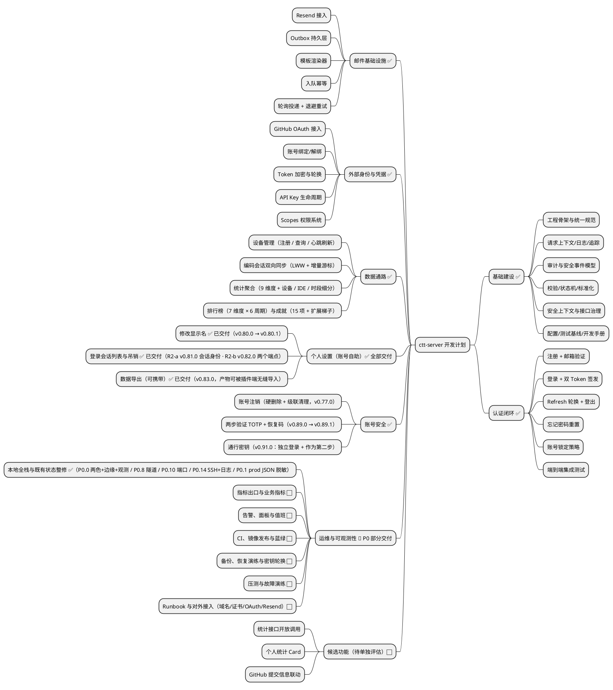
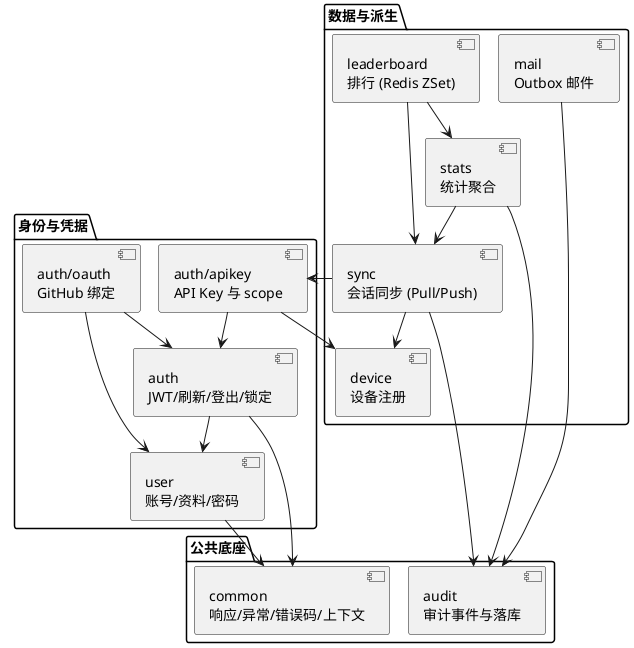
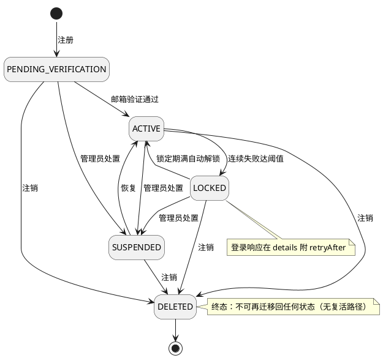
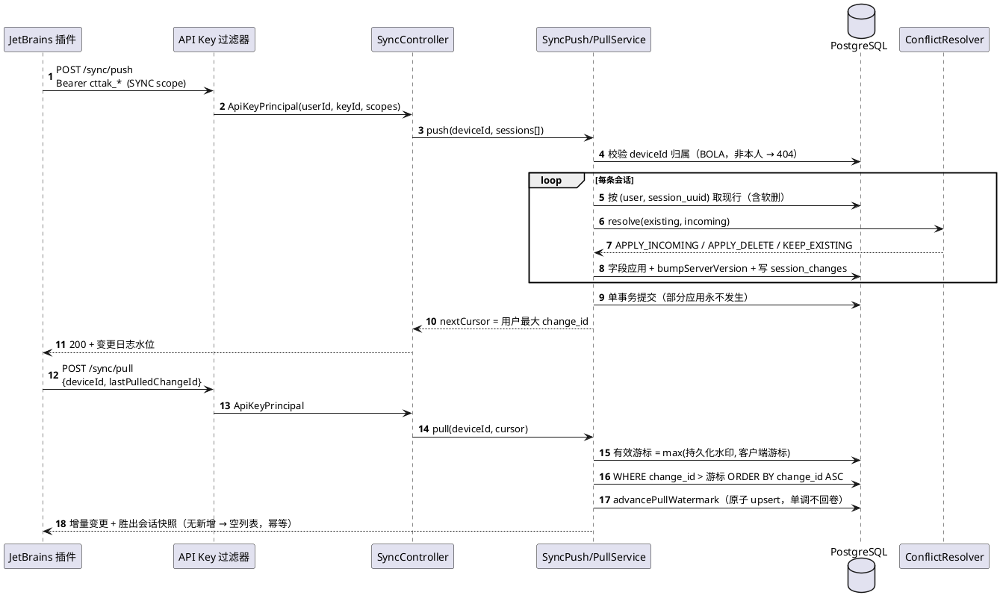
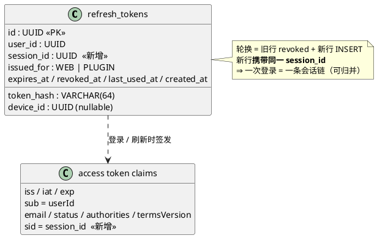
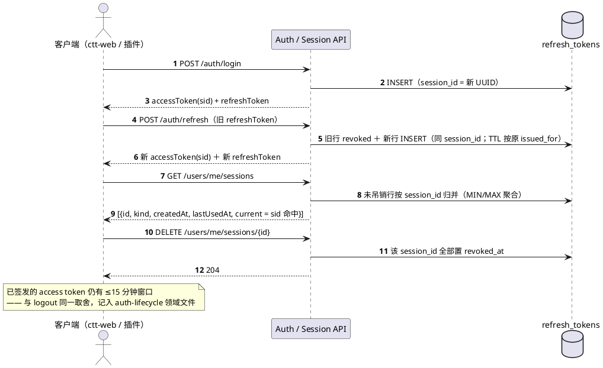
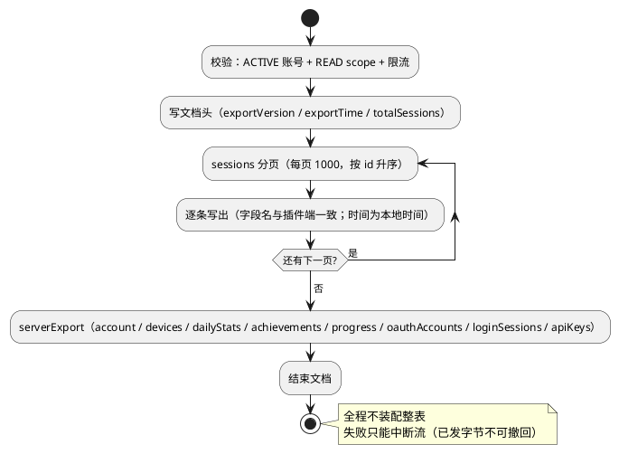
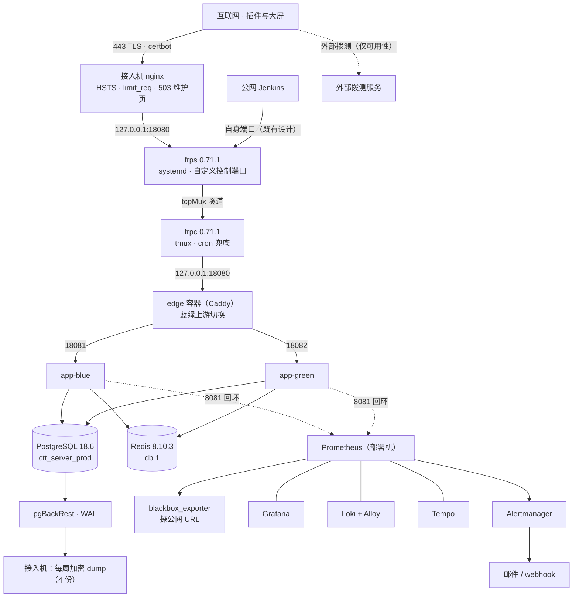
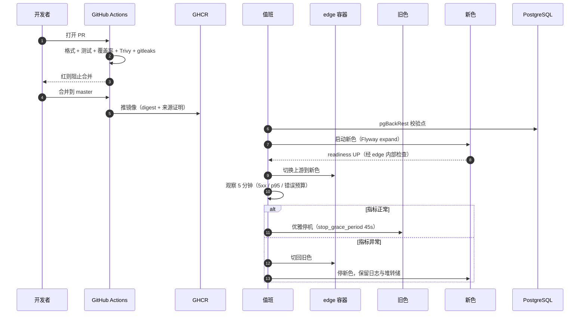

# ctt-server 开发计划

> **本文件的分工**（避免日后混用）：
>
> - `.plans/` —— 规划、阶段计划、交付记录、归档；**人机共读，中文**（本文件）
> - `docs/` —— 面向使用者的项目文档，**英文**
> - `memory-bank/` —— AI 自用的记忆与领域知识
>
> 迁移自 Notion《🖥️ ctt-server 开发计划》（2026-09-01 快照），此后以本文件为准。
>
> **怎么读**（2026-11-08 增补）：
>
> - 前半部分（到「运维与可观测性升级」为止）是**阶段计划**：目标 → 子任务 → 交付清单 → 验收；已完成的节在标题与清单上带版本号，写完即回填，不留「需创建」这类旧状态。
> - 从「会话批量撤销」开始是**按主题追加的交付记录**：标题带日期与版本，新条目追加在文末，不保证严格排序。查找用上面的能力索引与版本号，不要顺序通读。
> - 版本号一律以 `gradle/libs.versions.toml` 的 `appVersion` 为准；本文件只记录到版本，不复述发布流程。
>
> | 能力面 | 计划节 | 状态 | 最近一次变更 |
> |---|---|---|---|
> | 基础建设（骨架 / 日志 / 审计 / 校验 / 治理 / 测试基线） | 1–6 | ✅ | v0.93.1 生产 JSON 脱敏补强 |
> | 认证闭环（注册 / 登录 / 刷新 / 重置 / 锁定） | H–M | ✅ | v0.92.0 限流改为按账户分桶 |
> | 邮件基础设施（Resend / Outbox / 模板 / 重试） | A–G | ✅ | v0.87.2 依赖升级 |
> | OAuth 接入（GitHub） | N–S | ✅ | v0.78.1 错误码按 `ErrorCode.java` 校正 |
> | API Key（生命周期 / 认证 / scope / 审计） | N–S（本节编号自成一套，与 OAuth 无关） | ✅ | v0.92.0 删除 `API` 限流维度 |
> | 设备（模型 / 注册 / 查询与吊销） | D1–D3 | ✅ | v0.86.1 心跳刷新 `lastSeenAt` |
> | 编码会话同步（模型 / LWW / Pull-Push / 插件契约） | T–W | ✅ | v0.92.1 空轮询不再写游标 |
> | 统计与排行（看板 / 排行 / 成就 / 物化） | S1–S6 | ✅ | v0.86.0 排除 0 分成员 |
> | 个人设置（改名 / 会话 / 导出） | R1–R3 + 批量撤销 | ✅ | v0.88.0 批量撤销会话 |
> | 账号安全（注销 / 两步验证 / 通行密钥） | 独立子计划 | ✅ | v0.91.0 通行密钥作为第二步 |
> | 运维与可观测性（P0–P7） | 「运维与可观测性升级」 | 🚧 P0 部分交付（P0.1 / P0.8 / P0.10 / P0.14 已完成） | v0.93.1 P0.1 完成 |

## 🗺️ 计划总览



## 🎯 项目定位

ctt-server 是 code-time-tracker 的后端服务，负责用户认证、编码会话同步、数据统计等核心能力。本文档分为「基础建设」与「后续功能大纲」两部分。

## 🧱 第一阶段：基础建设✅

### 目标与边界

这一阶段的交付物不是「用户能注册登录」，而是一套后续所有认证能力都能复用的底层平台。

**本阶段明确不交付：**

- 邮箱密码注册/登录闭环
- 邮件发送链路实现
- JWT / Refresh Token 签发与轮换
- GitHub OAuth
- API Key 生成与吊销



### 1：工程骨架与统一规范

**目标：** 把项目从「能写代码」升级成「能长期写代码」

- [x] 重构包结构，拆出 `common`、`auth`、`user`、`device`、`audit`、`mail` 边界模块
- [x] 定义统一响应模型：`ApiResponse<T>`、`ErrorResponse`、分页响应、空响应
- [x] 定义统一错误码体系，按 `COMMON`、`AUTH`、`USER`、`MAIL`、`RATE_LIMIT`、`SECURITY`、`SYSTEM` 分组
- [x] 定义统一异常体系：`BusinessException`、`ValidationException`、`UnauthorizedException`、`ForbiddenException`、`ConflictException`、`TooManyRequestsException`
- [x] 定义接口返回约束：成功结构、失败结构、字段命名、时间格式、trace 字段位置
- [x] 输出《接口风格约定》文档
**交付物：** 统一 API 外壳 / 全局异常处理器 / 错误码枚举与分类文档 / 包结构文档

**验收：** 新建任意测试接口自动返回统一结构；参数校验失败、业务异常、系统异常均能统一出参

### 2：请求上下文、日志、追踪体系

**目标：** 系统如何看见自己

- [x] 实现 `traceId` 生成与透传机制
- [x] 建立请求上下文对象：`traceId`、`clientIp`、`userAgent`、`requestUri`、`method`、`deviceId`
- [x] 接入 MDC，统一日志输出字段
- [x] 设计请求日志、业务日志、错误日志三层日志规范
- [x] 设计脱敏规则：邮箱、token、密码、authorization header、cookie 不允许原样落日志
- [x] 统一异常日志策略：`warn` / `error` / 只做审计不打堆栈
**交付物：** `TraceIdFilter` / `RequestContextHolder` / 结构化日志规范 / 脱敏日志规范 / 错误日志分级策略

**验收：** 任意一次请求都能通过 `traceId` 串起全链路日志；敏感数据不进入普通应用日志

### 3：审计模型与安全事件模型

**目标：** 系统如何留下可追责记录，基于已有的 `audit_logs` 表补完语言体系

- [x] 设计审计事件枚举，先把模型定住
- [x] 定义 `resource_type` 规范取值：`USER` / `EMAIL_VERIFICATION` / `PASSWORD_RESET` / `REFRESH_TOKEN` / `API_KEY`
- [x] 定义 `action` 命名规范，如 `REGISTER_REQUESTED`、`LOGIN_FAILED`、`EMAIL_VERIFICATION_SENT`
- [x] 定义 `details` 的 JSON 结构规范，避免后面写得五花八门
- [x] 实现 `AuditLogService`，让业务只传对象，不直接拼 JSON
- [x] 明确「什么必须审计、什么只记业务日志」
**交付物：** 审计事件字典 / `AuditLogService` / 审计落库统一模型 / 审计字段规范文档

**验收：** 后续任何认证行为都能以统一格式写入 `audit_logs`；审计日志能区分「谁 / 在何时 / 从哪里 / 对什么资源 / 做了什么动作 / 结果如何」



### 4：参数校验、领域规则、状态机基础

**目标：** 系统如何拒绝非法输入与非法状态

- [x] 建 DTO 校验基线：邮箱格式、显示名长度、密码强度、UUID、分页参数等通用规则
- [x] 提炼领域规则校验器，不把所有规则写进 Controller
- [x] 设计用户状态机：`PENDING_VERIFICATION → ACTIVE → LOCKED / SUSPENDED / DELETED` 迁移图
- [x] 设计 Token 状态判定模型：有效、过期、已消费、已吊销、不可用
- [x] 设计统一时间策略：全部使用 `Instant` / `OffsetDateTime`，明确时区处理规范
- [x] 设计统一大小写规范：邮箱入库前标准化，查询统一 `lower(email)`
**交付物：** 通用参数校验组件 / 领域状态机设计文档 / Token 状态判定器 / 时间与标准化规则文档

**验收：** 后续写注册/登录接口时，不需要在业务逻辑里临时发明状态规则；用户状态变更、token 判定、邮箱标准化都有统一入口

### 5：安全上下文、接口治理、限流与幂等框架

**目标：** 接口如何被安全地访问

- [x] 设计 `CurrentUserProvider`，统一读取当前登录用户，不让业务层直接碰 Security 细节
- [x] 设计公开接口与受保护接口的分类模型
- [x] 实现限流框架，支持按 IP、按用户、按邮箱、按接口名四种 key 维度的扩展点
- [x] 实现轻量幂等框架，支持「同一业务操作在短时间内不重复执行」
- [x] 设计客户端身份提取规则，为未来 `devices`、`refresh_tokens`、`api_keys` 接入预留统一上下文
- [x] 定义安全 Header 与请求元信息规范
**交付物：** `CurrentUserProvider` / 限流框架骨架 / 幂等框架骨架 / 接口访问分类清单 / 客户端上下文提取器

**验收：** 新增任意接口时，都能快速声明认证要求、限流要求、幂等要求；未来接入 API Key 与设备时不需重新发明客户端身份模型

### 6：配置规范、测试基线、开发手册固化

**目标：** 把前五周基础层「收口」，让后续开发不靠记忆靠规范

- [x] 建立配置分层：`application.yml`、`application-local.yml`、`application-dev.yml`，敏感配置走环境变量
- [x] 规范安全配置项命名：JWT、邮件、限流、审计、密码策略、锁定策略等提前预留配置位
- [x] 建立测试基线：Controller Slice Test、Service Test、Repository Test、集成测试脚手架
- [x] 接入 Testcontainers，统一 PostgreSQL 测试环境
- [x] 设计 Fixture / Builder 工具，方便后续写用户、token、审计测试数据
- [x] 输出开发手册：如何新增错误码、审计事件、公共异常、受保护接口
**交付物：** 配置规范 / 测试脚手架 / Testcontainers 基线 / 开发手册 / 基础层完成清单

**验收：** 新人接手能根据手册继续开发；新功能开发前不需重新搭建测试环境；认证业务开始时工程环境已稳定

### 基础建设总交付清单

| 交付项 | 结果 |
|---|---|
| 工程分层 | common / auth / user / device / audit / mail 边界清晰 |
| API 规范 | 统一响应、统一错误码、统一异常出口 |
| 可观测性 | traceId、结构化日志、脱敏日志、错误分级 |
| 审计体系 | 审计事件字典、统一审计落库服务 |
| 规则体系 | DTO 校验、领域状态机、标准化规则 |
| 接口治理 | 安全上下文、限流骨架、幂等骨架 |
| 工程保障 | 配置规范、测试基线、开发手册 |

## 🗺️ 第二阶段以后：功能开发大纲

> 基础建设之后的能力面：认证闭环、邮件、OAuth、API Key、设备、会话同步、统计与排行、个人设置都已在下面逐阶段展开并交付。本部分保留每阶段的原始目标、子任务与验收，作为决策溯源；尚未展开的只剩运维与可观测性的 P1–P7。

### 🔐 认证闭环 — 细化开发计划✅

> **前置状态：** 邮件基础设施（A–G 全部 ✅）已就绪，`MailOutboxService.enqueueVerificationEmail` / `enqueuePasswordResetEmail` 可直接调用。本阶段复用所有已有基础：`AuditLogService`、限流框架、幂等框架、`UserStateMachine`、`TokenStatusJudge`、`Testcontainers` 基线。

#### H：用户注册 + 邮箱验证✅

**目标：** 新用户提交邮箱密码，系统发出验证邮件，用户点击链接后状态变为 `ACTIVE`

**数据层前置确认：**

- [x] 确认 `users` 表字段完整：`id`、`email`（唯一索引）、`display_name`、`password_hash`、`status`（`PENDING_VERIFICATION` / `ACTIVE` / `LOCKED` / `SUSPENDED` / `DELETED`）、`created_at`、`updated_at`
- [x] 确认 `email_verification_tokens` 表字段（⚠️ 表名是 `email_verification_tokens`，不是 `email_verifications`）：
  - ✅ 核心字段：`id`、`user_id`（FK）、`token_hash`（SHA-256）、`expires_at`、`created_at`
  - ✅ 状态相关：**无 `status` 列**，使用 `consumed_at`（已使用）、`revoked_at`（已撤销）时间戳动态推导状态
  - ✅ 其他字段：`email`、`purpose`（`REGISTER_VERIFY` / `CHANGE_EMAIL`）、`sent_at`、`request_ip`、`user_agent`

- [x] 索引确认：
  - ✅ `token_hash` 唯一索引：`uk_email_verification_token_hash`
  - ✅ 联合索引：`idx_email_verification_lookup (user_id, purpose, expires_at, consumed_at)`（⚠️ 不是 `user_id + status + expires_at`）

**业务实现：**

**1. DTO 层（已有，无需修改）**

- [x] `UserRegisterRequest` DTO 已存在：
  - ✅ `email`：`@Email` 校验，构造函数已做 lowercase 标准化
  - ✅ `password`：`@StrongPassword` 校验（8-72 字符、含大小写、数字）
  - ✅ `displayName`：`@Pattern` 校验（2-50 字符）

**2. 注册服务（扩展 `UserService`，已交付）**

- [x] 扩展 `UserService.registerUser()`：
  - [x] 邮箱唯一性检查（`existsByEmailIgnoreCase`，冲突抛 `ConflictException(ErrorCode.AUTH_002)`）
  - [x] 密码 BCrypt 哈希（`BCryptPasswordEncoder`，`strength=12`）
  - [x] 创建 `PENDING_VERIFICATION` 状态用户，写入 `users`
  - [x] 落审计事件 `REGISTER_REQUESTED`
  - [x] 新增：生成 64 字节随机 token（`SecureRandom`），SHA-256 哈希后存入 `email_verification_tokens`
  - [x] 新增：设置 `expires_at = now() + 24h`（⚠️ 建议统一为 24 小时；`MailOutboxService` 当前默认 15 分钟，需对齐配置）
  - [x] 新增：调用 `MailOutboxService.enqueueVerificationEmail(userId, displayName, email, rawToken)`（⚠️ 注意参数顺序）
  - [x] 整个流程在同一事务内，邮件入队失败则回滚注册

**3. 注册接口（已有，需补充限流注解）**

- [x] `POST /api/v1/auth/register` 已存在（`AuthController.register()`）
- [x] 新增：添加 `@RateLimit(type = RateLimitType.IP, limit = 60, windowSeconds = 3600)`（60 次/小时）
**4. 邮箱验证服务（需新建 `EmailVerificationService`）**

- [x] 创建 `EmailVerificationService.verify(String rawToken)`：
  - [x] `sha256(rawToken)` 查 `email_verification_tokens`（通过 `EmailVerificationTokenRepository.findByTokenHash()`）
  - [x] 不存在 → `UnauthorizedException(ErrorCode.AUTH_005)`
  - [x] 已消费（`consumed_at != null`）→ `UnauthorizedException(ErrorCode.AUTH_005)`
  - [x] 已撤销（`revoked_at != null`）→ `UnauthorizedException(ErrorCode.AUTH_005)`
  - [x] 已过期（`now > expires_at`）→ `UnauthorizedException(ErrorCode.AUTH_006)`
  - [x] 调用 `token.consume()`（⚠️ 不是直接更新 `status = CONSUMED`）
  - [x] 调用 `User.verifyEmail()`（⚠️ 不是直接更新 `users.status = ACTIVE`）
  - [x] 落审计事件 `EMAIL_VERIFICATION_SUCCESS`

**5. 验证接口（需新建）**

- [x] 创建 `EmailVerificationController.verifyEmail(String token)`：
  - [x] `GET /api/v1/auth/verify-email?token=...`（公开接口 `@PublicApi`）
  - [x] 委托 `EmailVerificationService.verify(token)`
  - [x] 成功返回 `200 OK` + `ApiResponse<EmptyResponse>`

**6. 重新发送验证邮件（扩展，已交付）**

- [x] 创建 `EmailVerificationService.resendVerificationEmail(String email)`：
  - [x] 用户必须处于 `PENDING_VERIFICATION` 状态（`UserValidator.assertCanVerifyEmail()`）
  - [x] 吊销旧 token：查询未过期的 token，调用 `token.revoke()`（⚠️ 不是更新 `status = REVOKED`）
  - [x] 生成新 token，调用 `MailOutboxService.enqueueVerificationEmail()`
  - [x] 限流：复用现有 `MailOutboxService` 的限流逻辑（**3 次/1 分钟**，⚠️ 不是 10 分钟 3 次）
  - [x] 落审计事件 `EMAIL_VERIFICATION_SENT`

**7. Repository 层（新建，已交付）**

- [x] 创建 `EmailVerificationTokenRepository`：
  - [x] `Optional<EmailVerificationToken> findByTokenHash(String tokenHash)`
  - [x] `List<EmailVerificationToken> findByUserIdAndPurpose(UUID userId, String purpose)`
  - [x] `boolean existsByUserIdAndPurposeAndConsumedAtIsNull(UUID userId, String purpose)`

**交付物：**

| 类型 | 文件 | 状态 |
|---|---|---|
| Service | `UserService`（扩展） | ✅ 已交付（token 生成与入队在同一事务） |
| Service | `EmailVerificationService`（新建） | ✅ 已交付 |
| Controller | `EmailVerificationController`（新建） | ✅ 已交付 |
| Repository | `EmailVerificationTokenRepository`（新建） | ✅ 已交付 |
| DTO | `UserRegisterRequest` | ✅ 已有 |
| Entity | `EmailVerificationToken` | ✅ 已有（含 `revoke()` 方法） |
| Migration | `V20260322120000__add_revoked_at_to_email_verification_tokens.sql` | ✅ 已有 |

**验收标准：**

1. ✅ 注册 → 收邮件 → 点链接 → `users.status` 变 `ACTIVE`
2. ✅ 同一邮箱二次注册返回 409（`ConflictException`）
3. ✅ token 过期/伪造/已消费/已撤销返回 401（`UnauthorizedException`）
4. ✅ 1 分钟内重发超 3 次被限流（`TooManyRequestsException`）
5. ✅ **状态推导正确**：`consumed_at != null` → CONSUMED，`revoked_at != null` → REVOKED

#### I：邮箱密码登录 + JWT / Refresh Token 签发✅

**目标：** `ACTIVE` 用户能凭邮箱密码换取 `Access Token + Refresh Token`，双 Token 机制落地

**数据层前置确认：**

- [x] 确认 `refresh_tokens` 表字段（已存在于 `V20260303210000` 迁移脚本）
  - ✅ **无 `status` 列**，Entity 使用 `determineStatus()` 从 `revoked_at + expires_at` 动态推导状态
  - ✅ 实际为 `device_id`（UUID，FK to `devices`）
  - ✅ 实际字段：`id`、`user_id`、`token_hash`、`issued_for`（`WEB` / `PLUGIN`）、`device_id`、`expires_at`、`revoked_at`、`last_used_at`、`created_at`

- [x] 索引已就位：
  - ✅ `uk_refresh_tokens_token_hash`（唯一索引）
  - ✅ `idx_refresh_tokens_user_id`
  - ✅ `idx_refresh_tokens_active`（部分索引）

**配置项落位：**

- [x] `ctt.security.jwt.secret-key`（已存在，走环境变量 `JWT_SECRET_KEY`）
- [x] `ctt.security.jwt.access-token-ttl`（已存在，默认 `15m`，`Duration` 类型）
- [x] `ctt.security.jwt.refresh-token-ttl-web`（已存在，默认 `30d`）
- [x] `ctt.security.jwt.issuer`（已存在，值为 `ctt-identity-provider`）
**业务实现：**

**1. 依赖与基础设施**

- [x] 添加依赖：`implementation("org.springframework.security:spring-security-oauth2-jose")`
- [x] 创建 `RefreshTokenRepository`（继承 `JpaRepository<RefreshToken, UUID>`）
- [x] 扩展 `TokenUtils` 支持 Refresh Token 生成：
  - [x] 复用现有 `generateRawToken()`
  - [x] 复用现有 `hashToken()`

**2. JWT Bean 注册**

- [x] 在 `SecurityConfig` 或独立 `JwtConfig` 中注册 `JwtEncoder` Bean
- [x] 注册 `JwtDecoder` Bean
**3. JWT 提供器**

- [x] 实现 `JwtTokenProvider`：
  - [x] 注入 `JwtEncoder` + `SecurityProperties.JwtProperties`
  - [x] `generateAccessToken(User user)` → 使用 `JwtClaimsSet.builder()` 构建 Claims（`iss`、`sub=userId`、`email`、`iat`、`exp`），通过 `JwtEncoder.encode()` 签发返回 token 字符串

**4. 登录服务**

- [x] 实现 `UserLoginService.login(LoginRequest request, String ip, String userAgent)`：
  - [x] 查用户（`findByEmailIgnoreCase`），不存在 → `UnauthorizedException(ErrorCode.AUTH_001)`（防枚举）
  - [x] 检查 `users.status`：
    - [x] `PENDING_VERIFICATION` → `ForbiddenException(ErrorCode.AUTH_006)`
    - [x] `LOCKED` → `ForbiddenException(ErrorCode.AUTH_004)`
    - [x] `SUSPENDED` / `DELETED` → `ForbiddenException(ErrorCode.AUTH_005)`
  - [x] 调用 `UserValidator.assertLoginAttemptsNotExceeded(user)` 检查锁定
  - [x] BCrypt 校验密码：
    - [x] 失败 → `user.recordFailedLogin(maxAttempts)` + 审计 `LOGIN_FAILED` + `UnauthorizedException(ErrorCode.AUTH_001)`
    - [x] 成功 → `user.recordSuccessfulLogin()` + 调用 `JwtTokenProvider.generateAccessToken()` + 生成 Refresh Token 写入 `refresh_tokens` + 审计 `LOGIN_SUCCESS`

**5. 登录接口**

- [x] 实现 `POST /api/v1/auth/login`：
  - [x] 公开接口：`@PublicApi`
  - [x] 限流：`@RateLimit(type = IP, limit = 30, windowSeconds = 3600)`
  - [x] 返回 `AuthTokenResponse`

**6. Security Filter Chain 配置**

- [x] 在 `SecurityConfig` 的 `SecurityFilterChain` 中开启 JWT 资源服务器支持
- [x] 实现自定义 `AuthenticationEntryPoint`，将 token 无效/过期统一映射到 `ErrorCode.AUTH_003` 的响应格式
**7. DTO**

- [x] 创建 `LoginRequest` DTO（`email`、`password`）
- [x] 创建 `AuthTokenResponse` record：
  - [x] `accessToken`
  - [x] `refreshToken`
  - [x] `accessTokenExpiresIn`
  - [x] `tokenType = "Bearer"`

**交付物清单：**

| 组件 |
|---|
| `RefreshToken` Entity |
| `TokenStatus` Enum |
| `TokenUtils` |
| `User.recordFailedLogin()` |
| `UserValidator` |
| `SecurityProperties.JwtProperties` |
| `ErrorCode (AUTH_001~012)` |
| `AuditAction.LOGIN_SUCCESS / FAILED` |
| `spring-security-oauth2-jose` 依赖 |
| `JwtEncoder` / `JwtDecoder` Bean |
| `RefreshTokenRepository` |
| `JwtTokenProvider` |
| `UserLoginService` |
| `LoginRequest` DTO |
| `AuthTokenResponse` DTO |
| `POST /login` Endpoint |
| `SecurityConfig` oauth2ResourceServer 配置 |
| 自定义 `AuthenticationEntryPoint` |

**验收标准：**

- [x] 正确凭据返回双 Token（`access + refresh`）
- [x] 密码错误返回 `401 (AUTH_001)`，不泄露用户是否存在
- [x] 未验证用户返回 `403 (AUTH_006)`
- [x] 锁定用户返回 `403 (AUTH_004)`
- [x] 用 JWT 访问受保护接口返回 `200`
- [x] 伪造 / 过期 JWT 返回 `401 (AUTH_003)`
- [x] `refresh_tokens` 表写入正确
- [x] 审计日志记录 `LOGIN_SUCCESS / LOGIN_FAILED`

#### J：Refresh Token 轮换 + 主动登出✅

**目标：** Access Token 过期后能无感刷新；用户主动登出后 Refresh Token 立即失效；检测到 Refresh Token 复用时全设备下线

**业务实现：**

- [x] 实现 `TokenRefreshService.refresh(String rawRefreshToken)`：
  - [x] sha256(rawRefreshToken) 查 `refresh_tokens`
  - [x] 不存在 → `AUTH_TOKEN_INVALID`
  - [x] `status = REVOKED` → **检测到复用攻击**：吊销该用户全部 `ACTIVE` Refresh Token，落审计事件 `REFRESH_TOKEN_REUSE_DETECTED`，返回 `AUTH_TOKEN_REUSE_DETECTED`（迫使全量重新登录）
  - [x] `status = EXPIRED` 或 `expires_at < now()` → `AUTH_TOKEN_EXPIRED`
  - [x] 正常：**原 token 置 `REVOKED`**，生成新 Refresh Token 写库（轮换机制），签发新 Access Token
  - [x] 更新 `last_used_at = now()`，落审计事件 `REFRESH_TOKEN_ROTATED`

- [x] 实现 `POST /api/v1/auth/refresh`（公开接口，按 IP 限流：120次/小时）
- [x] 实现 `LogoutService.logout(Long userId, String rawRefreshToken)`：
  - [x] 吊销当前设备 Refresh Token（`status = REVOKED`）
  - [x] 落审计事件 `LOGOUT`

- [x] 实现 `POST /api/v1/auth/logout`（受保护接口，需要有效 JWT）
- [x] 实现 `POST /api/v1/auth/logout-all`（受保护接口）：吊销该用户全部 `ACTIVE` Refresh Token，落 `LOGOUT_ALL_DEVICES`
**交付物：** `TokenRefreshService` / `LogoutService` / `POST /refresh` + `POST /logout` + `POST /logout-all`

**验收：** 正常刷新返回新双 Token，旧 Refresh Token 不可再用；复用旧 Refresh Token 触发全设备下线且审计记录含 `REFRESH_TOKEN_REUSE_DETECTED`；登出后旧 Refresh Token 刷新返回 401

#### K：忘记密码 → 邮件重置链路✅

**目标：** 未登录用户能通过邮件重置密码，链路防枚举、防重放

**数据层前置确认：**

- [x] 确认 `password_resets` 表字段：`id`、`user_id`（FK）、`token_hash`（sha256）、`status`（`PENDING` / `CONSUMED` / `EXPIRED` / `REVOKED`）、`expires_at`、`created_at`
**业务实现：**

- [x] 实现 `PasswordResetService.requestReset(String email)`：
  - [x] 查用户：**无论邮箱是否存在，均返回 200 + 相同响应体**（防枚举）
  - [x] 仅当用户存在且 `status = ACTIVE` 时：吊销旧 `PENDING` 重置 token，生成新 token（64字节，sha256），`expires_at = now() + 1h`，调 `MailOutboxService.enqueuePasswordResetEmail`
  - [x] 落审计事件 `PASSWORD_RESET_REQUESTED`（用户不存在时落 `PASSWORD_RESET_EMAIL_NOT_FOUND`，但响应不区分）
  - [x] 按邮箱限流：10 分钟内最多 3 次

- [x] 实现 `POST /api/v1/auth/password-reset/request`（公开，邮箱限流 3 次/10 分钟）
- [x] 实现 `PasswordResetService.resetPassword(ResetPasswordRequest)`：
  - [x] sha256(token) 查 `password_resets`，校验状态与过期时间
  - [x] 校验新密码不能与当前密码相同（BCrypt 校验）
  - [x] 更新 `users.password_hash`，置 token `status = CONSUMED`
  - [x] **吊销该用户全部 `ACTIVE` Refresh Token**（密码变更后强制重新登录）
  - [x] 落审计事件 `PASSWORD_RESET_COMPLETED`

- [x] 实现 `POST /api/v1/auth/password-reset/confirm`（公开，IP 限流 15 次/10 分钟）
**交付物：** `PasswordResetService` / `PasswordResetTokenRepository` + Integration Tests / `POST /password-reset/request` + `POST /password-reset/confirm`

**验收：** 邮件中链接 1 小时内有效；token 使用后不可复用；重置成功后旧 Refresh Token 全部失效；邮箱不存在时响应与存在时相同（防枚举验证）

#### L：账号锁定策略✅

**目标：** 防暴力破解，失败计数超阈值自动临时锁定，锁定到期自动解锁

**配置项落位：**

- [x] `auth.lockout.max-attempts`（默认 5）
- [x] `auth.lockout.window-seconds`（失败计数滑动窗口，默认 900，即 15 分钟）
- [x] `auth.lockout.lockout-duration-seconds`（默认 1800，即 30 分钟）
- [x] `auth.lockout.storage`（`db` / `redis`，默认 `db`，预留 Redis 快速切换）
**业务实现：**

- [x] 实现 `LoginAttemptService`（解耦失败计数逻辑，与登录主流程松耦合）：
  - [x] `recordFailure(String email, String ip)` → 写 `login_attempts` 表（或 Redis Hash），在滑动窗口内计数
  - [x] `isLocked(String email)` → 检查是否超阈值且仍在锁定窗口内
  - [x] `clearAttempts(String email)` → 登录成功后清零

- [x] `login_attempts` 表字段（DB 方案）：`id`、`email_hash`（sha256，不存原文）、`ip_hash`、`attempt_at`；按 `(email_hash, attempt_at)` 清理过期记录
- [x] 在 `UserLoginService.login` 中集成：登录前先查 `isLocked`，失败后调 `recordFailure`，超阈值时更新 `users.status = LOCKED`，设置 `locked_until` 字段
- [x] 实现定时任务 `AccountUnlockScheduler`（或在查询时懒解锁）：`locked_until < now()` 的 `LOCKED` 用户自动恢复 `ACTIVE`
- [x] 锁定时落审计事件 `ACCOUNT_LOCKED`；解锁时落 `ACCOUNT_UNLOCKED`
- [x] `POST /api/v1/auth/login` 响应被锁定用户时，在 `ErrorResponse.details` 中附 `retryAfter` 时间戳
**交付物：** `LoginAttemptService` / `login_attempts` 表 DDL / `AccountUnlockScheduler` / 锁定配置项 / Service Test（覆盖第 5 次失败触发锁定、锁定窗口到期自动解锁）

**验收：** 连续 5 次密码错误后 `users.status` 变 `LOCKED`；锁定期间任何密码均返回 `403 AUTH_004`（Account locked）+ `retryAfter`；30 分钟后可正常登录；审计记录可追溯完整失败序列

#### M：认证闭环集成测试✅

**目标：** 完整注册 → 登录 → 刷新 → 登出链路有 E2E 自动化保障

- [x] `RegistrationAndVerificationIntegrationTest`：
  - [x] 完整注册 → GreenMail 收邮件 → 提取 token → 验证 → `users.status = ACTIVE`
  - [x] 重复注册同邮箱 → 409
  - [x] 验证 token 过期 → 401；重发验证邮件 → 旧 token 失效，新 token 可用

- [x] `LoginAndTokenIntegrationTest`：
  - [x] 正常登录 → 返回双 Token → 用 Access Token 访问受保护接口 200
  - [x] 错误密码 5 次 → 第 6 次返回 `AUTH_004`（Account locked）
  - [x] 刷新：旧 Refresh Token 换新双 Token → 再用旧 Refresh Token → 触发 `REFRESH_TOKEN_REUSE_DETECTED` → 全设备下线

- [x] `PasswordResetIntegrationTest`：
  - [x] 忘记密码 → GreenMail 收邮件 → 重置 → 旧 Refresh Token 全部失效 → 新密码可登录
  - [x] 1 小时后 token 过期 → 重置返回 401

- [x] `LogoutIntegrationTest`：单设备登出 / 全设备登出，Refresh Token 状态核查
**交付物：** 四组集成测试 / `AuthFixtures`（含注册用户、已激活用户、已锁定用户、活跃 Refresh Token 预设）

**验收：** `./gradlew test` 全绿；所有集成测试可在 CI 中重复执行（Testcontainers 隔离）

#### 认证闭环交付清单

| 交付项 | 核心产出 |
|---|---|
| H：注册 + 邮箱验证 | `UserRegistrationService` / `EmailVerificationService` / 3个接口 |
| I：登录 + Token 签发 | `UserLoginService` / `AuthTokenService` / `JwtAuthenticationFilter` / `/login` |
| J：Token 轮换 + 登出 | `TokenRefreshService` / `LogoutService` / `/refresh` / `/logout` / `/logout-all` |
| K：忘记密码链路 | `PasswordResetService` / `/forgot-password` / `/reset-password` |
| L：账号锁定策略 | `LoginAttemptService` / `AccountUnlockScheduler` / 锁定配置 |
| M：集成测试 | 四组 E2E 测试 + `AuthFixtures` |

### 📧 邮件基础设施 ✅

> **发送服务商：** Resend（已注册）
> SMTP Host: `smtp.resend.com`，Port: `465`，Username: `resend`，Password: API Key（走环境变量）
> ⚠️ 额度与限速：以控制台 Usage 页为准（数值会变，不在文档里固化）；P4.5 用 20 封实测确认日限与突发行为。SMTP 发送只在控制台 emails 表可见，服务端不提供 SMTP 日志，失败原因需自行记录回执码。入队幂等保护必须落实，不能浪费额度。

#### A：Resend 接入与环境配置✅

**目标：** 打通真实发送链路，本地/测试不污染额度，生产走 Resend

- [x] `application-local.yml` / `application-dev.yml` 接入 **Mailpit**（本地 SMTP 沙箱，Docker Compose 新增服务）
- [x] `application-test.yml` 使用 `GreenMail`（`@SpringBootTest` 集成测试内嵌 SMTP，不真实发送）
- [x] `application-prod.yml` 配置 Resend SMTP：`spring.mail.*` 全走环境变量，API Key 不入代码
- [x] 配置项命名规范落位 `application.yml`：
  - [x] `mail.from.address` / `mail.from.name`
  - [x] `mail.outbox.poll-interval-ms` / `mail.outbox.batch-size` / `mail.outbox.zombie-timeout-seconds`
  - [x] `mail.retry.base-delay-seconds` / `mail.retry.multiplier` / `mail.retry.max-delay-seconds` / `mail.retry.max-attempts`

- [x] Docker Compose 补充 Mailpit 服务配置，本地一条命令启动即可收信
**交付物：** 三环境 SMTP 配置方案 / Mailpit Docker Compose 片段 / 环境变量命名清单

**验收：** 本地启动后向任意地址发送测试邮件，Mailpit Web UI（`localhost:8025`）能收到；`application-prod.yml` 中无任何明文凭据

#### B：Mail Outbox 数据模型与持久层✅

**目标：** 邮件不再是「调用即发」，而是先落库再异步投递，发送链路可观测、可重试

- [x] 确认 `mail_outbox` 表字段完整性：`id`、`recipient`、`subject`、`body_html`、`body_text`、`status`（`PENDING` / `SENDING` / `SENT` / `FAILED` / `CANCELLED`）、`retry_count`、`max_retries`、`next_retry_at`、`sent_at`、`last_error`、`trace_id`、`created_at`、`updated_at`
- [x] 创建 `MailOutbox` JPA Entity，字段映射与枚举 `MailStatus` 对齐
- [x] 实现 `MailOutboxRepository`，添加查询方法：
  - [x] `findPendingJobs(Pageable)` — 查 `status=PENDING AND next_retry_at <= now()`
  - [x] `findByTraceId(String traceId)` — 按 traceId 查投递记录
  - [x] `countByRecipientAndStatusAndCreatedAtAfter(...)` — 防重复投递频率校验

- [x] `MailOutboxRepository` Repository Test 覆盖以上三个查询方法
**交付物：** `mail_outbox` DDL / `MailOutbox` Entity / `MailStatus` 枚举 / `MailOutboxRepository` + 对应测试

**验收：** Repository Test 全绿；`findPendingJobs` 能正确按 `next_retry_at` 筛出到期任务；频率校验查询能区分 10 分钟内已入队与未入队的场景

#### C：邮件模板渲染器✅

**目标：** 邮件内容有统一的 HTML/纯文本双版本，变量注入类型安全

- [x] 选型确认：使用 Thymeleaf（`spring-boot-starter-thymeleaf`），模板放 `resources/mail-templates/`
- [x] 建立模板目录结构：
  - [x] `mail-templates/email-verification.html` — 注册验证邮件
  - [x] `mail-templates/password-reset.html` — 重置密码邮件
  - [x] `mail-templates/layout/base.html` — 公共 Layout（页眉、页脚、品牌色）

- [x] 实现 `MailTemplateRenderer` 接口及 Thymeleaf 实现类：`render(templateName, variables)` / `renderText(templateName, variables)`
- [x] 为每个模板定义强类型 DTO（替代裸 Map）：
  - [x] `EmailVerificationTemplateData(String username, String verificationLink, Duration expiresIn)`
  - [x] `PasswordResetTemplateData(String username, String resetLink, Duration expiresIn)`

- [x] `MailTemplateRenderer` 单元测试：变量正确注入、关键 HTML 结构存在、链接格式正确
**交付物：** 两套 HTML 邮件模板 + 纯文本备用版本 / `MailTemplateRenderer` 接口及实现 / 强类型模板 DTO / 单元测试

**验收：** 单元测试全绿；用 Mailpit 手动触发渲染结果，验证邮件在主流邮件客户端（移动端/桌面端）视觉正常；链接、用户名、过期时间均正确填充

#### D：Mail Outbox Service（写入侧）✅

**目标：** 业务层只需调用「入队」，不关心发送细节；同一操作在短时间内不重复入队

- [x] 实现 `MailOutboxService` 接口，仅负责**写入** Outbox，不触发发送：
  - [x] `enqueueVerificationEmail(Long userId, String email, String token)`
  - [x] `enqueuePasswordResetEmail(Long userId, String email, String token)`
  - [x] 内部调用 `MailTemplateRenderer` 渲染，组装 `MailOutbox` 实体写入

- [x] 入队时自动填充 `trace_id`（从 `RequestContextHolder` 取当前 traceId）
- [x] 入队时设置 `status=PENDING`、`retry_count=0`、`next_retry_at=now()`
- [x] 入队幂等保护：同一 `(recipient, template_type, reference_id)` 在 10 分钟内已有 `PENDING/SENT` 记录则跳过，发布 `MAIL_IDEMPOTENT_SKIP` 审计事件
- [x] `MailOutboxService` Service Test：正常入队、幂等跳过、模板渲染失败回滚
**交付物：** `MailOutboxService` 接口与实现 / 幂等逻辑 / Service Test

**验收：** Service Test 全绿；同一用户在 10 分钟内重复请求发送验证邮件，数据库只存在一条 `PENDING` 记录，第二次调用产生 `MAIL_IDEMPOTENT_SKIP` 审计事件

#### E：Mail Dispatcher + 重试策略（投递侧）✅

**目标：** Outbox 中的 `PENDING` 记录能被自动捞起发送，失败后按指数退避重试，多实例下不重复投递

- [x] 实现 `MailDispatcher`（`@Component`），持有 `JavaMailSender` 执行真实发送
- [x] 实现 `MailOutboxPoller`（`@Scheduled`），轮询并驱动投递：
  - [x] 每 `${mail.outbox.poll-interval-ms:5000}` ms 执行一次
  - [x] 每次最多取 `${mail.outbox.batch-size:20}` 条
  - [x] 取出后立即将 `status` 置为 `SENDING`（乐观锁）
  - [x] 成功：`status=SENT`、`sent_at=now()`，发布 `MAIL_SENT`
  - [x] 失败：进入重试逻辑

- [x] 多实例并发安全：`SENDING` 超时补偿（`updated_at < now()-2min` 的 `SENDING` 记录重置为 `PENDING`）
- [x] 实现 `ExponentialBackoffRetryStrategy`：
  - [x] 基础延迟 `base-delay-seconds`，乘数 `multiplier`，上限 `max-delay-seconds`
  - [x] 抖动 ±10% 防止集群雷同重试
  - [x] 达到 `max-attempts`（默认 5）后 `status=FAILED`，发布 `MAIL_PERMANENTLY_FAILED`

- [x] `ExponentialBackoffRetryStrategy` 单元测试：覆盖 0/1/3/5 次重试的时间窗口边界
**交付物：** `MailDispatcher` / `MailOutboxPoller` / `ExponentialBackoffRetryStrategy` + 单元测试 / 超时补偿逻辑

**验收：** 单元测试全绿；本地启动后写入一条 `PENDING` 记录，5 秒内 Mailpit 收到邮件且数据库状态变为 `SENT`；手动将 SMTP 配置改错，触发发送失败，观察 `retry_count` 递增、`next_retry_at` 符合指数退避规律

#### F：邮件投递审计✅

**目标：** 每一封邮件的完整生命周期都有审计记录，可追责、可排查

- [x] 在 `AuditEvent` 枚举追加：`MAIL_ENQUEUED` / `MAIL_SENT` / `MAIL_RETRY_SCHEDULED` / `MAIL_PERMANENTLY_FAILED` / `MAIL_IDEMPOTENT_SKIP`
- [x] 审计 `details` JSON 规范：
  - [x] 必含：`recipientMasked`（邮箱脱敏）、`templateName`、`mailOutboxId`、`retryCount`
  - [x] 失败场景额外含：`lastError`（截断至 500 字符）

- [x] `AuditFixtures` 补充对应预设数据
**交付物：** 更新后的 `AuditEvent` 枚举 / `details` JSON Schema 描述 / `AuditFixtures` 补充

**验收：** 手动触发入队、发送成功、幂等跳过三个场景，`audit_logs` 表中能查到对应事件且 `details` 字段格式正确；邮箱地址在审计记录中已脱敏

#### G：集成测试✅

**目标：** 邮件链路关键路径有自动化保障，不依赖手动验证

- [x] `MailOutboxPollerIntegrationTest`：
  - [x] 写入 `PENDING` → 触发轮询 → 验证 `status=SENT` 且 GreenMail 收到邮件
  - [x] 模拟 SMTP 不可用 → 验证重试次数递增、`next_retry_at` 符合退避
  - [x] 5 次失败后 → 验证 `status=FAILED` 且 `MAIL_PERMANENTLY_FAILED` 审计落库
  - [x] 并发安全：两线程同时轮询，同一封邮件只发送一次

- [x] `MailTemplateRendererIntegrationTest`：渲染两种模板，断言变量注入正确、链接格式合法
- [x] `MailOutboxServiceIntegrationTest`：正常入队落库 / 幂等入队被跳过且审计事件正确
**交付物：** `MailOutboxPollerIntegrationTest` / `MailTemplateRendererIntegrationTest` / `MailOutboxServiceIntegrationTest`

**验收：** `./gradlew test` 全绿；并发安全测试在重复运行 10 次中无重复投递

### 🔗 OAuth 接入 ✅（N–S 全部交付）

> **前置依赖：** 认证闭环（H–M）全部 ✅，`UserStateMachine`、`AuditLogService`、`CurrentUserProvider`、`Testcontainers` 基线全部就绪。本阶段复用所有已有基础设施，不重新发明认证框架。
> **设计原则：** OAuth 是「另一种凭据来源」，核心用户实体（`users` 表）保持不变，OAuth 身份通过独立的 `user_oauth_accounts` 表关联。新用户走 OAuth 直接激活（跳过邮箱验证），老用户可自助绑定/解绑 OAuth 提供方。
> ⚠️ 当前仅接入 GitHub，不抽象多 Provider 框架。

#### N：数据模型与基础设施准备✅

**目标：** 确认已有表结构，补充缺失基础设施，为 GitHub OAuth 提供数据底座

**数据层前置确认（`user_oauth_accounts` 表已在 init 迁移中创建）：**

- [x] 表名：`user_oauth_accounts`（⚠️ 不是 `oauth_accounts`）
- [x] 实际字段：`id`（UUID PK）、`user_id`（UUID FK → `users.id` ON DELETE CASCADE）、`provider`（VARCHAR 30）、`provider_user_id`（VARCHAR 255）、`provider_login`（VARCHAR 255）、`provider_email`（VARCHAR 255）、`access_token_encrypted`（TEXT）、`refresh_token_encrypted`（TEXT，可为 NULL）、`token_expires_at`（TIMESTAMPTZ，可为 NULL）、`created_at`（TIMESTAMPTZ）、`updated_at`（TIMESTAMPTZ）
- [x] ⚠️ **无** `scope` 字段、**无** `raw_profile` 字段
- [x] 唯一约束：`uk_user_oauth_provider_uid (provider, provider_user_id)`
- [x] 唯一约束：`uk_user_oauth_user_provider (user_id, provider)`
- [x] 索引：`idx_user_oauth_user_id (user_id)`
- [x] CHECK 约束：`chk_oauth_provider` 当前允许 `GITHUB` / `GOOGLE` / `GITLAB` / `APPLE`
**Flyway 迁移（已在 init 迁移中完成）：**

- [x] ⚠️ **无独立 OAuth 迁移脚本**：`user_oauth_accounts` 表、`chk_oauth_provider` CHECK 约束、`audit_logs` CHECK 约束扩展均在 `V20260303210000__init_base_schema.sql` 中定义
- [x] `audit_logs.chk_audit_resource_type` 已包含 `OAUTH_ACCOUNT` 值（无需 ALTER）
**OAuth State 存储（Redis 方案）：**

- [x] 复用项目现有 Redis 基础设施（`StringRedisTemplate`），不建额外表
- [x] Key 格式：`oauth:state:{state_uuid}`，Value：JSON 序列化的 `OAuthStatePayload`（含 `redirect_uri`、可选 `userId`）
- [x] TTL：10 分钟（`SETEX` 自动过期，零清理成本）
**加密基础设施：**

- [x] 实现 `OAuthTokenEncryptor` 接口（`encrypt(plaintext: String): String` / `decrypt(ciphertext: String): String`）
- [x] 默认实现 `AesGcmTokenEncryptor`：AES-256-GCM，密钥走环境变量 `OAUTH_TOKEN_ENCRYPTION_KEY`（Base64 编码的 32 字节密钥），IV 随机生成并拼接在密文头部
- [x] 在 `SecurityProperties` 中追加 `oauth.token-encryption-key` 配置项
- [x] `AesGcmTokenEncryptor` 单元测试：加密后不可逆读、解密还原正确、不同明文密文不同（IV 随机性）
**Domain 对象：**

- [x] 创建 `UserOAuthAccount` JPA Entity，映射 `user_oauth_accounts` 表（⚠️ 类名与表名一致，不是 `OAuthAccount`）
- [x] 创建 `OAuthProvider` 枚举：**仅保留 `GITHUB`**（⚠️ 移除 `GOOGLE`/`GITLAB`/`APPLE`，当前只做 GitHub 接入，避免噪音）
- [x] 创建 `UserOAuthAccountRepository`：
  - [x] `findByProviderAndProviderUserId(provider, providerUserId): Optional<UserOAuthAccount>`
  - [x] `findByUserIdAndProvider(userId, provider): Optional<UserOAuthAccount>`
  - [x] `findAllByUserId(userId): List<UserOAuthAccount>`
  - [x] `existsByUserIdAndProvider(userId, provider): boolean`

- [x] 创建 `OAuthTokenConverter`（JPA AttributeConverter）：自动加密/解密 `access_token_encrypted` 和 `refresh_token_encrypted` 字段，使用 `AesGcmTokenEncryptor`
- [x] 创建 `OAuthStatePayload` record（`action` / `redirectUri` / `userId`）+ `OAuthStatePayload.Action` 枚举（`LOGIN` / `BIND`）
**审计事件扩展：**

- [x] 在 `AuditAction` 枚举追加：`OAUTH_LOGIN_SUCCESS` / `OAUTH_LOGIN_FAILED` / `OAUTH_ACCOUNT_LINKED` / `OAUTH_ACCOUNT_UNLINKED`
- [x] ⚠️ `OAUTH_TOKEN_REFRESHED` 暂不添加（GitHub token 不过期，Q 阶段不需要刷新逻辑）
**错误码扩展：**

- [x] 在 `ErrorCode` 枚举的 `AUTH` 分组追加 6 个错误码（`AUTH_013`–`AUTH_018`）——**以下为 2026-10-18 回源校正后的最终值**（原记录写于实施前，编号与语义错位 ✗，详见「个人设置」节的校正记录）：
  - [x] `AUTH_013` "OAuth state validation failed"（HTTP 403 FORBIDDEN）：CSRF state 校验失败
  - [x] `AUTH_014` "Token creation failed"（HTTP 409 CONFLICT）：token 落库失败（原计划"已删除 / 应返 500"的结论不成立，实际保留且为 409）
  - [x] `AUTH_015` "OAuth provider error"（HTTP 502 BAD_GATEWAY）：Provider 返回异常（网络 / 授权失败）
  - [x] `AUTH_016` "OAuth account already linked"（HTTP 409 CONFLICT）：该 Provider 账号已绑定其他用户
  - [x] `AUTH_017` "OAuth account not linked"（HTTP 404 NOT_FOUND）：用户尚未绑定该 Provider
  - [x] `AUTH_018` "Cannot unlink last credential"（HTTP 409 CONFLICT）：用户无密码且只剩一个 OAuth，拒绝解绑

**交付物：** 无独立 Flyway 迁移（init 迁移已覆盖）/ `OAuthTokenEncryptor` + `AesGcmTokenEncryptor` / `OAuthTokenConverter`（JPA Converter）/ `UserOAuthAccount` Entity / `OAuthProvider` 枚举（仅 GITHUB）/ `UserOAuthAccountRepository` / `OAuthStatePayload` record + Action 枚举 / 审计事件 & 错误码扩展

**验收：**

- [x] `./gradlew flywayMigrate` 在 Testcontainers PostgreSQL 上执行成功，`user_oauth_accounts` 表存在，CHECK 约束正确
- [x] `AesGcmTokenEncryptor` 单元测试全绿（6 个测试方法）
- [x] `UserOAuthAccountRepository` Repository Test 全绿（findByProviderAndProviderUserId、唯一约束冲突场景）
- [x] ❌ **无单元测试**：`OAuthTokenConverter`（JPA Converter，源文件存在）、`OAuthStatePayload`（record，源文件存在）

#### O：GitHub OAuth 核心流程实现 ✅

**目标：** 实现完整的 GitHub OAuth 2.0 授权码流程（登录 + 新用户注册），不使用 Spring Security OAuth2 Client 的 Session 机制，改为无状态 JWT 流

**流程设计（无状态方案）：**

```javascript
客户端 → GET /api/v1/auth/oauth/github/authorize
  → 服务端生成 state（UUID，TTL=10min，存 Redis）
  → 返回 JSON {authUrl: "https://github.com/..."}

GitHub → GET /api/v1/auth/oauth/github/callback?code=...&state=...
  → 服务端校验 state（防 CSRF）
  → 用 code 换 GitHub access_token
  → 调用 GitHub API 获取用户信息（id、email、login、name）
  → 走 OAuthLoginOrRegisterService（登录 or 注册）
  → 签发 ctt Access Token + Refresh Token
  → 重定向到前端回调 URL（带 token 参数）
```

**State 管理（防 CSRF）：**

- [x] 实现 `OAuthStateService`（✅ 已实现，N Stage 完成）
  - [x] `generateAndSaveState(payload: OAuthStatePayload): String`：生成 UUID state，序列化 payload 后以 `oauth:state:{uuid}` 为 Key 存入 Redis（TTL=10min）
  - [x] `consumeState(stateId: String): OAuthStatePayload`：原子 GETDEL 读取并删除（防重放），无效则抛 `ForbiddenException(AUTH_013)`
  - [x] `OAuthStatePayload`（record + Action enum LOGIN/BIND）已在 N Stage 实现

- [x] 复用项目现有 `StringRedisTemplate` + `ObjectMapper`（已在 N Stage 完成）
- [x] **验收测试**：Mockito 单元测试覆盖 state 生成、消费、过期、重放、异常、兼容场景（10 个测试用例）✅
**GitHub API 客户端：**

- [x] 实现 `GitHubOAuthClient`（基于 Spring `RestClient` / `WebClient`）：
  - [x] `exchangeCodeForToken(code, state): GitHubTokenResponse`：POST `https://github.com/login/oauth/access_token`
  - [x] `getUserInfo(accessToken): GitHubUserInfo`：GET `https://api.github.com/user`，解析 `id`、`login`、`name`、`avatar_url`、`email`（⚠️ email 可能为 null，需额外调 `/user/emails`）
  - [x] `getUserEmails(accessToken): List<GitHubEmail>`：GET `https://api.github.com/user/emails`，取 `primary=true && verified=true` 的邮箱

- [x] 创建 `GitHubOAuthProperties`：`client-id`、`client-secret`（走环境变量 `GITHUB_CLIENT_ID` / `GITHUB_CLIENT_SECRET`）、`scope`（`read:user,user:email`）
- [x] `GitHubOAuthClient` 单元测试（MockServer / WireMock）：正常换 token、用户邮箱为 null 时的回退逻辑、GitHub API 不可用时的异常映射
**登录/注册核心服务：**

- [x] 实现 `OAuthLoginOrRegisterService.process(provider, accessToken, providerUserInfo): LoginResponse`：
  1. [x] 查 `user_oauth_accounts` by `(provider, provider_user_id)`
  2. [x] **命中**（已有绑定）：
    - [x] 加载关联 `users` 记录，校验 `status ∈ {ACTIVE}`（`LOCKED/SUSPENDED/DELETED` 拒绝登录）
    - [x] 更新 `user_oauth_accounts.access_token_encrypted`（AES-GCM 加密）、`provider_login`、`provider_email`、`token_expires_at`
    - [x] ⚠️ 不更新 `raw_profile`（字段不存在）
    - [x] 落审计事件 `OAUTH_LOGIN_SUCCESS`
    - [x] 签发 ctt Access Token + Refresh Token，返回 `LoginResponse`
  3. [x] **未命中**（新用户）：
    - [x] 检查 Provider 返回的 `email` 是否已有本地账号（查 `users` by email）：
      - [x] 若有 → **自动合并**：在 `user_oauth_accounts` 插入绑定记录，落审计事件 `OAUTH_ACCOUNT_LINKED`，然后走上面「已有绑定」逻辑
      - [x] 若无 → **新建用户**：`users.status = ACTIVE`（OAuth 用户跳过邮箱验证），`password_hash = null`（纯 OAuth 用户无密码），`display_name` 取 Provider 的 `name/login`，插入 `user_oauth_accounts`，落审计事件 `OAUTH_LOGIN_SUCCESS`
    - [x] 整个新建流程在同一事务内

**Callback Controller：**

- [x] 实现 `OAuthCallbackController`：
  - [x] `GET /api/v1/auth/oauth/{provider}/authorize`（`@PublicApi`）：生成 state，返回 GitHub 授权 URL（302 或 JSON `{authUrl: "..."}` 供前端跳转）
  - [x] `GET /api/v1/auth/oauth/{provider}/callback`（`@PublicApi`）：校验 state → 换 token → 取用户信息 → 调 `OAuthLoginOrRegisterService` → 重定向前端（`{frontendUrl}/oauth/callback?accessToken=...&refreshToken=...`）或直接返回 JSON
  - [x] 失败时重定向前端错误页（`{frontendUrl}/oauth/error?code=...`）
  - [x] 限流：`@RateLimit(type = IP, limit = 30, windowSeconds = 3600)`

**配置项：**

- [x] `oauth.github.callback-url`：✅ 等效实现（回调 URL 在 Controller 中由请求 URL 动态构造）
- [x] `oauth.frontend-callback-url`：✅ 等效实现（配置名为 `ctt.security.oauth.frontend-url`）
- [x] `oauth.state.ttl-seconds`：✅ 符合（TTL 在 OAuthStateService 中硬编码 `Duration.ofMinutes(10)`）
**交付物：** `OAuthStateService` / `GitHubOAuthClient` / `OAuthLoginOrRegisterService` / `OAuthCallbackController` / `GitHubOAuthProperties` / 相关 DTO（`GitHubTokenResponse`、`GitHubUserInfo`、`GitHubEmail`）

**验收：**

- [x] 全新 GitHub 账号首次授权 → 系统自动创建用户（`status=ACTIVE`，`password_hash=null`），`user_oauth_accounts` 写入正确，返回有效双 Token ✅
- [x] 已有 GitHub 绑定的用户再次授权 → 正常登录，`access_token_encrypted` 更新，审计事件 `OAUTH_LOGIN_SUCCESS` 记录正确 ✅
- [x] GitHub 邮箱与已有本地账号一致 → 自动合并绑定，不创建重复用户 ✅
- [x] state 过期/无效 → 返回 `AUTH_013 ForbiddenException` ✅
- [x] state 重放攻击防护（原子 GETDEL） ✅
- [x] 锁定用户 OAuth 登录 → 返回 403（`AUTH_004`） ✅
- [x] `GitHubOAuthClient` 单元测试全绿 ✅
- [x] `OAuthStateService` 单元测试（10 个测试用例） ✅
- [x] `access_token` AES-256-GCM 透明加密存储（`OAuthTokenConverter` + `AesGcmTokenEncryptor`） ✅
**验收决议：✅ 核心业务完整通过验收（commit 0c0b10f），无遗留待确认项。**

**实现路径差异（不构成阻塞项）：**

1. State 无 HMAC 签名：采用纯 UUID + Redis TTL 方案，Redis 作为 server-side store，防 CSRF 核心语义已满足
2. `GitHubOAuthProperties` 内嵌在 `SecurityProperties` 中：符合 Spring Boot 单一配置树最佳实践

#### P：已有账号绑定 / 解绑 OAuth 提供方 ✅

> **实现状态：** ✅ **全部完成**（v0.28.0 BIND + v0.29.0 UNBIND）— 通过 `?action=bind` + `OAuthStatePayload.Action.BIND` + `attachToExistingUser/unbindFromExistingUser` + `OAuthAccountController` 实现。
> 纯 OAuth 用户（无密码）解绑唯一 Provider → 返回 `AUTH_018`（"Cannot unlink last credential"，409）
**目标：** 已登录用户能在账号设置中主动绑定或解绑 OAuth Provider，安全边界清晰
  **绑定流程：**
  - [x] 发起绑定：`GET /api/v1/auth/oauth/{provider}/authorize?action=bind`，由 `OAuthLoginOrRegisterService` 生成带 `userId` 的 state
    - [x] 校验用户已存在且 `status=ACTIVE`
    - [x] 校验该用户尚未绑定该 Provider（已绑定则抛 `AUTH_016`）
    - [x] 生成 state 时在 payload 中携带 `userId`（区分「登录流」与「绑定流」）
    - [x] 返回授权 URL
  - [x] 在 `OAuthCallbackController.callback` 中根据 state payload 判断流程类型：
    - [x] `userId` 存在 → 绑定流：调 `OAuthLoginOrRegisterService.attachToExistingUser(userId, provider, providerUserInfo)`
      - [x] 确认该 `(provider, provider_user_id)` 未被其他用户占用（已占用抛 `AUTH_016`）
      - [x] 插入 `user_oauth_accounts` 记录
      - [x] 落审计事件 `OAUTH_ACCOUNT_LINKED`
      - [x] 重定向前端「绑定成功」页
    - [x] `userId` 不存在 → 登录/注册流（走 O 阶段逻辑）
  **解绑：**
  - [x] 实现 `OAuthLoginOrRegisterService.unbindFromExistingUser(userId, provider)`：
    - [x] 查询 `user_oauth_accounts` 确认绑定存在（不存在抛 `AUTH_017`）
    - [x] **安全校验（最后凭据保护）**：若用户 `password_hash = null`（纯 OAuth 用户）且 `user_oauth_accounts` 只剩此一条 → 拒绝解绑，抛 `AUTH_018`（409；防止用户把自己锁在系统外）
    - [x] 删除 `user_oauth_accounts` 记录
    - [x] 落审计事件 `OAUTH_ACCOUNT_UNLINKED`
  - [x] 实现 `DELETE /api/v1/auth/oauth/accounts/{provider}`（受保护接口，需有效 JWT）
  - [x] 实现 `GET /api/v1/auth/oauth/accounts`（受保护接口）：返回当前用户已绑定的 Provider 列表（只含 `provider`、`providerLogin` 等展示字段，不含任何 token）
 **交付物：** `OAuthLoginOrRegisterService.attachToExistingUser` / `unbindFromExistingUser` / `DELETE /api/v1/auth/oauth/accounts/{provider}` / `GET /api/v1/auth/oauth/accounts` / 「最后凭据保护」逻辑 ✅

（定稿时设想的 `OAuthLinkService` 与 `/api/v1/users/me/oauth-connections` 未按原名落地：实施合并进登录注册服务，端点改为 `/api/v1/auth/oauth/accounts`；错误码以 `ErrorCode.java` 为准，见文末「校正记录」。）
  **验收：**
  - [x] 已登录用户发起绑定 GitHub → 授权后 `user_oauth_accounts` 新增记录，审计事件 `OAUTH_ACCOUNT_LINKED` 正确
  - [x] 同一 GitHub 账号被两个不同 ctt 用户尝试绑定 → 第二次返回 `AUTH_016`（409）
  - [x] 纯 OAuth 用户（无密码）解绑唯一 Provider → 返回 `AUTH_018`（409）
  - [x] 有密码用户解绑 OAuth → 成功，`user_oauth_accounts` 记录删除，审计事件正确
  - [x] `GET /api/v1/auth/oauth/accounts` 返回数据不含任何 token 明文

#### Q：OAuth Token 生命周期管理 ✅

**实现状态：** ✅ **全部完成** — Token 加密基础设施、账号生命周期联动、密钥轮换服务均已实现（v0.35.0）。

具体来说：用户 `status → DELETED` 后 `user_oauth_accounts` 记录被 FK 级联删除（验证 FK 行为符合预期）

  **目标：** Provider access_token 安全存储，账号生命周期联动
  **Token 刷新（简化）：**
  - [x] GitHub access_token **不过期**（除非用户手动撤权），`token_expires_at` 始终为 `null`
  - [x] ⚠️ `OAuthTokenRefreshService` **本阶段不需要实现**，仅保留接口预留。待后续接入第二个 Provider（如 Google）时再实现刷新逻辑
  **账号生命周期联动：**
  - [x] 用户注销账号（`DELETE /api/v1/users/me`，v0.77.0 起已交付）或 `status → DELETED` 时：
    - [x] 级联删除 `user_oauth_accounts` 记录（由 FK `ON DELETE CASCADE` 自动处理，无需 Service 层额外清理）✅
  - [x] 管理员暂停用户（`status → SUSPENDED`）时：
    - [x] `user_oauth_accounts` 记录**保留**（不删除），用户再次 OAuth 登录时在 `OAuthLoginOrRegisterService` 中被状态机拦截返回 403 ✅
  **加密密钥轮换（方案设计，不要求本阶段实现，但要留文档）：**
  - [x] 文档化密钥轮换策略（`docs/security-architecture.md:997`）✅
  - [x] 后台任务批量解密再加密（`TokenKeyRotationService`，v0.35.0 新增）✅
  **交付物：**
  - [x] 账号生命周期联动逻辑（FK 级联已覆盖）✅
  - [x] 密钥轮换方案文档 + `TokenKeyRotationService` 实现 + `TokenKeyRotationServiceTest` 测试 ✅
  **验收：**
  - [x] 用户 `status → DELETED` 后 `user_oauth_accounts` 记录被 FK 级联删除 ✅
  - [x] 用户 `status → SUSPENDED` 后 OAuth 登录被 403 拦截，`user_oauth_accounts` 记录未被误删 ✅
  - [x] `TokenKeyRotationService` 单元测试 5/5 通过 ✅

#### ~~R：Provider 扩展适配器框架~~（已移除）

> **移除原因：** 当前只接入 GitHub，抽象 `OAuthProviderAdapter` 接口 + Registry 属于过度设计。待后续真正需要接入第二个 Provider 时再提取。

#### S：OAuth 集成测试 ✅

**实现状态：** ✅ **已完成** — 使用 MockMvc + MockRestServiceServer + Mockito 替代 WireMock（更轻量、Spring 原生）。11 个 OAuth 测试文件，80+ 测试方法，覆盖全部 10 个计划场景。

**目标：** OAuth 核心路径有自动化保障，Mock 替换真实 GitHub API，不依赖网络

**测试工具：**

- [x] 使用 MockRestServiceServer + MockMvc（Spring 内置）替代 WireMock，达到相同目标：OAuth 核心路径有自动化保障，Mock 替换真实 GitHub API，不依赖网络
- [x] 测试数据通过 `@BeforeEach` + `@Nested` 内联创建，覆盖「已有 GitHub 绑定用户」「纯 OAuth 用户（无密码）」「普通密码用户（无 OAuth 绑定）」三类用户
**`OAuthLoginIntegrationTest`（等效实现）：**

- [x] MockRestServiceServer 桩：GitHub `/login/oauth/access_token` 返回 mock token，`/user` 和 `/user/emails` 返回 mock 用户数据（`GitHubOAuthClientTest`）
- [x] 场景 1：全新 GitHub 账号 → 系统创建用户（`status=ACTIVE`，`password_hash=null`），`user_oauth_accounts` 写入，返回有效双 Token（`OAuthLoginOrRegisterServiceTest`）
- [x] 场景 2：已有绑定账号 → 正常登录，`access_token_encrypted` 更新（`OAuthLoginOrRegisterServiceTest`）
- [x] 场景 3：GitHub 邮箱与已有本地账号一致 → 自动合并，`user_oauth_accounts` 插入，不创建新 `users` 行（`OAuthLoginOrRegisterServiceTest`）
- [x] 场景 4：state 过期 → 返回 `AUTH_013`（403）（`OAuthStateServiceTest` + `OAuthCallbackControllerMockMvcTest`）
- [x] 场景 5：GitHub API 返回 401（access_token 失效）→ 映射为 `AUTH_015`（502）（`GitHubOAuthClientTest` + `OAuthCallbackControllerMockMvcTest`）
- [x] 场景 6：锁定用户 OAuth 登录 → 403（`AUTH_004`）（`OAuthLoginOrRegisterServiceTest`）
**`OAuthLinkingIntegrationTest`（等效实现）：**

- [x] 场景 1：已登录用户绑定 GitHub → `user_oauth_accounts` 新增，审计事件 `OAUTH_ACCOUNT_LINKED`（`OAuthAccountControllerMockMvcTest`）
- [x] 场景 2：同一 GitHub 账号绑定第二个 ctt 用户 → `AUTH_016`（409）（`OAuthAccountControllerMockMvcTest`）
- [x] 场景 3：纯 OAuth 用户解绑唯一 Provider → `AUTH_018`（409）（`OAuthAccountControllerMockMvcTest`）
- [x] 场景 4：有密码用户解绑 OAuth → 成功（`OAuthAccountControllerMockMvcTest`）
**交付物：** `OAuthCallbackControllerMockMvcTest`（14+ tests）/ `OAuthLoginOrRegisterServiceTest`（13+ tests）/ `OAuthAccountControllerMockMvcTest`（11+ tests）/ `OAuthStateServiceTest`（10+ tests）/ `GitHubOAuthClientTest`（15+ tests）/ 其他 6 个测试文件

**验收：**

- [x] `./gradlew test` 全绿，所有 OAuth 测试可在 CI 中重复执行（无真实网络依赖，MockRestServiceServer 完全接管）
- [x] 测试覆盖率：`oauth` 包 80+ 测试方法覆盖全部核心业务逻辑

#### OAuth 接入总交付清单

| 阶段 | 交付项 | 核心产出 | 状态 |
|---|---|---|---|
| N | 数据模型 & 基础设施 | 无独立 Flyway 迁移 / `OAuthTokenEncryptor`  • `AesGcmTokenEncryptor` / `OAuthTokenConverter` / `UserOAuthAccount` Entity & Repository / `OAuthStatePayload` / 审计事件 & 错误码扩展 / Redis State 存储 | ✅ 已完成 |
| O | GitHub OAuth 核心流程 | `OAuthStateService`（✅） / `GitHubOAuthClient`（✅） / `OAuthLoginOrRegisterService`（✅） / `OAuthCallbackController`（✅） | ✅ 已完成（已验证） |
| P | 账号绑定 / 解绑 | `OAuthLinkService` / 绑定接口 / 解绑接口 / 查询已绑定列表接口 / 最后凭据保护 | ✅ 已完成 |
| Q | Token 生命周期管理 | Token 加密基础设施（已实现）/ 账号生命周期联动（已实现）/ 密钥轮换服务（已实现） | ✅ 已完成 |
| ~~R~~ | ~~Provider 扩展框架~~ | ~~已移除~~（仅 GitHub，过度设计。待第二 Provider 时再提取） | ~~已移除~~ |
| S | 集成测试 | 11 个 OAuth 测试文件，80+ 测试方法，MockMvc + MockRestServiceServer 替代 WireMock | ✅ 已完成 |

### ✅ API Key 管理

> **实施状态：** ✅ **全部完成**（v0.36.0–v0.40.1，约 2 周）
> **交付范围：** API Key 完整生命周期（创建 / 哈希存储 / 认证 / 吊销 / 审计 / 集成测试 / 文档）。JetBrains 插件可通过 `Authorization: Bearer cttak_xxx_xxx` 认证同步数据。
> **设计原则：** API Key 是独立凭据，`users` 表保持不变，`api_keys` 表关联用户。Key 永不存明文、SHA-256 哈希入库、raw key 仅创建时返回一次。
> **前置依赖：** OAuth 接入全部完成，认证闭环、审计体系、Redis State 存储、错误码体系已就绪。
> ⚠️ 仅作为 JetBrains 插件认证凭证，不替代 OAuth、不做多租户密钥分发。

#### N：API Key 核心生命周期（CRUD + 端点）✅

> 编号说明：本节字母（N–S）自成一套，与 OAuth 接入的 N–S 无关；下文「Phase N/O/P/Q」均指本节。

**实现状态：** ✅ **全部完成**（v0.36.0）— 68 个测试全部通过，Code Review 修复已完成

**目标：** 实现生产级 API Key 管理，用于 JetBrains 插件认证，镜像 OAuth 接入模块的结构和严谨性

**架构 & 技术栈：** `auth/apikey/` 包，结构与 `auth/oauth/` 一致；Java 25 / Spring Boot 4 / Spring Security 7 / Spring Data JPA / Flyway / JUnit 6 + Testcontainers

**错误码扩展：**

- [x] `AUTH_010` (401) — API Key 无效（格式错误、哈希不匹配）
- [x] `AUTH_011` (401) — API Key 已过期（`expires_at < now()`）— 预留给 Phase O
- [x] `AUTH_012` (403) — API Key 已吊销（`revoked_at IS NOT NULL`）— 在 Phase O 接入
- [x] `AUTH_020` (403) — API Key 缺少必要 scope — 预留给 Phase P
- [x] `AUTH_021` (401) — API Key header 格式错误 — 预留给 Phase O
**数据层前置确认：**

- [x] `api_keys` 表已存在（V20260303210000__init_base_schema.sql）
- [x] `devices` 表已存在（设备绑定可选）
- [x] `users` 表已存在（外键关联）
**Domain 对象：**

- [x] **Task N.1: ApiKeyScope enum** — `READ`, `WRITE`, `SYNC`, `ADMIN`，每个带 `String authority`（`ROLE_API_KEY_<SCOPE>` 格式）
- [x] **Task N.2: ApiKeyStatus enum** — `ACTIVE`, `REVOKED`, `EXPIRED`，含 `derive(ApiKey, Instant)` 静态方法，优先级：已吊销 > 已过期 > 活跃
- [x] **Task N.3: ApiKey entity** — JPA 实体，映射 `api_keys` 表，11 列，含生命周期方法 `isActive()`/`revoke(Instant)`/`touchLastUsed(Instant)`，`revoke()` 幂等（保留原始 `revokedAt`）
- [x] **Task N.4: ApiKeyScopeConverter** — JPA 转换器，JSONB 存储，null/blank 安全，防御性 `ensureObjectMapperInitialized` 检查（Code Review H-2 修复空集反序列化 bug）
- [x] **Task N.5: ApiKeyRepository** — Spring Data JPA 仓库，4 个查询方法：`findByKeyHash`（认证查找）、`findAllByUserId`（列表）、`findByIdAndUserId`（BOLA）、`countByUserIdAndRevokedAtIsNull`（限额）
**加密基础设施：**

- [x] **Task N.6: ApiKeyHasher** — SHA-256 哈希 + SecureRandom 生成
  - 复用 `TokenUtils.hashToken`（项目已有 SHA-256 工具）
  - `generateRawKey()` 使用 `SecureRandom` 输出 `cttak_xxx_xxx` 格式（8 字符前缀 + 32 字符密钥，URL-safe Base64）
  - 关键不变量：raw key 永不进 `api_keys` 表，仅 `key_hash` + `key_prefix` 入库
  - `KEY_PREFIX_MARKER = "cttak_"` 设为 `public`（Code Review L-3 修复，供 Service 层引用）

**DTO 层：**

- [x] **Task N.7: CreateApiKeyRequest/Response** — 请求 DTO（`@NotBlank @Size(max=100)` name、`@NotEmpty` scopes、`@Future` expiresAt）/ 响应 DTO（rawKey 仅返回一次 + ApiKeyResponse 快照）
- [x] **Task N.8: ApiKeyResponse/ApiKeysResponse** — 列表查询 DTO，`status` 字段使用 `ApiKeyStatus` 枚举类型（Code Review H-4 修复，原为 String），无 `keyHash` 泄露
- [x] **~~Task N.9: RevokeApiKeyRequest~~** — **已删除**（Code Review M-2 修复：死代码，Controller 从未读取 Body；`revokeApiKey` 接口签名简化为 `revokeApiKey(UUID userId, UUID id)`，与 OAuth UNBIND 流程对称）
**服务层：**

- [x] **Task N.10: ApiKeyService + ApiKeyServiceImpl** — 核心业务逻辑：`createApiKey`（限额 20/用户、生成 key、保存实体、审计 `API_KEY_CREATED`）、`revokeApiKey`（BOLA 检查、幂等吊销、审计 `API_KEY_REVOKED`）
- [x] **Task N.11: ApiKeyQueryService + ApiKeyQueryServiceImpl** — 只读查询服务：`listApiKeys`（按 `createdAt` 降序）、`getApiKey`（BOLA 保护）
**控制层：**

- [x] **Task N.12: ApiKeyController** — REST 端点（`/api/v1/auth/api-keys`）：POST（201 + rawKey）、GET（200 列表）、GET /{id}（200 详情）、DELETE /{id}（204 幂等吊销）。`@RateLimit(USER, 10, 3600)` 限制创建。完整 Swagger `@ApiResponses` + `@ExampleObject`。
**测试（实际 8 个测试文件，68 个测试用例）：**

- [x] **Task N.13: ApiKeyHasherTest** — 9 个测试：格式匹配、确定性、熵验证、已知 SHA-256 向量
- [x] **Task N.14: ApiKeyScopeConverterTest** — 8 个测试：往返转换、null/blank/empty 处理、ObjectMapper 未初始化防御
- [x] **Task N.15: ApiKeyServiceImplTest** — 7 个测试：create 成功/上限/用户不存在、revoke 成功/幂等/不存在/BOLA
- [x] **Task N.16: ApiKeyQueryServiceImplTest** — 5 个测试：空列表、按 createdAt 降序、keyHash 不暴露、get 成功/不存在
- [x] **Task N.17: ApiKeyControllerMockMvcTest** — 20 个测试覆盖 4 个端点组 + BOLA + 校验 + 401 路径
- [x] **Code Review 补充测试（H-3）**：ApiKeyStatusTest（6）、ApiKeyTest（9）、ApiKeyResponseTest（4）
**交付物：** 11 个源文件 + 8 个测试文件（含 Code Review 新增 3 个测试文件）

**Code Review 修复记录（16 项）：**

- C-1: `README.md` + `developer-handbook.md` + `api-governance.md` 文档同步
- H-1: ApiKeyController Javadoc 状态码 "(404)" → "(401)"
- H-2: ApiKeyScopeConverter 空集反序列化 bug 修复
- H-3: 新增 3 个单元测试文件
- H-4: ApiKeyResponse.status 从 String 改为 ApiKeyStatus enum
- M-1: extractPrefix 改用 KEY_PREFIX_MARKER 长度切片
- M-2: revokeApiKey 接口移除 reason 参数 + 删除 RevokeApiKeyRequest
- M-4: ApiKeyScopeConverter 增加 objectMapper null 防御性检查
- L-1: ApiKey entity 移除 @Schema 注解（与 User/Device 一致）
- L-3: ApiKeyHasher.KEY_PREFIX_MARKER 改为 public
**验收：**

- [x] 创建 API Key → 返回 raw key + key_prefix + scopes
- [x] 同一用户创建 20 个 key 后，第 21 个返回 409
- [x] 列出当前用户的所有 API Key（不含 raw key）
- [x] 查询单个 API Key（不含 raw key）
- [x] 吊销 API Key → revoked_at 设置，审计事件记录
- [x] 二次吊销同一 key → 返回 204（幂等）
- [x] 尝试吊销其他用户的 key → 返回 401（BOLA 防护，AUTH_010）
- [x] `./gradlew test --tests "*ApiKey*"` — 68/68 全部通过
- [x] `./gradlew spotlessCheck` — PASS

#### O：API Key 认证管线 ✅

**目标：** 允许 JetBrains 插件使用 `Authorization: Bearer cttak_xxx_xxx` 认证，访问 `/api/v1/sync/**` 端点

**安全模型：**

- [x] **Task O.1: ApiKeyPrincipal** — Security principal record（`model/ApiKeyPrincipal.java`，Java 25 record，含 userId/keyId/scopes）
- [x] **Task O.2: ApiKeyAuthenticationException** — 合理偏离：复用现有 `NotFoundException`/`UnauthorizedException`/`ForbiddenException` + `ErrorCode` 体系，与 JWT 路径一致
- [x] **Task O.3: ApiKeyProperties** — 配置属性（`SecurityProperties.ApiKeyProperties` 嵌套 record，`application.yaml` 同步）
**过滤器：**

- [x] **Task O.4: ApiKeyAuthenticationFilter** — Spring Security 过滤器（`client/ApiKeyAuthenticationFilter.java`，3 层快速跳过，`ex.errorCode()` 非硬编码）
- [x] **Task O.5: ApiKeySecurityConfig** — 配置类（`config/ApiKeySecurityConfig.java`，`@Configuration` + `@Bean`）
**集成：**

- [x] **Task O.6: SecurityConfig integration** — 注入过滤器到 SecurityFilterChain（`addFilterBefore`，CSRF bypass 使用配置属性）
- [x] **Task O.7: 新增审计动作** — `API_KEY_USED`（成功）+ `API_KEY_AUTH_FAILED`（失败），过滤器中实现
**测试：**

- [x] **Task O.8: ApiKeyAuthenticationFilterTest** — 单元测试（8 个用例：透传 x2、认证成功、403 inactive、401 x4）
- [x] **Task O.9: Sync endpoint compatibility check** — 全量 1023 测试通过，0 回归
**交付物：** 4 个源文件 + 1 个测试文件（实际交付）

**验收：**

- [x] 使用有效 API Key 访问 `/api/v1/sync/**` → SecurityContext 包含 ApiKeyPrincipal
- [x] 使用过期 API Key → 返回 401 AUTH_011
- [x] 使用已吊销 API Key → 返回 403 AUTH_012
- [x] 使用无效格式 header → 透传到 JWT 链
- [x] API Key 认证成功 → last_used_at 同步更新
- [x] API Key 认证成功 → SecurityContext 包含 ApiKeyPrincipal（userId/keyId/scopes）
- [x] 使用 JWT 访问 `/api/v1/sync/**` → 仍然正常工作（双轨认证）
- [x] `./gradlew test --tests "*ApiKeyAuthenticationFilter*"` — 8/8 通过
**代码审查：** 5 轮审查，修复 20+ 项（含 AUTH_009→AUTH_022 语义冲突、过滤器错误码屏蔽、CSRF 硬编码、审计日志缺失）

**版本：** 0.36.0 → 0.37.0（MINOR）

#### P：Scopes 权限系统（v0.39.0）✅

**目标：** 在受保护端点强制执行基于 scope 的授权

**实现状态：** ✅ 全部完成

---

**权限映射（Phase O 已实现）：**

- [x] **Task P.1: ApiKeyPrincipal authority mapping** — `ROLE_API_KEY_<SCOPE>` 权限字符串
  - `ApiKeyScope` 枚举定义 4 个 scope：READ、WRITE、SYNC、ADMIN
  - `ApiKeyAuthenticationFilter` 在认证时将 scope 转换为 `SimpleGrantedAuthority`

**注解：**

- [x] **Task P.2: @RequiresApiKeyScope 注解** — 方法级别 scope 校验
  - 新增 `@RequiresApiKeyScope` 自定义注解 (`auth/apikey/security/`)
  - 新增 `ApiKeyScopeAspect` AOP 切面（参数绑定，非硬编码 FQN）
  - JWT 用户自动绕过，API Key 用户检查 scope，ADMIN scope 超越所有

**端点应用：**

- [x] **Task P.3: Apply scope enforcement on endpoints** — 在 8 个端点应用 scope 校验
  - `ApiKeyController`: POST/DELETE=WRITE, GET=READ (4 个端点)
  - `DeviceController`: GET=READ, DELETE=WRITE (2 个端点)
  - `SyncController`: POST pull/push=SYNC (2 个端点，最小实现)

**DTO 验证（Phase N 已实现）：**

- [x] **Task P.4: ApiKeyScope usage in DTOs** — `CreateApiKeyRequest` 已有 `@NotEmpty` scope 验证

---

**交付物：**

| 文件 | 类型 | 说明 |
|---|---|---|
| `RequiresApiKeyScope.java` | 新增 | 自定义注解 |
| `ApiKeyScopeAspect.java` | 新增 | AOP 切面（JWT 绕过 + scope 检查 + 审计） |
| `SyncController.java` | 新增 | 同步端点最小实现（SYNC scope） |
| `SecurityConfig.java` | 修改 | 启用 `@EnableMethodSecurity(prePostEnabled=true)` |
| `AuditAction.java` | 修改 | 新增 `API_KEY_SCOPE_DENIED` 审计事件 |
| `ApiKeyScope.java` | 修改 | ADMIN 超越行为 Javadoc |
| `ApiKeyController.java` | 修改 | 4 个端点添加 scope + 403 OpenAPI |
| `DeviceController.java` | 修改 | 2 个端点添加 scope + 403 OpenAPI |
| `README.md` | 修改 | 同步端点文档 |
| `developer-handbook.md` | 修改 | scope 执行 + 同步端点说明 |

---

**测试覆盖：**

| 测试文件 | 测试数 | 覆盖场景 |
|---|---|---|
| `ApiKeyScopeAspectTest` | 6 | scope 匹配、ADMIN 超越、scope 拒绝、多 scope、JWT 绕过、无认证 |
| `SyncControllerMockMvcTest` | 4 | JWT 访问、未认证 401 |
| `ApiKeyScopeIntegrationTest` | 8 | SYNC→200、READ-only→403、ADMIN→200、JWT 绕过→200 |

---

**验收：**

- [x] scope 在执行点强制生效：key 缺少所需 scope 时返回 403
- [x] 审计记录 scope 拒绝（`API_KEY_SCOPE_DENIED`）
- [x] 无回归：Web 端 JWT 用户绕过 scope 检查
- [x] 403 响应带 OpenAPI 文档（`AUTH_020` 示例）
- [x] 集成测试验证完整请求管道（认证过滤器 → scope 切面 → 控制器）

---

**Code Review：** 3 轮审查，修复 8 项（含 OpenAPI 缺失、FQN 类名、@TestPropertySource、测试命名）

**版本：** 0.37.1 → 0.39.0（MINOR）

#### Q：审计 + 安全事件（v0.40.0）✅

**目标：** 完整的 API Key 生命周期审计追踪，加上限流和防暴破保护

**实现状态：** ✅ 全部完成（Phase O/N/Q）

**审计事件矩阵：**

- [x] **Task Q.1: Audit event coverage matrix** — 覆盖所有生命周期事件（Phase O/N 已实现）

| 事件 | AuditAction | Severity | Resource | Details |
|---|---|---|---|---|
| 创建 | `API_KEY_CREATED` | INFO | `API_KEY` | `keyId, keyPrefix, scopeCount, expiresAt?` |
| 认证成功 | `API_KEY_USED` | INFO | `API_KEY` | `keyId, ipAddress, traceId` |
| 认证失败（吊销） | `API_KEY_AUTH_FAILED` | WARNING | `API_KEY` | `keyId, reason="revoked"` |
| 认证失败（过期） | `API_KEY_AUTH_FAILED` | WARNING | `API_KEY` | `keyId, reason="expired"` |
| 认证失败（格式错误） | `API_KEY_AUTH_FAILED` | WARNING | `API_KEY` | `reason="malformed"` |
| 认证失败（scope不足） | `API_KEY_AUTH_FAILED` | WARNING | `API_KEY` | `keyId, reason="insufficient_scope"` |
| 吊销 | `API_KEY_REVOKED` | INFO | `API_KEY` | `keyId, keyPrefix, reason?` |

**异步审计：**

- [x] **Task Q.2: Async audit emission** — 不阻塞认证路径（Phase O 已实现：AuditEventListener @Async）
**限流：**

- [x] **Task Q.3: Per-IP rate limit on auth path** — 10 次失败/60 秒（Phase Q 已实现：RedisRateLimiter + 修复竞态条件）
**防暴破：**

- [x] **Task Q.4: Brute-force lockout** — per IP，Redis TTL-based（Phase Q 已实现：与 Q.3 合并）
**异常处理：**

- [x] **Task Q.5: GlobalExceptionHandler integration** — 映射异常 → HTTP 状态码（Phase O 已实现）
**交付物：** 8 个文件修改（RedisRateLimiter + ApiKeyAuthenticationFilter + ApiKeySecurityConfig + SecurityProperties + application.yaml + `developer-handbook.md` + 4 个测试文件 + ApiKeyAuthenticationFilterTest 新增 429 测试）

**验收：**

- [x] 所有审计事件按正确的 severity 和 details 发出
- [x] 防暴破保护：10 次失败/60 秒 per IP 触发 429
- [x] `lastUsedAt` 写入异步（AuditEventListener @Async），不阻塞认证路径
- [x] 无 raw key 出现在任何审计行（仅 keyId/keyPrefix）
- [x] RedisRateLimiter 竞态条件已修复（先增后查）
- [x] 集成测试：`./gradlew test --tests "*ApiKeyAuthenticationFilterTest"` — 9/9 PASS

#### R：集成测试（API Key）✅

**目标：** 完整生命周期覆盖：create → use → revoke，使用真实 Spring 上下文和 Testcontainers PostgreSQL

**测试场景：**

- [x] **Task R.1: ApiKeyIntegrationTest** — 6 个 E2E 场景

| 场景 | 描述 |
|---|---|
| happy_path | create → authenticate → use → revoke 全流程 |
| revoke | 吊销后使用 → 403 AUTH_012 |
| expire | 创建 `expiresAt = now + 1s` 的 key，时间推进后 → 401 AUTH_011 |
| scope_deny | 创建仅 READ scope 的 key → 访问 SYNC 端点 → 403 AUTH_020 |
| BOLA | 用户 A 创建 key，用户 B 尝试吊销 → 401 AUTH_010（防 UUID 枚举，不返回 404） |
| rate_limit | 11 次失败认证/60s → 第 11 次返回 429 |

**覆盖率：**

- [x] **Task R.2：覆盖率核验通过** — 指令覆盖率 93.5%、分支覆盖率 83.5%（阈值 85% / 80%）
**基线：**

- [x] **Task R.3: Test baseline ✓** — `./gradlew test --tests "*TestBaselineSmokeTest"` — green
**交付物：** 1 个集成测试文件

**验收：**

- [x] `./gradlew test --tests "*ApiKeyIntegration*" ✓ 7/7 PASS` — 全部通过
- [x] E2E 场景：create → authenticate → use → revoke 全流程 ✓
- [x] 测试覆盖率：指令 93.5% / 分支 83.5%（远超阈值）

---

**完成总结（v0.40.1）**

**核心交付物**

- 1 个集成测试文件：`src/test/java/com/ahogek/cttserver/auth/apikey/ApiKeyIntegrationTest.java`（454 行，6 个 E2E 场景 + 7 个测试方法）
- 5 个原子化提交（fix / test / docs / chore: bump version / docs(memory-bank)）
- 4 个非 AI commit 已 cherry-pick 到 master（零冲突）；1 个 AI memory-bank commit 留在 develop
- 全量测试：1041 tests / 0 failed；覆盖率 指令 93.5% / 分支 83.5%；spotlessCheck PASS；build PASS
**顺手修复的 4 个 Phase N/O 隐藏 bug**（执行集成测试时暴露）

| # | Bug | 根因 | 修复 |
|---|---|---|---|
| 1 | jsonb converter | `@Convert(String) + columnDefinition="jsonb"` 在 Hibernate 7 下触发 PSQLException | `@JdbcTypeCode(SqlTypes.JSON)`（与 AuditLog/MailOutbox 一致） |
| 2 | filter order | ApiKeyAuthenticationFilter 实际放在 BearerTokenAuthenticationFilter 之后 | `addFilterBefore(apiKeyFilter, BearerTokenAuthenticationFilter.class)` |
| 3 | double JWT parse | JWT 过滤器对 cttak_\* token 仍尝试解析 | 新增 `ApiKeyAwareBearerTokenResolver`（注入 SecurityProperties + import static KEY_PREFIX_MARKER） |
| 4 | CurrentUserProvider | 不识别 ApiKeyPrincipal | ApiKeyPrincipal 重构为嵌入 CurrentUser + from() factory |

**项目一致性决策**

- BOLA：任务描述 404 → 实际 401 AUTH_010（BOLA 防护语义，防止 UUID 枚举）
- Revoke：任务描述 401 → 实际 403 AUTH_012（ErrorCode 定义）
- 删除 ApiKeyScopeConverter 死代码（无 @Convert 引用）
**Code Review**：3 CRITICAL + 3 MAJOR 修复；scope blast 验证 0 个同类 latent bug

**版本**：0.40.0 → 0.40.1（PATCH）

**远端**：develop 5 commits / master 4 commits（R17 验证 clean）

**状态**：✅ Phase R 完成 + 4 bug 修复 + review 修复 + 文档同步 + 远端推送

#### S：文档 + UI 集成 ✅

**目标：** 端到端文档化新模块；与 `ctt-web` 协调 "API Keys" 设置页面

**开发者文档：**

- [x] **Task S.1：已完成** — `developer-handbook.md`：错误码注册表 + 审计事件 + API Key 认证章节
- [x] **Task S.2：已完成** — `api-governance.md`：API Key 认证安全层级 + 限流策略
**用户文档：**

- [x] **Task S.3：已完成** — `README.md`：API 端点表 + 技术栈确认
**前端集成：**

- [x] **Task S.4：已完成** — `dev-docs/apikey/frontend-integration.md`：前端集成指南
**OpenAPI：**

- [x] **Task S.5：已完成** — OpenAPI 示例完整，Swagger 示例逐项审查
**交付物：** 4 个文档更新 + 1 个新文档

**验收：**

- [x] `docs/developer-handbook.md` 包含新审计动作和错误码 ✓
- [x] `docs/api-governance.md` 记录 API Key 认证和限流策略 ✓
- [x] `README.md` API 端点表包含 API Key 管理端点 ✓
- [x] 所有 DTO 的 `@Schema(description, example)` 注解完整 ✓
- [x] Raw key 不出现在任何日志/审计/DTO 中（除创建时）✓

---

**完成总结**

S.1~S.3/S.5 已在 Phase N/O/P/Q/R 累积完成，无需额外修改。

- `developer-handbook.md`：29 个错误码引用、32 处 API Key 文档、认证章节、审计事件、限流、scope 强制、filter order 均在 Phase N/O/P/Q/R 累积完成
- `api-governance.md`：Tier 2/4 已包含 API Key 端点分类和限流策略
- `README.md`：端点表、认证流程（含 Resolver + Principal）、Error Codes 表、技术栈均已更新
- OpenAPI 示例：Controller 39 个 @Schema/@ApiResponse 注解，Review 阶段已通过
S.4 为唯一新增交付物：

- `dev-docs/apikey/frontend-integration.md`（230 行）
- 创建/列表/吊销流程、错误码映射、状态显示指南、安全注意事项
- 审查后修复 7 项问题（缺失 timestamp、缺 429 错误码、expiresAt 不一致、@Future 约束说明、错别字、相关文档脚注）
版本：0.40.1（不变，dev-doc 非生产代码）

状态：✅ S.1~S.5 全部完成 + 已提交（develop + master cherry-pick）✓

#### API Key 管理总交付清单

| 阶段 | 交付项 | 核心产出 | 说明 | 状态 |
|---|---|---|---|---|
| N | API Key 核心生命周期 | `ApiKeyScope` / `ApiKeyStatus` / `ApiKey` Entity / `ApiKeyRepository` / `ApiKeyHasher` / DTOs（5 records）/ `ApiKeyService` / `ApiKeyQueryService` / `ApiKeyController` | 建立 API Key 完整 CRUD 能力：用户可创建、列出、查询、吊销 API Key；raw key 仅在创建时返回一次，此后只保留 SHA-256 哈希，杜绝明文泄露 | ✅ 已完成（v0.36.0） |
| O | API Key 认证管线 | `ApiKeyPrincipal`（嵌入 CurrentUser）/ `ApiKeyProperties` / `ApiKeyAwareBearerTokenResolver` / `ApiKeyAuthenticationFilter` / `ApiKeySecurityConfig` / `SpringSecurityCurrentUserProvider`（扩展 ApiKeyPrincipal 分支） | 让 JetBrains 插件能以 `Authorization: Bearer cttak_xxx_xxx` 方式同步数据；认证成功后将 `ApiKeyPrincipal` 注入 SecurityContext；`lastUsedAt` 同步写入；addFilterBefore(BearerTokenAuthenticationFilter) 确保 API Key 在 JWT 之前处理；`ApiKeyAwareBearerTokenResolver` 对 `cttak_*` 返回 null 避免 JWT 解析；当集成测试时暴露 4 个隐藏 bug（jsonb converter、filter order、double JWT parse、CurrentUserProvider 识别） | ✅ 已完成 |
| P | Scopes 权限系统 | `@RequiresApiKeyScope` 注解 + `ApiKeyScopeAspect` AOP 切面 / `@JdbcTypeCode(SqlTypes.JSON)`（替代 `ApiKeyScopeConverter`）/ sync 端点 scope 应用 / JWT 用户自动绕过 | 在受保护端点强制执行基于 scope 的细粒度授权；创建 key 时声明 scopes，认证时校验 scopes，缺少必要权限返回 `403 AUTH_020`；`ApiKeyScopeConverter` 已删除（死代码，`@JdbcTypeCode(SqlTypes.JSON)` 替代） | ✅ 已完成 |
| Q | 审计 + 安全事件 | `AuditAction` 扩展（`API_KEY_CREATED/USED/AUTH_FAILED/REVOKED`）/ 异步审计发射 / per-IP 限流（10 次失败/60 秒）/ 防暴破 Redis TTL 方案 | 覆盖 API Key 完整生命周期的审计追踪；认证失败分 revoked / expired / malformed / insufficient_scope 四类原因落库；per-IP 暴力破解防护，超阈值返回 429；raw key 永不出现在任何审计行 | ✅ 已完成 |
| R | 集成测试 | `ApiKeyIntegrationTest`（E2E 6 个场景）/ 覆盖率验证（instruction ≥ 85%，branch ≥ 80%）/ TestBaselineSmokeTest | 完整 E2E 链路：create → authenticate → use → revoke；BOLA 越权返回 401（非 404，BOLA 防护语义防 UUID 枚举）、吊销后返回 403（非 401，ErrorCode 定义）、过期 401、scope 不足 403、限流 429 共 6 个关键边界场景；使用 Testcontainers PostgreSQL，1041 tests / 0 failed，coverage 93.5% / 83.5% | ✅ 已完成 |
| S | 文档 + UI 集成 | `developer-handbook.md` 更新 / `api-governance.md` 更新 / `README.md` 端点表更新 / `dev-docs/apikey/frontend-integration.md` 新建 / 所有 DTO `@Schema` 注解 | 端到端文档化新模块：`developer-handbook.md` 补充错误码/审计事件/认证章节/限流/scope 强制/filter order；`README.md` 补充认证流程/Error Codes表；新建前端集成指南（230行）；审查后修复7项问题 | ✅ 已完成 |

**关键决策：**

- 异步 lastUsedAt 写入（\< 5ms 延迟预算）
- 双轨认证（JWT 或 API Key）
- per-user 20 个 key 上限
- 复用 `TokenUtils.hashToken` (SHA-256)
- 复用 `ErrorCode.AUTH_010/011/012`
**新增 ErrorCode：**

- `AUTH_020` (403 scope 不足)
- `AUTH_021` (401 header 格式错)
**新增 AuditAction：**

- `API_KEY_USED`
- `API_KEY_AUTH_FAILED`

### 📱 设备管理

> **前置依赖：** 认证闭环（H–M）与 API Key 管理。设备模型已在 `devices` 表中预留，本阶段已激活并与同步模块联动（插件需求驱动，v0.48.0 完成）。

#### D1：设备模型激活 ✅

**实现状态：** ✅ **全部完成**（v0.48.0）— devices 表激活（此前生产路径零写入点），全量 1185 tests / 0 failed，双轴 Code Review 通过

**目标：** 激活 `devices` 表（init 迁移已预置），建立可支撑设备注册与同步校验的领域模型。

**架构 & 技术栈：** `device/` 包（entity/repository/service/dto/controller）+ `auth/apikey`（ApiKey 补全 device 关联）

**子任务：**

- D1.1：`Device` Entity — 移除 `@GeneratedValue`（id 是客户端分配的 deviceId，非 DB 生成）+ `@Version`（null 初始化，Spring Data 判新建走 persist）；修复 save() 对客户端 id 走 merge 的 StaleObjectStateException
- D1.2：`DeviceRepository` — `findById` / `findByIdAndUserId`（BOLA）/ `findByUserIdOrderByLastSeenAtDesc`
- D1.3：`ApiKey.device` 关联补全 — 实体已有 `@ManyToOne Device` + `api_keys.device_id` 列（半成品），补 getter/setter 使业务层可用
- D1.4：迁移回填 — `devices.version` 列直接融入 init 迁移（开发阶段回填策略，无独立迁移）
**关键设计决策：**

- 客户端分配 ID 的 JPA 模式：无 @Version 时 save() 对非 null id 走 merge（Hibernate 对 DB 无行的 detached 实体抛 StaleObjectStateException）；@GeneratedValue + 非 null id 又触发"uninitialized version"拒绝 → 正解 = 移除 @GeneratedValue + @Version(null)
- 与登录解耦：devices 记录不再依赖登录流程（refresh_tokens.device_id 仅是跟踪字段）
**验收标准：**

- [x] Flyway validate 通过（devices.version 列与实体一致）
- [x] 客户端 id 设备可正常持久化（persist 路径）
**验证：** 全量 1185 tests / 0 failed；jacoco PASS；spotless PASS；LSP 0 errors

#### D2：设备注册端点（POST /devices）✅

**实现状态：** ✅ **全部完成**（v0.48.0）— 插件需求落地（方案 B 显式注册），全量 1185 tests / 0 failed

**目标：** 提供设备注册能力——插件绑定 SYNC key 后注册本设备，消除首次同步 COMMON_002 失败。

**子任务：**

- D2.1：`RegisterDeviceRequest` — deviceId(必填 UUID)/deviceName(255)/platform(50)/ideName(100)/ideVersion(50)/appVersion(50)，@Size 对齐列宽
- D2.2：`DeviceService.registerDevice` — upsert 语义（未注册创建/已注册更新元数据+lastSeenAt+lastIp）；归属冲突 409 DEVICE_001；API key 认证时绑定 key↔device（api_keys.device_id 更新到最新）；审计 DEVICE_LINKED
- D2.3：`DeviceController POST /devices` — SYNC scope（JWT 绕过）+ @RateLimit(USER, 10/3600) + Swagger 完整（400/401/403/409/429 独立示例）
- D2.4：方案裁决 — 需求报告方案 A（key 创建带 deviceId）判定不可行（创建 key 端点需 JWT/WRITE，Web 控制台无插件 deviceId）；采纳方案 B
**关键设计决策：**

- key↔device 绑定补全半成品结构：api_keys.device_id 列已存在但业务层从未使用，注册时写入实现"绑定 key 即绑定设备"
- 归属冲突新增 DEVICE_001（409）：现有码无匹配（COMMON_002=404 语义不符）
- 审计复用闲置的 DEVICE_LINKED + 新增 ResourceType.DEVICE（枚举遗漏补全）
**验收标准：**

- [x] 插件绑定 SYNC key 注册后，GET /devices 可见该设备
- [x] 以该 deviceId 执行 pull/push 不再 COMMON_002
- [x] 归属冲突 → 409 DEVICE_001
**验证：** 全量 1185 tests / 0 failed（DeviceServiceTest 6 + DeviceControllerMockMvcTest 8 + DeviceRegistrationIntegrationTest 7）

#### D3：设备查询与管理（GET/DELETE）✅

**实现状态：** ✅ **全部完成**（v0.48.0）— 查询 scope 语义修正 + 吊销保留，全量 1185 tests / 0 failed

**目标：** 提供设备列表查询（插件设备状态检查）与吊销（管理操作）。

**子任务：**

- D3.1：`GET /devices` — scope 从 READ 改为 READ 或 SYNC（@RequiresApiKeyScope 多值任一语义），插件 SYNC key 可查、READ key 保留读能力
- D3.2：`@RequiresApiKeyScope` 扩展 — 单值 → 多值"任一"匹配；Aspect 审计参数多值 join；现有单值使用点全兼容
- D3.3：`DELETE /devices/{deviceId}` — 保持 WRITE scope，吊销设备（撤销 refresh tokens，记录保留审计）
**关键设计决策：**

- 读操作不剥夺 READ 语义：GET 支持 READ 或 SYNC（避免 READ key 能力退化 + 插件 SYNC 可用）
- DeviceController 三方法统一走 CurrentUserProvider（兼容 ApiKeyPrincipal，替代 @AuthenticationPrincipal）
**验收标准：**

- [x] SYNC key 与 READ key 均可查询设备列表
- [x] 设备吊销仅 WRITE scope（插件不具备）
**验证：** 全量 1185 tests / 0 failed

#### 设备管理总交付清单

| 阶段 | 交付项 | 核心产出 | 说明 | 状态 |
|---|---|---|---|---|
| D1 | 设备模型激活 | `Device` Entity（@Version + 客户端 id）/ `DeviceRepository` / `ApiKey.device` 关联补全 / 迁移回填 | 激活 devices 表（此前生产路径零写入点）；修复客户端分配 ID 实体的 JPA 持久化（merge 陷阱）；补全 api_keys.device_id 半成品 | ✅ 已完成（v0.48.0） |
| D2 | 设备注册端点 | `POST /devices` / `RegisterDeviceRequest` / `DeviceService.registerDevice`（upsert+key 绑定）/ `DEVICE_001` | 插件绑定 SYNC key 后注册本设备；key↔device 绑定实现"绑定即注册"；归属冲突 409；审计 DEVICE_LINKED | ✅ 已完成（v0.48.0） |
| D3 | 设备查询与管理 | `GET /devices`（READ 或 SYNC）/ `DELETE /devices/{id}`（WRITE）/ `@RequiresApiKeyScope` 多值任一 | 插件设备状态检查（SYNC key 可查）+ Web 管理吊销；scope 语义扩展不破坏既有单值使用 | ✅ 已完成（v0.48.0） |

**关键决策：**

- 方案 B（显式 POST /devices 注册）取代报告方案 A（key 创建带 deviceId，Web 端无插件 deviceId 不可行）
- 设备 id = 客户端分配（插件 UserManager.getUserId()），非 DB 生成
- key↔device 绑定（api_keys.device_id）补全半成品结构
- GET 查询同时接受 READ 或 SYNC（读操作保留 READ 语义）
**新增 ErrorCode：**

- `DEVICE_001`（409 设备已注册到其他用户）
**新增/复用 Audit：**

- 复用 `DEVICE_LINKED`（此前闲置）
- 新增 `ResourceType.DEVICE`



### 🔄 编码会话同步

> **前置依赖：** API Key 管理 、设备管理 。JetBrains 插件通过 API Key 认证，定期将本地编码会话上报到服务端。

#### T：数据模型与持久层 ✅

**实现状态：** ✅ **全部完成**（v0.45.0）— 全量 1126 tests / 0 failed，双轴 Code Review 通过（Standards PASS + Spec COMPLIANT）

**目标：** 激活 `coding_sessions` / `session_changes` / `sync_cursors` 三张已在 init 迁移中预置的表，建立可支撑双向同步的领域模型。

**架构 & 技术栈：** `sync/` 包，含 `entity/` / `enums/` / `repository/`；Java 25 / Spring Boot 4 / Spring Data JPA / Flyway / JUnit 6 + Testcontainers

**子任务：**

- T1：`CodingSession` Entity — 映射 `coding_sessions` 表（`session_uuid` / `user_id` / `project_name` / `language` / `start_time` / `end_time` / `client_modified_at` / `client_version` / `server_version` / `updated_by_device_id` / `is_deleted` / `deleted_at`），LWW 冲突解析所需字段齐备；域方法 `softDelete`（幂等保留 deleted_at）/ `restore` / `bumpServerVersion`；唯一约束 `uk_coding_sessions_user_session_uuid (user_id, session_uuid)`
- T2：`SessionChange` Entity + `ChangeOp` 枚举 — 映射 `session_changes` 表（`change_id` BIGSERIAL / `user_id` / `device_id` 可空 / `session_id` FK→coding_`sessions.id` / `op` / `server_version` / `happened_at`）；`op` 枚举值严格对齐 `chk_session_change_op` CHECK（UPSERT / DELETE）
- T3：`SyncCursor` Entity + `SyncCursorId` 复合主键 — 映射 `sync_cursors` 表（复合 PK `(user_id, device_id)` / `last_pulled_change_id` / `updated_at`），每设备一条；`advancePullWatermark` 单调守护（永不回退）。**`last_push_at` 已于 2026-11-05 删除**（迁移 `V20261105120000`，该列无读写方）
- T4：三个 Repository（`CodingSessionRepository` / `SessionChangeRepository` / `SyncCursorRepository`）— 按 user/device 维度查询、按 change_id 增量拉取（`WHERE change_id > :cursor` + per-user 隔离 + 升序）、软删除过滤；`SyncCursorRepository.advancePullWatermark` 以 `@Modifying` 原子语句实现并发安全单调水印（`lastPulledChangeId < :watermark` 谓词），bulk JPQL 显式设 updated_at
- ~~T5：DTOs~~ — **推迟至 V 阶段**（pull/push 协议语义未定，提前定义属 Speculative Generality；V 阶段与协议一起定稿）
**关键设计决策：**

- 以实际 DDL 为准（R8.5）：无 `file_path` / `duration_seconds` / `device_id` 列（计划稿字段与真实表不符，不映射）；设备溯源用 `updated_by_device_id`；`session_changes.session_id` 是 FK 而非 `session_uuid`
- 软删除 `is_deleted` 在所有查询默认过滤，sync 数据永不硬删（change-log 传播收敛）
- `change_id`（BIGSERIAL）作为单调水印，增量拉取按 user 隔离
- 标量 UUID 引用（无 JPA 关联）保持 sync 模块依赖轻量
- Repository Javadoc 逐方法标注索引支撑，诚实标注无索引路径（`updated_by_device_id` 待未来加 partial index）
**验收标准：**

- [x] 三张表均有 JPA 实体映射，Flyway validate 通过（`@BaseIntegrationTest` 上下文加载验证）
- [x] 软删除（`is_deleted`）在所有查询中默认过滤，硬删除绝不用于 sync 数据
- [x] 增量查询（`WHERE change_id > :cursor`）按 user+device 隔离
- [x] 单测覆盖 Entity 状态机与 Repository 查询（含软删除/水标边界）— CodingSessionTest / SessionChangeTest / SyncCursorTest / SyncCursorIdTest / ChangeOpTest + 三 RepositoryTest
**验证：** 全量 1126 tests / 0 failed；jacoco PASS；spotless PASS；LSP 0 errors

#### U：LWW 冲突解析引擎 ✅

**实现状态：** ✅ **全部完成**（v0.46.0）— `ConflictResolver` 纯领域组件 + `Decision` 枚举，全量 1142 tests / 0 failed，双轴 Code Review 通过（Standards PASS + Spec PASS）

**目标：** 实现基于 server_version 的 Last-Write-Wins 冲突解析，保证多设备并发上报时不丢数据、不乱序。

**架构 & 技术栈：** `sync/service/` 包；纯领域组件（无 Spring/DB 依赖、不改变体）；Java 25 / JUnit 6

**子任务：**

- U1：`ConflictResolver` — 对同一 session 的并发变更，按优先级判定胜者：①删除胜（最强终态）②server_version 高者胜（双方均携带服务端版本时）③client_version 高者胜（服务端版本相等或一方无版本时）④clientModifiedAt 最新胜（同版本兜底）；完全相同状态 → 保留服务端（幂等 no-op，重提未变状态不产生冗余写入）
- U2：`server_version` 单调递增策略 — 实体 `bumpServerVersion()` 每次落库 +1，作为全序时钟；`ConflictResolver` 消费该水印（>0 才参与比较），递增动作归属未来推送服务（本阶段不改变体，职责边界清晰）
- U3：软删除合并规则 — 一端删除、一端更新时删除胜出（`APPLY_DELETE`）；双向判定（服务端已删 vs 客户端更新 → `KEEP_EXISTING`）；双方均删除落入版本规则（更近的删除仍是删除）
**关键设计决策：**

- 领域裁决：需求"同版本取 happened_at 最新"在 CodingSession 领域落地为 `clientModifiedAt`（实体无 happenedAt 字段）
- 判定输出 `Decision` 枚举：`APPLY_INCOMING`（采纳客户端 + 记 UPSERT）/ `KEEP_EXISTING`（保留服务端行）/ `APPLY_DELETE`（软删 + 记 DELETE）
- 纯函数设计：静态方法、不改变体（副作用与 bumpServerVersion 归属未来推送服务）
- 幂等 tie-break：完全相同状态解析为 KEEP_EXISTING，避免重复写入与冗余变更日志
**验收标准：**

- [x] 并发写入同一 session，最终只剩一条胜出记录，无重复（resolver 确定性单一决策；全量收敛依赖推送服务，属下一阶段）
- [x] 删除与更新竞争，删除胜出（双向覆盖）
- [x] `ConflictResolverTest` 覆盖同版本/不同版本/删除竞争三组边界（16 用例：不同版本 8 + 同版本 2 + 删除竞争 5 + 纯函数不变性 1）
**验证：** 全量 1142 tests / 0 failed；jacoco PASS；spotless PASS；LSP 0 errors

#### V：双向同步协议（Pull / Push） ✅

**实现状态：** ✅ **全部完成**（v0.47.0）— Pull/Push 协议落地替换占位实现，全量 1163 tests / 0 failed，双轴 Code Review 通过（Standards PASS + Spec PARTIAL 2 项已修复）

**目标：** 实现 `POST /api/v1/sync/pull` 与 `POST /api/v1/sync/push` 的真实业务逻辑，替换当前仅演示 scope 的占位实现。

**架构 & 技术栈：** `sync/service/`（SyncPullService / SyncPushService）+ `sync/dto/`（6 个请求/响应记录）+ `SyncController`；Java 25 / Spring Boot 4 / JUnit 6

**子任务：**

- V1：Pull 语义 ✅ — 请求 `{deviceId, lastPulledChangeId, replayFromChangeId?}`；不传重放点时查询游标 = max(持久化水印, 客户端游标)（陈旧客户端无法回卷），传了则从该值读、上限为水印；`nextCursor` 恒等于实际下发页尾（2026-11-06 修正，原实现把它抬到水印，会使落后超过一页的客户端跳过未收到的变更）；按 change_id 升序返回增量 + 胜出会话快照（含软删行，DELETE 事件可送达行身份）；设备水印经 `advancePullWatermark` 原生 SQL 原子 upsert（INSERT ... ON CONFLICT + GREATEST）单调推进；无新增 → 空列表 + 当前游标（幂等）
- V2：Push 语义 ✅ — 批量 `{deviceId, sessions[]}`；逐条查询含软删行后经 `ConflictResolver` 三路路由：`APPLY_INCOMING`（字段应用 + bumpServerVersion + UPSERT 变更）/ `APPLY_DELETE`（软删 + bump + DELETE 变更）/ `KEEP_EXISTING`（no-op）；新会话 server_version 从 1 起；客户端删除服务端不存在的会话 → 幂等 no-op；整批单事务（部分应用永不发生）；响应返回用户最大 change_id 作为 nextCursor
- V3：认证集成 ✅ — 复用 `ApiKeyAuthenticationFilter`（`Bearer cttak_*`）+ `@RequiresApiKeyScope(ApiKeyScope.SYNC)`；JWT 用户经既有 Aspect 自动绕过（与现状一致）；deviceId 归属经 `DeviceRepository.findByIdAndUserId` BOLA 校验（未持有 → 404 `COMMON_002`，复用 DeviceService 同款文案，零新增错误码）
- V4：限流 ✅ — `@RateLimit(API, limit=120, windowSeconds=60)`；429 `RATE_LIMIT_001` + retryAfter 复用既有契约。**⚠ 该维度已于 2026-11-05 移除**：`API` 桶无用户维度，等价于全部署共享的一个 120/分钟桶，实测只支撑约 320–430 台设备且一次新设备排空就能占满。现为 pull `USER` 600/min、push `USER` 120/min + `GlobalRequestGuard` 每实例 200/s（见 `docs/api-governance.md` Tier 4）
- V5：审计 ✅ — 新增 `AuditAction.SYNC_PULL/SYNC_PUSH` + `ResourceType.CODING_SESSION`（未复用 `API_KEY_USED`——独立动作语义更清晰）；最初成功/失败都落。**2026-11-05 起改为仅失败审计**：成功只进应用日志（一次轮询两条审计行曾占 `audit_logs` 的 90%）
**关键设计决策：**

- deviceId 来源：请求体显式携带（API Key 的 device 关联可空且插件端不传），服务端按 user+device 校验归属，杜绝跨用户伪造
- pull 幂等双保险：客户端游标 + 服务端持久化水印；审查发现「游标行从未创建」缺陷（`advancePullWatermark` 原为纯 UPDATE，fresh device 匹配 0 行）→ 改为原生 SQL upsert，一条语句同时解决插入/单调/并发三问题
- push 软删互操作：查询含软删行，服务端软删 + 客户端 live → `KEEP_EXISTING`（删除胜，避免撞 `uk_coding_sessions_user_session_uuid` 唯一约束）
- 错误码零新增：404 复用 `COMMON_002`；限流/scope 复用既有契约
**验收标准：**

- [x] pull/push 端到端：push 一批 → pull 能取回增量 → 再次 pull 返回空（幂等）
- [x] 无 API Key / 无 JWT → 401；scope 不足 → 403 AUTH_020（MockMvc + 集成双覆盖）
- [x] 并发 push 同一 session → LWW 收敛为一条（集成验证单行 + client_version=2）
- [x] MockMvc + 集成测试覆盖上述场景；全量测试无回归
**验证：** 全量 1163 tests / 0 failed（基线 1142 + 21）；jacoco PASS（INSTRUCTION 93.5% / BRANCH 83.5%）；spotless PASS；LSP 0 errors；额外覆盖 device BOLA → 404（服务单元 + 集成层）

#### W：插件端对接与文档 ✅

**实现状态：** ✅ **全部完成**（v0.47.0）— 契约文档落地，双轴 Code Review 通过（Standards PASS + Spec PASS，6/6 DTO 字段与 @Schema 逐项核对一致）

**目标：** 产出 sync 契约文档供 code-time-tracker 插件端并行对接，交付验收标准。

**架构 & 技术栈：** `dev-docs/sync/`（插件接入指南）+ `docs/developer-handbook.md`（审计/错误码补充）；纯文档交付，无代码变更

**子任务：**

- W1 ✅ — `dev-docs/sync/frontend-integration.md` 新建（475 行中文契约文档）：流程总览（ASCII 同步循环）→ 认证（API Key SYNC scope + JWT 绕过 + 密钥获取路径）→ Pull 接口（请求/响应完整 JSON + 逐字段表 + 游标规则）→ Push 接口（LWW 结果表 + 原子性 + 响应游标）→ 错误码映射表（8 码含插件端处理建议）→ 限流重试策略（`Retry-After` 头 delta-seconds 优先 + 响应体 `retryAfter` ISO-8601 兜底 + jitter 退避 + 禁止无限重试）→ 对接流程建议 → 附录示例
- W2 ✅ — README Sync Engine 段落已在协议实现阶段完成（真实协议描述：404 COMMON_002/限流 120/审计 SYNC_PULL/SYNC_PUSH 均已写入），核对确认无需重复修改
- W3 ✅ — `developer-handbook.md` 补充：`### Sync Audit Events` 独立审计表（SYNC_PULL/SYNC_PUSH + ResourceType.CODING_SESSION + 成功 logSuccess / 失败 logFailure 细节）+ API Key 错误码表补 COMMON_002 行（此前仅内文出现未登记）
**关键设计决策：**

- 错误码零新增：文档映射的 8 个错误码（AUTH_010/011/012/020/021、COMMON_002/003、RATE_LIMIT_001）全部为既有错误码
- 审计事件独立成表：同步审计针对 CODING_SESSION 资源，不放入携带 API_KEY 注记的 API Key 审计表，对齐项目「每模块一张审计表」惯例
- 幂等场景显式化：审查发现「客户端删除服务端不存在的会话」幂等行为未在 LWW 结果表列出，补为独立结果行（与新会话创建行对照），保证插件端仅凭文档可对接
- 契约以代码为准：全部字段名/类型/必填/示例与后端 DTO `@Schema` 逐项核对，不依赖文档想象
**验收标准：**

- [x] 插件端可仅凭文档完成对接（字段、游标、错误码、重试语义均明确）
- [x] 文档中所有 DTO 字段与后端 `@Schema` 一致
**验证：** 双轴 Code Review（规范轴：中文一致/无 em-dash/表格有效/风格对齐既有指南；契约轴：6/6 DTO 逐项核对零偏差、游标/LWW/原子性/429 双源解析与代码一致）；em-dash 零；版本不变（纯文档不 bump，历史惯例一致）

#### 编码会话同步总交付清单

| 阶段 | 交付项 | 核心产出 | 说明 | 状态 |
|---|---|---|---|---|
| T | 数据模型与持久层 | `CodingSession` / `SessionChange` / `SyncCursor` Entity + `SyncCursorId` 复合主键 / `ChangeOp` 枚举 / 三个 Repository | 激活 init 迁移预置的三张表，建立支撑双向同步的领域模型与增量查询能力；软删除默认过滤，杜绝硬删；DTOs 推迟至 V 阶段（协议语义未定，避免 Speculative Generality） | ✅ 已完成（v0.45.0） |
| U | LWW 冲突解析引擎 | `ConflictResolver`（删除优先 → server_version → client_version → clientModifiedAt 四层优先级）+ `Decision` 枚举 / 删除优先合并规则 | 多设备并发上报收敛为单一正确状态，不丢数据、不乱序；删除是终态；完全相同状态幂等保留服务端 | ✅ 已完成（v0.46.0） |
| V | 双向同步协议（Pull/Push） | `SyncPullService` / `SyncPushService` / 6 个 DTO / `SyncController` 真实逻辑 / scope+限流+审计集成 | 替换占位实现：pull 按游标取增量（原生 SQL upsert 单调推进），push 批量落库生成变更日志（单事务原子）；认证复用 API Key，scope 强制 SYNC；设备归属 BOLA 校验 | ✅ 已完成（v0.47.0） |
| W | 插件端对接与文档 | `dev-docs/sync/frontend-integration.md` 新建 / README + handbook 同步（审计表、COMMON_002） | 契约先行：文档即合同，插件端可仅凭文档完成对接；DTO 字段与后端 @Schema 逐项核对一致 | ✅ 已完成（v0.47.0） |

**关键决策：**

- server_version 作为全序时钟（LWW），不依赖客户端时钟
- 软删除默认过滤，sync 数据永不硬删
- Pull 幂等（无新增返回空 + 当前游标），客户端游标与服务端持久化水印双保险
- 复用 API Key 认证 / SYNC scope / 既有 429 retryAfter 契约
- **错误码零新增**：计划稿设想的 `SYNC_001`/`SYNC_002` 未落地，404 复用 `COMMON_002`、400 复用 `COMMON_003`、429 复用 `RATE_LIMIT_001`
**新增 AuditAction：**

- `SYNC_PULL`
- `SYNC_PUSH`
（配套新增 `ResourceType.CODING_SESSION`）

### 📊 统计与排行

> **前置依赖：** 编码会话同步 。基于 `coding_sessions` 聚合统计数据，提供个人看板与全球排行榜。统计维度对齐插件端全部能力（summary / heatmap / streaks / languages / projects / timeOfDay / hourly / weekday / recent），排行覆盖总时长 / 连续天数 / 周期 / 时段偏好等维度，并扩展成就系统。

#### S1：统计聚合基础（个人看板核心维度）✅

**实现状态：** ✅ **全部完成**（v0.53.1，设备/IDE 维度扩展 v0.59.0，IDE 过滤 v0.60.0，年下拉数据源 v0.61.0，**summary 涨跌对比（`comparisons`，对比上一完整周期）v0.78.0**）— stats/ 包 9 维度聚合 + 6 端点落地，全量测试通过（含时区边界 / 跨天会话 / 空数据 / 非法区间），双轴 Code Review 通过，与插件端 StatisticsView 同数据集联调一致；插件端 heatmap 按天不合并 bug 已反馈修复。v0.59.0 补齐设备 / IDE 维度：origin_device_id 创建时盖章（跨设备更新不漂移）+ 全端点可选 deviceId 过滤（他人设备 404）+ distribution 新增 type=DEVICES / type=IDES（IDE 桶派生自 origin 设备注册的 ide_name；deviceId 为安装级、同机多 IDE 共享，协议/插件零改动）。v0.60.0 补齐 IDE 过滤：6 端点可选 ideName 参数（与 deviceId 互斥 400、未匹配任何设备 404）+ GET /ide-filters 筛选选项端点（distinct 非空 IDE 名）。v0.61.0 新增 GET /heatmap-years（有有效会话的年份倒序，热力图年下拉数据源；数据源=coding_sessions 非物化表）。v0.78.0 新增 summary 的 `comparisons`：五个指标各带上一**完整**周期（昨天/上周/上月/去年）的 `previousSeconds` + 两位小数 `changePercent`（`null` = 不可比），五键恒在、`total` 无对比项；物化与实时两条路径共用同一装配点

**目标：** 建立 stats/ 包，基于 coding_sessions 提供个人统计聚合，维度对齐插件端 StatisticsView 全部能力。
  **维度：**
  - summary — today / dailyAverage / thisWeek / thisMonth / thisYear / total（对齐插件端 SummaryData）
  - heatmap — 指定范围每日编码时长（年视图热力图）
  - streaks — 当前 / 最长连续编码天数
  - languages — 语言编码时长分布
  - projects — 项目编码时长分布
  - timeOfDay — Morning / Daytime / Evening / Night 时段分布
  - hourly — 24 小时平均编码时长（含活跃天数）
  - weekday — 周几分布
  - recent — 最近活动会话列表
  **端点：** GET /api/v1/stats/summary、/heatmap、/streaks、/distribution（type=languages/projects/timeOfDay/hourly/weekday/devices/ides）、/recent?limit=、/ide-filters、/heatmap-years
  **关键设计决策：**
  - UTC-First 存储，统计聚合按请求时区偏移（timezoneOffset 参数）换算每日 / 时段边界
  - 跨午夜会话按日切分（对齐插件端 splitSessionByDay），时段归属按时区
  - 只统计未删除会话（is_deleted=false）
  - 数据源：CodingSessionRepository 聚合查询（按 user 隔离），复用 sync 实体
  **验收标准：**
  - [x] 每个维度与插件端同数据集计算结果一致（联调验证）
  - [x] 单测 + 集成测试覆盖（含时区边界、跨天会话、空数据）
  **验证：** 全量 tests / 0 failed；jacoco PASS；spotless PASS；LSP 0 errors；与插件端 SQLite 同数据集独立复现一致（summary 全维度 / streaks.max / heatmap 活跃天数 / 四种分布自洽）

#### S2：排行基础（Redis ZSet 全球排行）✅

**实现状态：** ✅ **全部完成**（v0.54.0）— leaderboard/ 包 + Redis ZSet 全球排行落地（total/streak 双维度），全量测试通过，双轴 Code Review 通过，真实服务联调验证（push → 排行即时更新 + 多用户排名正确）

**目标：** leaderboard/ 包，Redis ZSet 实现用户间编码时长排行（全球维度）。

**能力：**

- total — 用户总编码时长排行（ZSet score = 合并重叠总秒数，对齐 stats 口径）
- streak — 连续编码天数排行（最长连续 max，UTC 统一时区）
**端点：** GET /api/v1/leaderboard?dimension=total/streak&limit=&offset=（响应含当前用户排名，并列同 rank）

**关键设计决策：**

- 更新策略：push 成功后从 DB 重算当前用户 score 用 ZADD 覆盖（非累加——软删/更新会导致漂移，streak 无法增量），仅影响受动用户、ZSet 自动重排；读-算-写以用户级 Redis 锁串行化，防并发同用户 push 覆盖过期 score；Redis 失败容忍记日志不传播，下次 push 自愈
- 连续天数排行需要独立键（streak 值由 stats 计算后写入）
- 响应含当前用户排名（zrevrank）
- 排行键按维度隔离（leaderboard:total / leaderboard:streak 全局键）：键数量固定=维度数、member 是有限用户数，无需 TTL；S3 周期键才需滚动 TTL
**验收标准：**

- [x] push 后排行即时更新，多用户排名正确
- [x] 单测 + 集成测试（含并发 push、排名并列）
**验证：** 全量 tests / 0 failed；jacoco PASS；spotless PASS；单测 7（合并 total / 最长 streak / Redis 失败容忍+锁释放 / 空用户 / 条目映射+竞赛排名 / 未排名 / 分页）+ 集成 7（多用户 total/streak 排名 / 并列同 rank / 并发更新 / 真实 push E2E / 401 / 400 非法 dimension）；真实服务联调验证 push → leaderboard 即时更新 + 多用户排名正确；token 引导脚本（注册 → Mailpit → 验证 → 登录）可复用

#### S3：排行进阶（周期与多维度）✅

**实现状态：** ✅ **全部完成**（v0.55.0）— LeaderboardPeriod 周期（ALL/WEEK/MONTH/YEAR）+ 趣味维度（nightOwl/earlyBird/growth）落地，全量测试通过，双轴 Code Review 通过（含跨午夜窗口漏计修复），真实服务接口验证 8 组合全 PASS。

> **口径提示（2026-11-08）：** 本节记的是 v0.55.0 的交付状态。周期后来扩到 6 个、维度扩到 7 个、`STREAK` 已放开全部周期，聚合口径也补了设备 / IDE / 时段细分。**当前口径以 S6 为准**，本节的组合矩阵与端点示例属历史值。

**目标：** 排行支持周期与更多趣味维度。

**能力：**

- period — 本周 / 本月 / 本年排行（周期键隔离，TTL 滚动自清理；TOTAL 支持全周期）
- nightOwl — 夜猫子排行（UTC 22:00-05:00 窗口合并时长）
- earlyBird — 早起鸟排行（UTC 06:00-09:00 窗口合并时长）
- growth — 本周增长最快排行（本周 − 上周净增长秒，固定 WEEK）
- streak — 保持全局 ALL（累积指标，周期内语义弱）
- languages / projects 维度：projects 至今未做；语言维度在 v0.75 / v0.76 以 `dimension=LANGUAGE` 落地，见 S6
**端点（历史值）：** GET /api/v1/leaderboard?dimension=TOTAL/STREAK/NIGHT_OWL/EARLY_BIRD/GROWTH&period=ALL/WEEK/MONTH/YEAR&limit=&offset=（当时的 8 个合法组合；当前矩阵见 S6）

**关键设计决策：**

- 维度-周期合法组合由 `LeaderboardDimension.supports` 单点判定（当时 8 个组合，现为 41 个）；非法组合 400 COMMON_003，与参数校验错误码一致
- 周期键滚动：键按周期起始分桶（周=ISO 周一、月=1 号、季=1/4/7/10 月首日、半年=1/7 月首日、年=1 月 1 日），写入刷新 TTL（WEEK 8d / MONTH 32d / QUARTER 93d / HALF_YEAR 185d / YEAR 370d）自清理旧键；ALL 键无 TTL，S2 键名不变向后兼容
- 时段维度复用 stats 聚合语义：mergedDurationInDailyWindow（每日窗口合并时长，支持跨午夜；凌晨会话归前一天窗口——审查修复的漏计缺陷）
- 增长排行按周键对比：score = 本周合并时长 − 上周合并时长（DB 重算，无需物化表；净增长秒避免涨幅比例除零）
- 更新策略延续 S2：push 后重算覆盖，updateUserScores 一次锁 + 一次 DB 查询 + 批量写 8 键（Redis 失败容忍自愈）
- 周期/时段边界统一 UTC（全球排行单一时区）
**验收标准：**

- [x] 周期排行（本周/本月/本年）与趣味维度（夜猫子/早起鸟/增长）分数正确
- [x] 非法维度×周期组合返回 400（COMMON_003）
- [x] 单测 + 集成测试（周期分数 / 窗口聚合 / 跨午夜 / 净增长 / TTL / 非法组合）
- [x] 真实服务接口验证 8 组合全 PASS + 400 边界
**验证：** 全量 tests / 0 failed；jacoco PASS；spotless PASS；LSP 0 errors；StatsCalculator +7 窗口用例 + LeaderboardService 14 用例 + LeaderboardIntegrationTest +5；真实服务验证（push 本周 3h + 上周 1h → TOTAL ALL/WEEK/MONTH/YEAR=14400/10800/14400/14400、STREAK=1、NIGHT_OWL=3600、EARLY_BIRD=3600、GROWTH=7200）；token 引导脚本复用

#### S4：成就系统 ✅

**实现状态：** ✅ **全部完成**（v0.56.0）— 15 个成就（连续 / 累计 / 语言 / 时段 / 爆发 / 全勤）惰性判定落地，幂等解锁 + ACHIEVEMENT_UNLOCKED 审计，全量测试通过，双轴 Code Review 通过（含 unlockedAt 时钟源漂移修复），真实服务验证全 PASS。

**目标：** 趣味成就 / 徽章，多维度触发，驱动用户活跃。

**成就维度（15 个）：**

- 连续 — 首次连续 3 / 7 / 30 天编码（最长连续 max）
- 累计 — 总时长 10 / 100 / 500 小时（合并重叠总秒数，对齐 stats 口径）
- 语言 — 使用过 3 / 5 / 10 种语言（distinct 语言数）
- 时段 — 早起鸟（UTC 06:00-09:00 窗口活跃累计 10 / 30 天）、夜猫子（UTC 22:00-05:00 窗口活跃累计 10 / 30 天）
- 爆发 — 单日编码超 8 小时（单日合并时长 max）
- 全勤 — 某自然月每天都有编码（进行中月份不会误判）
**端点：** GET /api/v1/stats/achievements?timezoneOffset=（返回全部 15 个成就：code / displayName / description / unlocked / unlockedAt / progress / target / unit；未解锁时 unlockedAt 为 null；READ scope + 60 req/min 限流）

**关键设计决策：**

- 成就定义配置化：Achievement 枚举内聚 15 成就定义（code / 展示名 / 描述 / 类型 / 阈值 / 单位），窗口小时定义在枚举字段（早 6-9 / 夜 22-5）
- 解锁记录幂等：user_achievements 表 + (user_id, achievement_code) 唯一约束 + INSERT ... ON CONFLICT DO NOTHING 原生 SQL（返回 1 新 / 0 已存在，原子防并发双解锁双审计）
- 解锁时机：统计查询时惰性判定（避免常驻任务），达标即解锁 + 审计，已解锁不重复解锁
- 解锁时间戳权威源：unlocked_at 由数据库 CURRENT_TIMESTAMP 生成，服务端解锁后重读 DB 值返回——修复了服务时钟与远程 DB 时钟偏差导致的首次 / 后续返回值漂移（实机自测发现）
- 进度计算复用 stats 聚合：streaks.max / summary 的 total / 语言 distinct 数 / activeDaysInDailyWindow（新增，共享窗口日归属逻辑）/ maxDailySeconds（新增）/ hasPerfectMonth（新增）
- 审计：解锁记 ACHIEVEMENT_UNLOCKED + ResourceType.ACHIEVEMENT（约束修改走独立迁移重建 chk_audit_resource_type——init 迁移已应用禁止修改，已固化到 AGENTS 文档 R22）
- 时段 / 全勤成就按请求时区（timezoneOffset，对齐个人统计端点；区别于全球排行的 UTC）
- 数据库变更走独立迁移：V20260831230000（user_achievements 表）/ V20260831230001（审计约束重建），init 迁零修改
**验收标准：**

- [x] 15 成就进度计算正确（连续 / 累计 / 语言 / 窗口活跃天 / 爆发 / 全勤月）
- [x] 惰性解锁幂等：并发请求不双解锁、不双审计；已解锁保留原始 unlockedAt
- [x] 每次新解锁记一条 ACHIEVEMENT_UNLOCKED 审计（ACHIEVEMENT 资源类型）
- [x] 单测 + 集成测试（进度 / 幂等 / 审计 / 窗口 / 全勤 / 空数据 / 401）
- [x] 真实服务验证：push 连续 3 天 → STREAK_3 解锁 + unlockedAt 三次查询完全一致 + 空用户全锁定 + 401/400 边界
**验证：** 全量 tests / 0 failed；jacoco PASS；spotless PASS；LSP 0 errors；StatsCalculator +9 窗口 / 单日 / 全勤用例 + AchievementServiceTest 8 用例 + StatsIntegrationTest +3（HTTP 解锁持久化幂等 / 空数据 / 边界）+ ResourceTypeTest 同步（hasSize 11 + 约束覆盖改读独立迁移）

#### S5：性能与物化 ✅

**实现状态：** ✅ **全部完成**（v0.57.0）— daily_stats 按日物化表（独立迁移）+ 增量物化 + 惰性自举 + achievements Redis 缓存（TTL 60s + push 失效）落地，全量测试通过，双轴 Code Review 通过（修复存量用户自举永久跳过、软删 push 不重算两大一致性缺陷），真实服务验证全 PASS。

**目标：** 大数据量下统计 / 排行稳定。

**能力：**

- heatmap / summary / streaks UTC 读走按日物化表（O(range) 替代全量会话加载；时区偏移请求实时回退——跨本地午夜会话归两天，UTC 单日物化无法无损服务偏移边界）
- achievements 结果 Redis 缓存（TTL 60s，push 失效；15 成就全量重算是最重读路径）
- 索引判断：既有 idx_sessions_user_time partial 索引已覆盖聚合查询，未臆测加索引；物化表主键即查询路径
**关键设计决策：**

- 增量物化：push 事务内仅重算受影响 UTC 日（touched dates 来自 push 会话起止，含软删），O(触明日数) 与历史规模无关；物化行 INSERT ON CONFLICT DO UPDATE 原子收敛
- 惰性自举：存量用户首次 UTC 读全量重建一次（bootstrapped 标记行区分「有行」与「历史已覆盖」——审查修复：仅靠 exists 判断会让存量用户永久跳过自举），用户级 Redis 锁防并发双建，REQUIRES_NEW 脱离只读事务
- 物化表独立迁移 V20260831230002，与源表解耦（init 迁移零修改，R22）
- 冷热分层落地形态：UTC 请求全量走物化（零精度损失）；时区偏移请求实时聚合（不做按日物化+偏移换算的双写）
- 失败容忍：物化 / 缓存异常记日志不传播，下次 push 重试自愈
**验收标准：**

- [x] push 后物化行增量更新，UTC summary / heatmap / streaks 读物化结果与实时一致（含跨午夜切分）
- [x] 惰性自举：存量用户首次读全量重建一次；直接 DB 插入不触发 push 路径，首次读补齐
- [x] achievements 缓存失效：push 后立即重读可见新解锁（不返回陈旧值）
- [x] 单测（物化重算 / 自举 / 锁竞争 / 失败容忍）+ 集成测试（物化一致性 / 缓存失效 E2E）
- [x] 真实服务验证：push 1h → UTC summary total=3600；push 11h 重叠会话 → total=39600（合并语义）；achievements 缓存失效后 TOTAL_10_HOURS 解锁；heatmap 稠密补零；非 UTC 回退实时
**验证：** 全量 tests / 0 failed；jacoco PASS；spotless PASS；LSP 0 errors；DailyStatsMaterializerTest 6 用例 + StatsServiceTest 5 用例（UTC 物化 / 非 UTC 实时 / bootstrap 不可用）+ StatsIntegrationTest +2（物化一致性含软删重算 / 缓存失效 E2E）；真实服务验证（push 1h → UTC total=3600；push 11h 重叠 → total=39600；缓存失效后立即解锁；heatmap 稠密 0 值补位；非 UTC 实时回退）

#### S6：统计与排行的后续演进（v0.58 → v0.79）✅

> S1–S5 立的是骨架，之后一年的增量都收敛在这张表里，免得读者把 v0.57 的口径当成现状。逐条细节见文末对应日期的交付记录；`v0.84` 起的周期扩展与窗口化 STREAK 也各有独立记录。

| 版本 | 能力 | 要点 |
|---|---|---|
| v0.58–v0.61 | 统计面扩展 | 设备维度、`IDES` 分布、`ideName` 过滤与 `/ide-filters`、`/heatmap-years` |
| v0.62–v0.67 | 时间口径补齐 | pull 分页协议、`week-hour` 端点、hourly 日期范围、时刻分桶、distribution 日期窗口、heatmap 年月选项 |
| v0.68–v0.72 | 成就体系扩展 | 扩展梯子与元数据、`unlockedAt` 以「达成瞬时」为准、进度单调不回退、窗口化成就与周期历史字段 |
| v0.73 | 排行语义定稿 | 竞技排名：并列同名次、下一名次跳过空位（1,2,2,4）；页首 rank 用 `ZCOUNT(nextUp(score), +inf) + 1` 而非 `offset+1`（中途进入并列段会给出错名次）；响应补 `totalParticipants` |
| v0.74 | 语言词表 v1 → v2 | 词表是「标准本身」（Linguist 全集），不是「本机 IDE 能枚举的 fileType」：92 → **842 canonical / 489 aliases / 76 nonLanguages**；未知值照存不建榜，留待分类 |
| v0.75–v0.76 | 语言分榜与目录 | `dimension=LANGUAGE`（每语言一榜，`language` 必填）；`GET /api/v1/leaderboard/languages` 默认只列有人榜，`includeEmpty=true` 列全量；词表变更靠**回填失效**（标记键含规则代号 + 词表版本），不靠人记 |
| v0.77 | 账号注销 | `DELETE /api/v1/users/me`（硬删除 + 级联）；排行榜与语言索引在事务提交后清理 |
| v0.79 | 每日小时分布 | `/stats/hourly` 支持日期范围与逐日分布（原为 24 小时平均值） |

**当前口径（2026-11 核对，以枚举与代码为准）：**

- 维度 7：`TOTAL` / `STREAK` / `NIGHT_OWL` / `EARLY_BIRD` / `GROWTH` / `ACTIVE_DAYS` / `LANGUAGE`；周期 6：`ALL` / `WEEK` / `MONTH` / `QUARTER` / `HALF_YEAR` / `YEAR`。
- 合法组合 41（7 × 6），其中 35 个带周期键与 TTL；**唯一**非法组合是 `GROWTH × ALL`；`GROWTH` 缺省周期为 `WEEK`，其余维度缺省 `ALL`。
- 0 分不入榜（`GROWTH` 例外：0 与负值都是度量），见 v0.86.0 记录。
- 窗口化 `STREAK` = 完全落在窗口内的最长连续天数（两端切断），见 v0.85.0 记录。

#### 统计与排行总交付清单

| 阶段 | 交付项 | 核心产出 | 说明 | 状态 |
|---|---|---|---|---|
| S1 | 统计聚合基础 | stats/ 包 + 9 维度聚合 + 6 端点 | 对齐插件端全部统计维度，时区感知聚合，跨天会话切分 | ✅ 已完成（v0.53.1） |
| S2 | 排行基础 | leaderboard/ 包 + Redis ZSet | 全球总时长 + 连续天数排行，push 增量更新，含当前用户排名 | ✅ 已完成（v0.54.0） |
| S3 | 排行进阶 | 周期 + 多维度排行 | 周 / 月 / 年滚动 + 夜猫子 / 早起鸟 / 增长率维度 | ✅ 已完成（v0.55.0） |
| S4 | 成就系统 | achievements 配置化规则 + 解锁记录 | 连续 / 累计 / 语言 / 时段 / 爆发 / 全勤徽章，惰性判定 | ✅ 已完成（v0.56.0） |
| S5 | 性能与物化 | 物化表 + Redis 缓存 + 索引优化 | 大数据量聚合稳定，push 增量物化 | ✅ 已完成（v0.57.0） |
| S6 | 演进收口 | 词表 v2 / 语言分榜 / 排行语义 / 成就扩展 / 时段细分 | v0.58–v0.79 的增量按版本收敛成一张表，并给出当前维度、周期与组合矩阵 | ✅ 已完成 |

**关键决策：**

- 统计维度对齐插件端全部（summary / heatmap / streaks / languages / projects / timeOfDay / hourly / weekday / recent）并扩展设备 / IDE 维度（origin_device_id 派生，独立迁移，插件零改动）
- 排行基于 Redis ZSet，push 增量更新，全球维度（无好友系统）
- UTC-First 存储 + 请求时区聚合
- 成就系统作为趣味功能驱动活跃（连续 / 累计 / 语言 / 时段 / 爆发 / 全勤）
- **迁移策略**：sync 模块（coding_sessions 等）已落地，后续统计 / 排行的数据库变更（物化表、成就表等）一律走独立迁移脚本（如 V20260830xxxx__xxx.sql），不再回填 init 迁移
**新增接口：**

- GET /api/v1/stats/summary、/heatmap、/heatmap-years、/streaks、/distribution、/recent、/achievements、/ide-filters
- GET /api/v1/leaderboard（`dimension` 7 值 × `period` 6 值，`LANGUAGE` 必带 `language`）与 GET /api/v1/leaderboard/languages

### 👤 个人设置（账号自助与数据可携带）✅ 全部交付（v0.80.0 → v0.83.1）

> **来源与性质：** ctt-web 阶段六《个人设置》对接告知（2026-10-18，前端已定稿）。本节是后端对其 **R1–R3** 的逐条答复（确认 / 反提案）、**排期**与**反向要求**；决策由后端定案，前端按契约接入。
> **执行契约：** 每批 = 代码 + 测试 + 版本号（AGENTS.md R15）+ 记忆（R2/R5），逐批独立提交（R6.5），master 逐条 cherry-pick（R17）。
> **交付进度（2026-10-19 回填）：** R1 修改显示名 ✅ 已交付（v0.80.0 → v0.80.1）· R2 登录会话列表与吊销 ✅ **已全部交付**（R2-a 会话身份 v0.81.0 · R2-b 两个端点 + 并发保证 v0.82.0）· R3 数据导出 ✅ **已交付**（v0.83.0，产物可被插件端无缝导入）。**阶段六（R1–R3）至此全部完成。**

#### 事实基线（2026-10-18 回源核实，全部为源码证据）

| # | 前端断言 | 核实结论 | 证据 |
|---|---|---|---|
| 1 | 无资料更新端点 | ✅ 属实 | `@PatchMapping` / `@PutMapping` / `updateProfile` / `updateDisplayName` 全仓各 0 命中；`displayName` 仅在注册（`UserService.java:104`）与 OAuth 建号（`OAuthLoginOrRegisterService.java:173`）写入 |
| 2 | 无登录会话端点 | ✅ 属实 | `/sessions` 0 命中；`RefreshTokenRepository` 现有仅 `findByTokenHash` / `revokeAllUserTokens` / `revokeDeviceTokens` |
| 3 | 无导出端点 | ✅ 属实 | `/export`、`StreamingResponseBody`、生产侧 `JsonGenerator` 均 0 命中 |
| 4 | `REGEX_DISPLAY_NAME` 可复用 | ✅ 属实 | `ValidationConstants.java:29`（2–50；中日韩 / 拉丁 / 数字 / `_` / `-`） |
| 5 | `UserProfileResponse` 可直接复用 | ✅ 属实 | `UserProfileResponse.java:31-56`（9 字段；`lastLoginAt` 显式 `@JsonInclude(ALWAYS)`） |
| 6 | 前端把 `AUTH_018` 映射为"不能解绑最后一个凭证" | ✅ **与现码一致**（前端是对的，本计划文件曾写错） | `ErrorCode.java:48` → `AUTH_018` "Cannot unlink last credential"（409） |

**既有缺陷（R2 顺带修，非本阶段引入）**：`TokenRefreshService.refresh()` 轮换新行时硬编码 `issuedFor = "WEB"` 且恒用 `refreshTokenTtlWeb()`（30d）——`refreshTokenTtlPlugin`（14d，`SecurityProperties.java:44`）**从未被使用** ✗ ⇒ 插件会话每次刷新都被降级为 WEB 并把有效期续成 30 天。用户会话列表一旦上线会把 PLUGIN 会话错标为 WEB，故该修复是 R2 的前置项。

> **2026-10-19 修复完成，且根因比上面这段诊断更深一层**：硬编码只是表象——真相是全仓**从没有任何地方写 `PLUGIN`**（登录路径同样如此，`ISSUED_FOR_WEB` 是唯一常量），所以插件会话是**从登录起**就被记成 WEB/30 天，而不是刷新才降级。判别规则现定为「`deviceId` 已在 `devices` 注册 ⇒ PLUGIN」（依据：`LoginRequest.deviceId` 是 `@NotBlank`，所有登录都带，故"带 deviceId"不能区分；设备注册表才是服务端可核实的插件声明）。代价：插件**首次**登录（尚未注册设备）仍记 WEB，刷新沿用该受众。

#### 裁决摘要

| 请求 | 裁决 | 与前端提案的差异 |
|---|---|---|
| R1 修改显示名 | ✅ 接受 | 端点 / 字段 / 校验同提案；**不引入显示名唯一性**；补限流与审计（不新增错误码） |
| R2 会话列表与吊销 | ✅ 接受，**反提案 1** | 必须新增 `session_id`（独立迁移）+ access token 增 `sid` claim，否则"会话"在数据层不存在（见下图）；顺带修上面那处缺陷 |
| R3 数据导出 | ✅ 接受，**反提案 1**（已按实施修订，见 R3「交付修订」） | 交付为**单一 JSON 文档**（`.json` 附件，插件端可直接导入）+ **必填** `timezoneOffset`；范围含**编码会话本体**与每日物化统计；不新增错误码。原反提案的 **NDJSON 流式已被否决**：插件端导入器读不了，且带 `Z` 的时间会让整份导入失败 |

#### R1：修改显示名 —— `PATCH /api/v1/users/me` ✅ 已交付（v0.80.0 → v0.80.1）

**目标：** 已登录用户修改自己的显示名，响应返回最新资料供前端同步本地状态。

**接口契约（定案）：**

| 项 | 值 |
|---|---|
| 方法 / 路径 | `PATCH /api/v1/users/me` |
| 请求体 | `{"displayName": "..."}`（`UpdateProfileRequest`） |
| 校验 | `@NotBlank(MSG_NOT_BLANK)` + `@Pattern(REGEX_DISPLAY_NAME, MSG_NAME_INVALID)`——**引用同一常量，不复制正则字面量** |
| 响应 | `200` + `RestApiResponse<UserProfileResponse>`（复用 `UserProfileService.getCurrentUserProfile`，含 `emailChangePending` / `hasPassword`） |
| 认证 | `getActiveUserRequired()`（与邮箱变更同族：身份类改动要求账号激活） |
| API key | `@RequiresApiKeyScope(WRITE)`（JWT 用户天然通过，插件 key 需 WRITE） |
| 限流 | `@RateLimit(type = USER, limit = 10, windowSeconds = 3600)`（对齐设备注册） |
| 审计 | 新增 `AuditAction.PROFILE_UPDATED`（`ResourceType.USER` 已存在，**无需重建审计约束**），`details = {field, oldValue, newValue}` |
| 错误码 | **零新增**：`400 COMMON_003`（校验）/ `403 AUTH_022`（非激活）/ `403 AUTH_020`（key 缺 WRITE）/ `401 AUTH_003` |

**决策台账（R1）：**

| 项 | 状态 | 依据 |
|---|---|---|
| 不做显示名唯一性 | ✅ 已定 | `users.display_name` 无唯一索引，且本产品没有按显示名查找 / 登录的路径（昵称非身份标识）。`USER_005`（Display name already taken）保持未使用，留待将来引入唯一句柄时启用 |
| 提交同名值 = 幂等成功 | ✅ 已定 | 返回当前资料，**不写库、不记审计**，避免"无变化"刷审计噪声 |
| 不做 PUT 全量替换 | ✅ 已定 | 可写字段目前只有一个；PATCH 单字段语义更窄，未来加字段（如 locale）可平滑扩展 |
| 未知字段沿用全局策略（忽略） | ✅ 已定 | 前端滚动升级期间更宽容，不额外收紧 |

**交付物：** `UpdateProfileRequest`（新）/ **`UserService.updateDisplayName`（新方法）**——实施时的 ruling：写方法落在 `UserService`（"校验 + 持久化 + 审计 + 事务"的应用服务），**不改** `UserProfileService` 的只读保证（其类注释明文声明只读）/ `UserController` 新路由 / `AuditAction.PROFILE_UPDATED` / `UserProfileIntegrationTest` 扩用例

**实现状态：** ✅ 已交付 **v0.80.1**（代码 + 测试 + 文档）——**13 个用例**：3 服务 + 3 控制器切片 + 4 集成（真实 HTTP + 真实库）+ 2 限流（`/users/me` 两条写路由）+ 1 门控（已删除账号改显示名）；全量 **1516 / 0 失败**。

**完成总结：** 按计划交付，**偏离初稿仅一处**——写方法落 `UserService` 而非 `UserProfileService`（理由见交付物行：后者的只读保证是写在类注释里的约束，不该为省一个方法而削弱）。计划预设的三条全部成立：零新增错误码、复用注册的校验常量、审计无需迁移（后者是先核实 `audit_logs.action` 无 CHECK 约束才确认的，不是假设）。实施期间另外发现并修掉两个既有问题（见下"顺带修复"），并把"给新路由配限流时逐条检查邻居路由"沉淀成领域实践。**明确未做**：不给 `GET /me` 加限流（理由见下）。两条边界初版只写成结论，**复核后补上了请求级用例**（见验收）——"没建例"不该以结论收场。R2 可直接沿用本项留下的三样东西：`@RequiresApiKeyScope` 的用法、`getActiveUserRequired()` 的接线方式、以及"限流是控制器属性"这条检查习惯。

**验收（实测）：**

- [x] 改名后 `GET /users/me` 返回新名（同一次请求的响应体也已是新名）——集成用例
- [x] 非法值 → `400 COMMON_003` 且库内不变（用例取 1 字符；51 字符 / emoji / 空格同属该正则，走同一条拒绝路径）
- [x] 提交同名 → 200 且 `audit_logs` 无新记录——集成用例
- [x] 真实变更 → 一条 `PROFILE_UPDATED`，`details` 含字段名与新旧值——集成用例断言 JSONB 原文
- [x] READ 权限 API key 调用 → `403 AUTH_020`——集成用例
- [x] 非激活账号持令牌调用 → `403` 对应状态码：`ActiveAccountGateIntegrationTest` 新增「**已删除账号改显示名 → `AUTH_022`**」（这正是门存在的理由：账号删除后旧令牌仍在 15 分钟窗口内有效）。门按**令牌携带的状态**映射：`LOCKED`→`AUTH_004`、`PENDING_VERIFICATION`→`AUTH_006`、`SUSPENDED`→`AUTH_005`、`DELETED`→`AUTH_022`——本节初稿只写了 `AUTH_022`，已按实况改准
- [x] 第 11 次/小时 → `429 RATE_LIMIT_001`：`UserMeRateLimitsIntegrationTest` 新增「**第 11 次改显示名 → 429**」；同类同时覆盖 `DELETE /me` 的第 6 次 → 429（原为 `AccountDeletionRateLimitIntegrationTest`，因覆盖面扩展而更名）

**R1 期间顺带修复的既有缺口（非本次引入，按"发现就解决"处理）：**

- `DELETE /api/v1/users/me` **无限流** → 加 `@RateLimit(USER, 5, 3600)`：该端点每次请求都跑 bcrypt（strength 12）校验密码，无限流即 CPU 耗尽风险（DoS 面），与其它凭据端点不一致已一年。TDD 固化：新集成测试 `AccountDeletionRateLimitIntegrationTest`（第 6 次/小时 → `429 RATE_LIMIT_001`；RED 与 GREEN 各实跑一次）
- `GET /api/v1/users/me` **判定为不加限流**：前端 AppHeader 每次渲染都会调用（其对接文档明示），实现零 bcrypt、一次主键查 —— 加了会破坏已确认的用法，收益不成比例
- `memory-bank/domains/api-contract/references.md` 的错误码计数漂移（AUTH 写 24、实测 25）已修正，核对基线刷到 v0.80.0；经验沉淀进 `api-contract/practices.md`「限流是控制器属性」

#### R2：登录会话列表与吊销 ✅ 已交付（端点 v0.82.0；文档 v0.83.0）

> **验收状态（2026-10-19 最终）**：`LoginSessionEndpointsIntegrationTest`（**9 例**：列表/踢会话隔离/删当前会话/`logout-all`/不泄露他人会话/未认证/UA 截断/UA 轮换沿用/**并发锁串行化**）与 `JwtToCurrentUserConverterTest`（+2 例）覆盖下列条目。**无遗留待办**：并发竞态已建确定性用例并借此修掉一个真缺陷（见下）；唯一不测的是"堆峰值"（不可稳定测量）。

**目标：** 用户看到"我在哪些客户端登录过"，可单独踢掉任一；`logout-all` 语义不变。

**为什么需要一次迁移（反提案的依据）：** 现状 `refresh_tokens` 是"一次刷新一行"——轮换时旧行置 `revoked_at`、**另插新行**（`TokenRefreshService.java:113-127`）。因此"会话"这一实体在数据层**不存在**，第 N 次刷新就是一行新记录 ✗；且 access token 的 claims 里没有任何会话标识（`JwtTokenProvider.java:57-69`）✗ ⇒ 不做 `session_id`，"当前会话"无法判定、列表会把每次刷新当成一个会话。



**迁移（独立脚本，R22 —— init 迁移已应用，绝不修改）：** 交付为 `V20261019120000__add_session_identity_to_refresh_tokens.sql`（**校正**：定稿时此处记为 `V20261018120000__add_session_id_…` ✗——实施日改期、并把 `user_agent` 并入同一脚本，故时间戳与文件名均不同，**以交付文件名为准**）。

```sql
ALTER TABLE refresh_tokens ADD COLUMN session_id UUID;
UPDATE refresh_tokens SET session_id = id WHERE session_id IS NULL;  -- 存量行各自成为一个会话
ALTER TABLE refresh_tokens ALTER COLUMN session_id SET NOT NULL;
ALTER TABLE refresh_tokens ALTER COLUMN session_id SET DEFAULT gen_random_uuid();
CREATE INDEX idx_refresh_tokens_session ON refresh_tokens (user_id, session_id);
-- 会话的客户端身份（可空：存量行与插件会话可以没有）；原文存储、服务端不解析
ALTER TABLE refresh_tokens ADD COLUMN user_agent VARCHAR(512);
```

- **R2-b ✅ 已交付（端点与并发保证随 v0.82.0；面向对接方的文档随 v0.83.0）：两个端点 + 并发保证** —— `GET /api/v1/users/me/sessions`（按 `session_id` 归并，一次登录一条；`current` 取自 access token 的 `sid`；`limit` 默认 20 / 上限 100；限流 60/h）与 `DELETE /api/v1/users/me/sessions/{sessionId}`（204；吊销该会话全部未吊销行；非本人或不存在统一 `404 COMMON_002`；限流 10/h；审计 `SESSION_REVOKED`）。DTO `LoginSessionResponse` 九字段 + `@JsonInclude(ALWAYS)`（可空键始终出现）。

**并发保证（本批核心）**：刷新与吊销**都先取会话级排它锁** `pg_advisory_xact_lock(hashtext(session_id))`（事务级自动释放）⇒ 两者串行，"踢了就一定失效"；否则刷新事务可在批量吊销扫过之后插入新行，被踢会话复活 ✗。

**连带修复（R2 引入后才会暴露）**：吊销会话后该客户端仍会拿旧 refresh token 刷新——原逻辑按**令牌重用**处理（`AUTH_009` + `revokeAllUserTokens`）⇒ "踢一个会话"会变成"全端登出" ✗。现按"该会话是否仍有活跃行"区分：无 ⇒ `401 AUTH_003`（只影响该会话）；有 ⇒ 重放的是轮换后的旧令牌 ⇒ 才判重用。相关既有测试已按新语义更新。

**查询正确性（用例抓到 ✗）**：会话跨度 `createdAt`=MIN / `lastUsedAt`=MAX / `expiresAt`=MAX 必须跨**该会话全部行**（轮换会吊销上一行），而"哪条会话在用、取谁作活跃行属性"只看**未吊销行** ⇒ 拆 `session_span` + `live_session` 两个 CTE；只聚合活跃行会把刚刷新的会话报成"从未使用"。

**测试**：`LoginSessionEndpointsIntegrationTest` 4 例（一次登录一条目 + PLUGIN 带设备名 + 最近活动排序 / 只停被踢会话且其余仍可刷新 / 允许吊销当前会话 / 不泄露他人会话且其会话不受影响）；`JwtToCurrentUserConverterTest` 补 `sid → sessionId` 两例（**R2-a 留下的缺口：该映射此前无任何断言**）。

**文档**：README（User Profile 表 + 会话语义段）、`dev-docs/user/frontend-integration.md`（完整契约：字段表 / 可空键语义 / 吊销语义）、`docs/developer-handbook.md`（`SESSION_REVOKED` 审计动作）。

- **R2 完成度：✅ 全部交付**（R2-a 会话身份 v0.81.0 / R2-b 端点与并发保证 v0.82.0）；下方"实现（定案）"一节为定稿规格，实际交付与之一致——仅两处按实现校正：① 会话跨度聚合跨**该会话全部行**（定稿只说 MIN/MAX，未点明"被吊销的前一行也必须计入"）；② 被吊销令牌的刷新按"会话是否仍有活跃行"分流（定稿只写了重用即全局吊销，实际补上了"整个会话已被吊销 ⇒ `401 AUTH_003`"这一分支，否则踢一个会话会变成全端登出）。

**审查修复（2026-10-19，标准轴与规格轴独立审查）**：两轴的独立结论**收敛到同一处行为缺陷** —— terms 接受路径把插件会话按全新签发重建（`deviceId=null`），使同一 `session_id` 下出现 WEB/30 天行并丢失设备绑定：与"续期沿用会话属性"相冲突，且会让 R2-b 的会话列表把插件会话显示成浏览器会话（"PLUGIN 才显示设备名"的验收会失效）。已按 TDD 修复（RED：`SessionIdentityIntegrationTest` 5 用例 1 失败 → `issueTokens` 改为按会话查活动行、沿用受众/设备/UA/相应 TTL → GREEN 5/5），并在 `domains/auth-lifecycle/practices.md` 固化「**轮换与一切后续签发沿用会话属性**」。

同批清理（两轴共同指出）：受众字面量统一到 `RefreshToken.AUDIENCE_*`（删 `UserLoginService` 与 `OAuthLoginOrRegisterService` 两处死常量）、`isPluginSession()` 接线到轮换路径、删除零调用的 2 参 `createRefreshToken`、迁移脚本中文注释改英文、4 个测试方法名规范化为 `shouldX_whenY`、测试文件全限定名改正。**判为不改并记录理由**：7 参静态工厂（单一入口、3 个调用点各一行，引入 Spec 类型收益不抵）｜`issueTokens` 无 `sid` 时自造会话（`issueTokens` 从不传 null，是 NOT NULL 列下的防御分支，令牌 claim 与响应自洽）。

- **R2-a（v0.81.0，无端点）**：迁移 `V20261019120000__add_session_identity_to_refresh_tokens.sql`（`session_id` NOT NULL + 回填 = id + 默认 + `(user_id, session_id)` 索引；`user_agent` 可空）+ `RefreshToken` 的 `AUDIENCE_WEB/AUDIENCE_PLUGIN` 常量与 `isPluginSession()`；**四条签发路径**（登录 / 轮换 / OAuth / terms 接受）全部携带会话身份与 UA（写入前截断 512 字符）；access token 增 `sid` claim（无会话则省略）；`CurrentUser` 增可空 `sessionId`——用 5 参便捷构造器让 **37 处既有构造点零改动**。用例 `SessionIdentityIntegrationTest` 4 个：两次登录两条会话且各记 UA / 注册设备 ⇒ PLUGIN + 14d / 轮换沿用会话、受众与 TTL / `sid` 命中；审查后补第 5 个 `shouldKeepPluginAudience_whenAcceptingTerms`（接受条款后仍是 PLUGIN + 带设备），全量 **1521 / 0 失败**
- **实施中的 Ruling 修正（证据驱动，非偏好）**：受众判别原定「带 deviceId 即插件」✗ 被 **`LoginRequest.deviceId` 的 `@NotBlank`** 证伪（所有登录都必须带），且实测**两侧客户端都不发**平台/IDE 头 ⇒ 改为 **deviceId 已在 `devices` 注册 ⇒ PLUGIN**（注册表是服务端可核实的"这是插件客户端"，也正是该表存在的意义）。代价：插件**首次**登录（尚未注册设备）仍记 WEB，刷新沿用该受众
- **修正计划内一处表述错误**：受众缺陷不只在轮换——全仓**从没有任何地方写 `PLUGIN`**，登录路径同样如此；`refreshTokenTtlPlugin` 在本次之前是**死配置**
- 连带更新的既有测试：`AuthControllerPasswordResetConfirmIntegrationTest` 的令牌助手补 `session_id`；6 个单元测试类的 mock 桩适配新签名

**实现（定案）：**

- 登录（`UserLoginService`）与 OAuth 建号 / 登录：新会话说 `session_id = gen_random_uuid()`
- **会话记录客户端 User-Agent（采纳前端可选建议，2026-10-18）**：列 `user_agent`（可空，写入前**截断到 512 字符**）。取法沿用既有惯例——刷新与重置密码路径早已从请求头取（`AuthController` 读 `USER_AGENT`），**登录路径目前没有取**（`UserLoginService.login(LoginRequest)` 是单参），本次补上；请求上下文 `RequestInfo` 里也已带 `userAgent` 可直接复用。轮换时**沿用旧行的值**（会话身份不随刷新变化），服务端**不解析** UA、原样返回，显示名（如 "Chrome · macOS"）由前端派生——与语言词表"原值存储、读取时归一"的既有决定一致
- 轮换（`TokenRefreshService`）：新行**携带旧行的 `session_id`**；并修既有缺陷——`issued_for` 按旧行取值（不再硬编码 `"WEB"`）、TTL 按会话类型取（PLUGIN → 14d / WEB → 30d）
- access token 增加 `sid` claim（= session_id）；`CurrentUser` record 增加可空 `UUID sessionId`（API key 认证为 null）；对客户端**完全透明**（token 仍是不透明串，客户端无需解析）
- `GET /api/v1/users/me/sessions?limit=`：取 `revoked_at IS NULL AND expires_at > now()` 的行，按 `session_id` 归并——`createdAt = MIN(created_at)`（真实登录时刻）、`lastUsedAt = MAX(last_used_at)`、`expiresAt = MAX(expires_at)`、`kind = issued_for`、`deviceName/ideName`（`device_id` 非空时取设备注册信息）、`userAgent`（会话内各行的值一致，取活跃行的原文）、`current = (session_id == 当前 sid)`；排序按 `lastUsedAt` **倒序**（最近活动在前，当前会话自然靠前）；用 API key 调用时没有会话身份 ⇒ 所有 `current = false`
- `DELETE /api/v1/users/me/sessions/{sessionId}`：该会话下所有未吊销行置 `revoked_at`；成功 `204`；非本人或不存在 → `404 COMMON_002`（不泄露存在性）；**允许吊销当前会话**（等价登出）
- **并发保证（必须做，否则"踢掉"有洞）**：若用户踢出一个会话的**同一瞬间**该客户端正在刷新，两个事务会交错——刷新事务先把旧行置吊销、再插入新行，而吊销事务的批量更新看不到"尚未插入"的行 ⇒ 被踢的会话又活过来 ✗。做法：**刷新与吊销都先对 `session_id` 取数据库级排它锁**（`pg_advisory_xact_lock(hashtext(session_id))`），把两者串行化 ⇒ "踢了就一定失效"。同一竞态在既有 `logout`（按令牌哈希吊销）上也存在，本阶段不扩大改动范围，但加了锁即同时覆盖
- 审计：新增 `AuditAction.SESSION_REVOKED`（`ResourceType.REFRESH_TOKEN`，`details = {sessionId, kind}`）
- 限流：GET `USER 60/3600`；DELETE `USER 10/3600`



**不变量（写入 `memory-bank/domains/auth-lifecycle/`）：** 会话吊销只作用于**刷新令牌**；access token 是自包含凭据，吊销后 ≤15 分钟仍有效——与 `logout` 完全一致，不为此引入每请求查库。

**交付物：** 迁移脚本 1 个 / `RefreshToken.sessionId` / `TokenUtils.createRefreshToken` 增参 / `TokenRefreshService` 缺陷修复 / `JwtTokenProvider.generateAccessToken(user, sessionId)` + `JwtToCurrentUserConverter` 读 `sid` / `CurrentUser.sessionId` / `SessionService`（新）/ `UserSessionController` 2 路由 / 审计事件 / `SessionServiceTest` + `SessionsIntegrationTest`

**验收：**

- [x] 登录 1 次 → 列表 1 条且 `current = true`；第二个浏览器登录 → 2 条，各自 `current` 判定正确（`shouldListOneEntryPerLogin_whenSessionsAreListed`）
- [x] 列表返回 `userAgent`（原文）——`shouldListOneEntryPerLogin_whenSessionsAreListed` 断言其与请求头一致
- [x] User-Agent 512 截断（600 字符登录 ⇒ 落库长度 512）与**轮换沿用**（轮换后新行的 UA 与前一行一致）各有独立用例
- [x] 连续刷新后仍按会话归并（用例中刷新一次后列表仍为 2 条而非 3 条）；`lastUsedAt` 随刷新前移、`createdAt` 保持首次登录时刻（同一用例断言）
- [x] 插件会话显示为 `PLUGIN` 且续期 TTL 为 14d（`SessionIdentityIntegrationTest`，R2-a 已交付）
- [x] `DELETE` 某会话 → 该会话刷新立即 `401 AUTH_003`（`Session has been revoked`），其它会话不受影响 —— **校正**：定稿写 `AUTH_008` ✗，实施时改为 `AUTH_003`：`AUTH_009` 保留给"会话仍活着的令牌重用"（盗窃信号），被整体吊销的会话不走那里
- [x] 并发串行化：**用例已建**（两线程 + 事务：持锁吊销 400ms 期间发起刷新 ⇒ 刷新阻塞、随后 `401 AUTH_003`）——该用例**发现并修复了一个真缺陷**：锁原先在"状态判定之后"才取，竞态下刷新会读到吊销前的旧状态并继续轮换；现改为**先取会话锁、再 `entityManager.refresh` 重读、然后判定**
- [x] 删他人 / 不存在的会话 id → `404 COMMON_002`（`shouldNotRevealForeignSession_whenRevoking`，并断言对方会话仍可刷新）；未认证 → 401（`shouldRequireAuthentication_whenListingSessions`）
- [x] `logout-all` → 列表变空（用例：两次登录 → 全端登出 → 列表 0 条）

#### R3：数据导出 —— `GET /api/v1/users/me/export` ✅ 已交付（v0.83.0）

> **交付修订（2026-10-19，用户在实施前提出的硬约束）**：导出**必须能被插件端无缝导入**，否则功能无意义 —— 据此核实了插件端 `DataExportImportService` 的真实导入器，**推翻了本节的 NDJSON 定案**：
>
> | 项 | 定案原稿 | 交付实现（按插件导入器对齐） |
> |---|---|---|
> | 文档形态 | NDJSON 逐行（`application/x-ndjson`） | **单一 JSON 对象**（`application/json`，`.json`）：`{exportVersion, exportTime, totalSessions, sessions[], serverExport{…}}`；插件用 Gson 反序列化为固定模型，逐行 NDJSON 读不了 |
> | 时间格式 | ISO instant | **`ISO_LOCAL_DATE_TIME`（无时区）**：插件用该 formatter 解析，带 `Z` 会**整体导入失败**（不是跳过一行）⇒ 以 `timezoneOffset`（必填、±720、超范围 400 `COMMON_003`）把 UTC 转成调用方本地时间 |
> | 额外数据 | 与会话同层（`type` 判别） | 收进 `serverExport` 扩展块（Gson **忽略未知字段**，故扩展与可导入性并存） |
> | 软删会话 | 导出并带 `isDeleted: true` | **不导出**：插件导入一律 `is_deleted=0` 且按 `sessionUuid` 去重 ⇒ 导出软删会在插件端"复活"已删会话 |
> | 空值 | — | 插件模型字段**非空**，无法提供时写 `""`（绝不 `null`） |
> | 流式 | 分页逐行写出（保留） | 保留：`JsonGenerator` 手写 + `sessions` 每页 1000（`findByUserIdAndIsDeletedFalse(Pageable)`）+ 先 `count` 再遍历 |
>
> 已知缺口（诚实记录）：插件端**没有**"从 URL 导入"的能力，用户需先把文件下载到本地再经 `ImportDataAction` 选文件 —— 这是插件端现有交互，后端无需配合；`sessions[]` 之外的扩展数据仅供 web/排障阅读。web 端（ctt-web）尚无导出实现，本批为其提供了现成契约。

**目标：** 一键带走"我的全部数据"，补齐数据可携带能力。

**契约（交付实现；定稿原稿见上方「交付修订」）：**

| 项 | 值 |
|---|---|
| 方法 / 路径 | `GET /api/v1/users/me/export` |
| 响应 | `200` + `application/json`（`.json` 附件，服务端分页流式写出），`Content-Disposition: attachment; filename="ctt-export-<yyyy-MM-dd>.json"`；`timezoneOffset` 必填（±720） |
| 认证 | `getActiveUserRequired()` + `@RequiresApiKeyScope(READ)` |
| 限流 | `@RateLimit(type = USER, limit = 3, windowSeconds = 3600)` |
| 审计 | 新增 `AuditAction.DATA_EXPORTED`（`ResourceType.USER`，`details = {sections}`） |
| 错误码 | 零新增（`400 COMMON_003` / `401` / `403` / `429`） |

**数据范围（`sessions[]` 是插件可导入的部分；其余收在 `serverExport`，插件会忽略未知字段）：**

| 块 | 内容 | 排除 |
|---|---|---|
| 顶层 | `exportVersion`（`1.0`）/ `exportTime`（本地时间）/ `totalSessions` / `sessions[]` / `serverExport{}` | — |
| `sessions[]` | sessionUuid / startTime / endTime / projectName / language / ideName / ideVersion / clientVersion | 软删会话（导出后会在插件端"复活"） |
| `serverExport.account` | id / email / displayName / emailVerified / createdAt / lastLoginAt / termsVersion | `passwordHash`、`lastLoginIp` |
| `serverExport.devices` | id / deviceName / platform / ideName / ideVersion / createdAt / lastSeenAt / revokedAt | — |
| `serverExport.dailyStats` | date / mergedSeconds | — |
| `serverExport.achievements` | code / periodKey / unlockedAt | — |
| `serverExport.oauthAccounts` | provider / providerLogin / providerEmail / createdAt | `accessToken` / `refreshToken`（即便已加密也不导出） |
| `serverExport.loginSessions` | id / kind / createdAt / lastUsedAt / expiresAt / userAgent / deviceId | 刷新令牌哈希（会话本体是用户数据，凭据不是） |
| `serverExport.apiKeys` | name / scopes / createdAt / lastUsedAt / revokedAt | `keyHash`、明文 |

**实现要点：**

- `StreamingResponseBody` + **注入项目的 `ObjectMapper`**（`JacksonConfig` 自定义过 mapper：`non_null` + JavaTimeModule；**不要** `new ObjectMapper()`）
- 编码会话按 **1000 行分页**读取（新增 `findByUserIdAndIsDeletedFalse(UUID, Pageable)`，按 `id` 升序保证页边界稳定），逐页写出、页间释放——**不做整表装配**（大用户不 OOM）
- 不包 `RestApiResponse` 外壳（这是文件下载，不是 API 数据响应）；首字节之后失败只能中断流（记日志，前端表现为截断）
- 异步任务 + 下载链接的方案**现在不做**，触发条件见下



**交付物（实际交付，2026-10-19）：** `UserController` 新增 `GET /me/export` 路由（计划原写"新建 `UserExportController`"，按项目一致性归入 `/users/me/*` 所在控制器）/ `UserExportService`（新）/ `CodingSessionRepository.findByUserIdAndIsDeletedFalse(Pageable)` / `AuditAction.DATA_EXPORTED` / `UserExportIntegrationTest`

**验收（2026-10-19 实际结果）：**

- [x] 文档 = `exportVersion` / `exportTime` / `totalSessions` / `sessions[]` / `serverExport{}`；集成测试断言 `totalSessions` 与 `sessions` 长度一致、**软删会话不出现**
- [x] 每条会话含插件端要求的 9 个字段且**均非 null**；时间为**无时区本地时间**（测试对每条时间戳用 `LocalDateTime.parse(ISO_LOCAL_DATE_TIME)` 解析，且 `timezoneOffset=480` 时 `00:30Z → 08:30`）
- [x] **否定断言**：响应体不出现 `passwordHash` / `keyHash` / `tokenHash`
- [x] 用插件端同构模型（忽略未知字段）反序列化成功 ⇒ **可导入性有可执行证据**
- [x] 未认证 `401`；`timezoneOffset` 缺失或 `800` → `400 COMMON_003`
- [x] **分页读取已验证**：2500 条会话（1000/页 = 3 页）导出后 `totalSessions` 与 `sessions` 长度均为 2500 —— 单次不分页读取只会得到 1000
- [x] 第 4 次/小时 `429 RATE_LIMIT_001`（用例显式开启限流开关后实测）
- ⬜ **堆峰值不单独测量**（决策，非缺口）：当前生产 3.6k 行、分页已由用例证明不整表装配；性能升级的触发条件见「排期与升级条件」

#### 排期与升级条件

| 顺序 | 项 | 依赖 | 规模 | 可用信号 |
|---|---|---|---|---|
| 1 | R1 修改显示名 | 无 | 小（1 批：DTO + 服务方法 + 路由 + 测试） | 合并推送后通知前端联调 |
| 2 | R2 会话列表与吊销 | 1 次独立迁移 + JWT 增 claim + 轮换缺陷修复 | 中（1–2 批） | 同上 |
| 3 | R3 数据导出 | 无（可与 R2 并行评审） | 中（1 批） | 同上 |

- 三项**彼此独立**；顺序只是交付顺序，前端如需重排（例如先要导出）告知即可。
- 日历日期取决于本仓库所有者的提交/发布节奏；每批合并后由后端主动给出"端点已可用"通知。
- **导出升级为异步任务 + 下载链接**的触发条件（先记下，不提前实现）：**单用户导出 > 10 MB 或导出 p95 > 5 s**。原稿写"p99 > 30s 或响应体 > 100MB"，2026-10-19 按生产实测下调——当时全库会话负载 **707 kB**（最重真实用户 3639 行），距 100MB 差两个数量级，以那个线为触发条件等于永不触发；10MB 才是真实会先遇到的量级（约 5 万行）。

**交付形态的取舍（2026-10-19 评估，结论：维持同步流式，不做异步）**：

| 形态 | 解决什么 | 代价 | 结论 |
|---|---|---|---|
| **A · 同步流式（已交付）** | 校验收尾一句话：一条 GET、无状态、无存储依赖；服务端**逐页**写（`JsonGenerator`，8KB 缓冲自动 flush），首字节约等于首次查询 | 客户端需等整份（**无法避免**：插件导入器要完整文件）；`fetch→blob` 占内存；无原生进度；中断重来 | **当前采用**：实测 707 kB / 4 次分页 / 亚秒级，触不到痛点 |
| **B · 一次性票据 + 原生下载 URL** | 内存友好、浏览器原生进度、可重试（票据有效期内） | 多一个端点 + Redis 单次键；仍是单请求，**不解决**网关超时 | **待触发**：一旦单用户 >10 MB，先做 B（成本小，且不动导出内容与解析方式） |
| **C · 异步任务 + 产物存储** | 彻底摆脱请求时长（网关超时） | 需要**持久产物存储**（项目当前只有 PG/Redis，无对象存储）+ 清理策略 + 任务框架 | 只有在"生成时间本身超过链路超时"时才值得 |

**关键区分（写进横切规范）：格式由消费端决定，通道才是可选的。** 导出格式只因插件端 `Gson` 导入器而定（NDJSON 不可导入、时间必须无时区），这一点没有选择余地；"同步单请求 / 原生下载 / 异步任务"才是有取舍的一层，而取舍依据是**实测规模**，不是直觉。

#### 给前端的反向要求

| # | 要求 | 原因 |
|---|---|---|
| 1 | 会话列表**不要**自行比对当前会话（不要传 refresh token），`current` 由后端用 `sid` 判定 | refresh token 不应离开它唯一的用途（刷新）；在前端做比对会把秘密暴露给前端逻辑 |
| 2 | 吊销当前会话 = 登出：前端清本地 token 并按登出 UI 处理 | 语义等价，避免"已登录但会话没了"的中间态 |
| 3 | 导出为**单一 JSON 文档**（`.json` 附件，插件端可直接导入）；`timezoneOffset` **必填**，缺失或超 ±720 即 `400` | **校正**：定稿写 NDJSON 流式 ✗——插件端导入器读不了 NDJSON，且按 `ISO_LOCAL_DATE_TIME` 解析时间，故改为单文档 + 本地时间；大账号仍由服务端分页流式写出，不经内存整表装配 |
| 4 | 会话被踢后，客户端下次刷新会拿到 `401 AUTH_003`（Session has been revoked）→ 用它提示"该会话已被登出" | 复用现有错误码，无需新增（**校正**：定稿写 `AUTH_008` ✗，见 R2-b 交付段） |
| 5 | 错误码零新增：R1–R3 全部复用现有码（`COMMON_003` / `COMMON_002` / `AUTH_003` / `AUTH_020` / `AUTH_022`） | 保持前端错误码映射表稳定 |
| 6 | 你们表里 `AUTH_018`（不能解绑最后一个凭证）**是对的**；跨端一律以 `ErrorCode.java` 为准 | 本计划文件的 OAuth 段曾写错，见下 |
| 7 | 你们 §3「跨端对接纪律」的其余各条（条款版本以 `publicConfig.termsVersion` 为准、逐请求传 `timezoneOffset`、密码前端 base64 / 后端不解码、邮件模板本地化归后端、`GET /users/me` 等既有契约）**全部维持现状**，本阶段不做任何变更 | 本阶段不顺手改动已在运行的契约 |

#### 明确不做

- 通知 / 邮件偏好端点（缓至通知能力立项）
- 头像上传（保持前端哈希种子头像的设计）
- 密码移除端点（凭证规则保持"至少保留一个"，`AUTH_018`）
- **（后端补充）** 不把登录会话并入 `/api/v1/devices`：设备是同步主体（插件），会话是凭据主体（浏览器 + 插件）；混用会让"踢设备"与"踢会话"互相误伤
- **（后端补充）** 不做多格式导出（zip / CSV / XML）：只做**一种**、且是插件端能直接导入的那一种（单 JSON 文档 + 无时区本地时间）。~~NDJSON~~ 已被否决：插件端导入器读不了，且带 `Z` 的时间会让整份导入失败（见 R3「交付修订」）

#### 校正记录：本计划 OAuth 段（N）的错误码清单

原清单写于 OAuth 实施之前且未回写，与现码不符 ✗。**以 `ErrorCode.java:43-48` 为准**：

| 编号 | 现码语义 | HTTP | 原计划文件所写（✗） |
|---|---|---|---|
| `AUTH_013` | OAuth state validation failed | 403 | OAuth provider error |
| `AUTH_014` | Token creation failed | 409 | （称已删除） |
| `AUTH_015` | OAuth provider error | 502 | Account already linked |
| `AUTH_016` | OAuth account already linked | 409 | Account not linked |
| `AUTH_017` | OAuth account not linked | 404 | Cannot unlink last credential |
| `AUTH_018` | Cannot unlink last credential | 409 | OAuth state invalid |

（P 段出现的枚举名 `OAUTH_CANNOT_UNLINK_LAST_CREDENTIAL` 是同一漂移的产物：实际枚举名是 `AUTH_018`。）

### 🔍 运维与可观测性升级（生产化全规划）

> **前置状态：** 面向生产的非功能性需求。2026-11-07 实测两台机器：**接入机**（境外，nginx + certbot + frps，只开网络不部署内容，1 vCPU / 961 MB）与**部署机**（4 vCPU / 32 GB / 770 GB 可用，应用、数据库、Redis、观测栈都在这一台）。真实地址与主机名不入库，见私密运维记录。当前没有指标出口、业务指标、自定义健康项、告警、CI、备份演练、runbook、压测；本地已有一键全栈（P0.0，见下），生产侧仍是单实例 + tmux 起停之外的剩余项。既有状态的现状：**frps 已改 systemd 托管、frpc 仍是 tmux（crontab 兜底）**；frps 的代理端口仍绑 `0.0.0.0`，靠 ufw 默认拒绝挡住；**开发与联调仍共用同一个数据库**。部署机上另有既有的公网 Jenkins，经 nginx 443 对外，本服务与其并存、不占用。

**实现状态：** 🚧 **P0 部分交付**（2026-11-07 首批，2026-11-08 补 P0.1–P0.4）。已完成：P0.0 本地全栈、P0.1 prod 日志脱敏、P0.2 镜像可追溯、P0.3 构建上下文收口、P0.4 compose 加固、P0.8 frps 托管（含 token/TLS/端口白名单）、P0.10 端口收口、P0.14 SSH 与日志轮转；部分：P0.9 frpc 仍由 cron 兜底。P1–P7 未开工，每步一个可独立验收的交付物。选型已定案，被否决的替代方案写在决策表里。

**本轮交付（2026-11-07）**

- 本地：`docker-compose.local.yaml` + `deploy/local/`（Caddy edge、两色、Prometheus/Grafana/blackbox、`up.sh`）。在 **4 GB** Docker VM 上三组 profile 同开，edge/blue/green/Grafana/Prometheus 五处 **200**，占用约 **2.06 GB**，`oom=false`；1.92 GB 下两色 + Grafana 会把 blue OOM 掉（`exit 137`），该口径已写进 README 与验收
- 镜像一律 `latest`（含大版本跟随）；`eclipse-temurin` 构建镜像按项目 Java 25 固定，属唯一例外
- 生产：frps 改 systemd（token 轮换 / TLS 强制 / 端口白名单 / 配置 600）、ufw 端口收口并删除遗留 `2024` 放行、接入机 SSH 关口令、`logrotate` 重复项修复
- P0.1（2026-11-08，v0.93.1）：prod JSON 日志脱敏生效。新增 `MaskingJsonEncoder`，掩码 formatted 文本与 `kvpList` 字符串值，命中即省略 `arguments`；`query_string` 里的验证 token 同批收口。明细见文末「prod 日志脱敏」一节
- P0.2（2026-11-08，v0.93.2）：镜像可追溯。新增 `deploy/local/digests.sh`（从两份 compose 解析 7 个镜像并记录 digest，`--out` 追加带时间戳的表），README 补用法与演练步骤。演练：记录 → `up.sh --profile obs`（edge / blue / Prometheus / Grafana 四处 200，两条探测结果均为 1）→ `clean build --rerun-tasks`（**1695 tests / 0 failures / 1 skipped**）→ 再记录：7 个镜像 digest 完全一致，只有本地构建的 `ctt-server-app` 镜像 id 随重建变化（预期）
- P0.3（2026-11-08，v0.93.4）：构建上下文收口。新增 `.dockerignore`，排除 `.git` / `build` / `.env*` / `.plans` / `memory-bank` / `docs` / `dev-docs` 与 AI 工作区、编辑器状态，保留生产构建所需的 `gradle/`、`gradlew`、构建脚本与 `src/`，以及本地镜像的 `build/local-image/app.jar`。实测复制进镜像的上下文：**249.44 MB → 4.06 MB**（不含暂存 jar）、**92.16 MB**（含 88 MB jar）
- P0.4（2026-11-08，v0.93.5）：compose 加固。两份 compose 用 `x-hardening` 锚点统一 `restart: unless-stopped`、`stop_grace_period: 45s`、`read_only`、`cap_drop: [ALL]`、`no-new-privileges`、json-file 日志轮转（10m × 3），逐服务补 `mem_limit` / `cpus` / tmpfs；能力按 entrypoint 精确加回：postgres `CHOWN/DAC_OVERRIDE/FOWNER/SETGID/SETUID`，redis `CHOWN/DAC_OVERRIDE/SETGID/SETPCAP/SETUID`（后者无 FOWNER，SETPCAP 供 setpriv 收窄 bounding set）。生产镜像 ENTRYPOINT 同步补 `-XX:MaxRAMPercentage=45 -XX:InitialRAMPercentage=20`，与 900m 上限对齐。9 个容器 `docker inspect` 逐项核对通过，edge / blue / green / Prometheus / Grafana / Mailpit 六处 200，两条探测结果为 1
- 尚未做：P0.5–P0.7、P0.9 的 systemd 化、P0.15、P0.16，以及 P1–P7

**目标：** 五个能力，各自可判定。

| 能力 | 判定标准 |
| --- | --- |
| 可观测 | 指标可被采集；日志（JSON + `traceId`）可检索；跨端排障能从请求追到日志与追踪 |
| 可告警 | 规则入库，阈值来自至少 7 天实测分位数；有值班路径与处置手册 |
| 可发布 | PR 有 CI；镜像按 digest 部署；发布为蓝绿切换，失败一分钟内可退回 |
| 可恢复 | 时间点恢复（RPO ≤ 5 min，RTO ≤ 60 min）；季度恢复演练有行数比对记录 |
| 可验证 | 压测脚本与阈值；故障演练覆盖依赖宕机、进程被杀、磁盘满、隧道中断 |

**部署拓扑（实测 2026-11-07）：**
| 环节 | 实际形态 |
| --- | --- |
| 公网入口 | 接入机（境外 VPS，Ubuntu，**1 vCPU / 961 MB / 20 GB，无 Docker**，`ufw` 已启用）；公网地址见私密运维记录，不入库 |
| 接入层 | 只跑 nginx（80/443，certbot；已服务 `ahogek.com` / `blog.*` / `blogapi.*` / `jenkins.*` / `link.*` / `leetcard.*`）+ frps；`ufw` 默认拒绝入站，放行 22/80/443 与控制端口。实测：8000–8003、8080、18080 从公网均被丢弃（`ufw.log` 记 `[UFW BLOCK]`，`curl` 全部超时） |
| SSH 入口（仅接入机） | **只有接入机（VPS）的 22 对公网开放**；部署机在 NAT 后、无公网地址，其 sshd 未改动。接入机此前 `PermitRootLogin yes` + `PasswordAuthentication yes`，近 24 小时 **1870 次**口令爆破（集中在少数境外 IP）。2026-11-07 已加固：`00-hardening.conf` 关口令、root 仅密钥、`MaxAuthTries 4`；密钥登录复验通过，口令登录返回 `Permission denied (publickey)`。**入侵痕迹核查**：`last` 三个月内的成功登录全部来自用户自有 ISP 网段，无异地成功登录 |
| 隧道服务端 | frp **0.71.1**，**已改 systemd 托管**（`Restart=always` + 开机自启，tmux 会话已删）；配置 600 权限；**token 已轮换为 48 位随机值**、`transport.tls.force = true`、`allowPorts` 白名单（8000–8003/8080/18080）；未设 `proxyBindAddr` ⇒ 代理端口仍在 `0.0.0.0` 监听，靠 ufw 挡住 |
| 隧道客户端 | 同版本；**token 已同步轮换、`transport.tls.enable = true`**，配置 600；既有映射保持现状，新增 `18080 → 18080`（`ctt-edge`，已注册成功）；Jenkins 实际经 `jenkins.*` 的 nginx 443 暴露 |
| 隧道托管 | frps 已 systemd；**frpc 仍是 tmux**，暂由用户 crontab `@reboot` 兜底，改 systemd 需 sudo（P0.9） |
| 部署机 | 家庭网络内的自建主机（Ubuntu，**4 vCPU / 32 GB / 916 GB（84% 可用）**，Docker 29.9.3 + Compose v5.7.0）；LAN 地址见私密运维记录。**威胁模型（你确认）**：家庭 LAN 视为可信边界，路由器不转发任何入站端口，**唯一的外部入口是接入机上的隧道** |
| 部署机现状 | 从 LAN 实测可直连 `5432` / `6379` / `8080` / `8181`（Redis 需口令；PG 与容器端口无认证前置）——**按上述威胁模型属接受项**；PostgreSQL 18.6 与 Redis 8.10.3 为宿主机原生进程，监听 `0.0.0.0` 与 `[::]`；`ufw` 已装未启用（`ENABLED=no`），`nftables` 也未启用 |
| 数据现状 | 现库 `ctt_server` 同时被开发与联调使用；Redis 无实例或逻辑库划分 |
| 本服务入口（规划） | `ctt.ahogek.com` → 接入机 nginx 443 → `127.0.0.1:18080` → frps → frpc `18080` → 部署机 `127.0.0.1:18080`（edge 容器）→ blue `18081` / green `18082` |

**本地先行（local-first）：每一阶段先在开发机跑通，再上部署机**

| 阶段 | 本地怎么跑 | 本地验收 |
| --- | --- | --- |
| 基线 | `docker compose up -d postgres redis mailpit` 后 `./gradlew bootRun`，或直接 `docker compose up -d app` | 迁移执行；注册/登录可用；邮件进 Mailpit `http://localhost:8025` |
| 边缘 + 蓝绿（P3.4） | 新增 `docker-compose.local.yaml`：`edge`（Caddy，`127.0.0.1:18080`）、`app-blue`（`18081`）、`app-green`（`18082`，profile `bluegreen`） | `http://localhost:18080/ctt-server/actuator/health` = 200；切上游后响应来自另一色 |
| 观测（P1.4 / P2） | `--profile obs` 起 Prometheus / Grafana / Loki / Tempo / Alertmanager / blackbox | Grafana 有数据；`promtool check rules` 通过；测试告警送到 Mailpit（Alertmanager 用本地 SMTP） |
| 备份（P4.1–P4.3） | pgBackRest 指向本地 PG（卷内仓库目录），演练恢复进临时库 | `pgbackrest check` 通过；恢复后行数比对差值为 0 |
| 邮件（P4.5） | 本地仍走 Mailpit；Resend 只在 staging 真实投递，收件人是自己 | 真实邮件到达且 SPF/DKIM/DMARC 通过 |
| 接入（P7） | 本地用 `localhost` 模拟：OAuth 走 dev App（回调 `http://localhost:8080/ctt-server/api/v1/auth/oauth/github/callback`），域名用 `/etc/hosts` 造 `ctt.local` | 本地 OAuth 登录成功，回调地址与 App 注册值逐字一致 |

**架构与技术栈（已决策）：**

| 维度 | 选择 | 理由 | 被否决 |
| --- | --- | --- | --- |
| 接入层 | **沿用接入机既有 nginx + certbot**，只新增一个 `ctt.ahogek.com` server block | 该机已在为 3 个域名管证书与 TLS；再装一套边缘会多一份证书与续期路径。接入机不部署内容 | 新装 Caddy（与 certbot 重复）、Traefik（配置面更大） |
| 隧道 | frp（frps 在接入机，frpc 在部署机），**两端改 systemd 托管** | 现有资产就是 frp 0.71.1；改服务单元即得开机自启与崩溃重启 | WireGuard（要改路由与 NAT）、SSH 反向隧道（无多路复用与统计） |
| 隧道代理端口 | 不改 frps 全局 `proxyBindAddr`（会打断既有公网隧道）；**按端口用 ufw 收口**：控制端口只允许部署机出口 IP，本服务端口拒绝公网（nginx 走回环） | 既有隧道（含公网 Jenkins）依赖默认监听，全局改动会连带打断它们 | 改全局 `proxyBindAddr=127.0.0.1`（会让既有隧道全部失联） |
| 零停机 | 蓝绿：部署机侧 `edge`（Caddy 容器，只绑 `127.0.0.1:18080`）在 blue/green 间切；frpc 只指向 edge | 切换在部署机完成，隧道不用重连；回滚 = 切回上游 | 单实例重启（有停机）、在接入机侧切上游（要改 nginx 并 reload） |
| 端口 | 既有服务沿用自身端口不动；本服务 `edge 18080`、蓝 `18081`、绿 `18082`，frpc `remotePort=18080 → localPort=18080` | 与既有服务端口全部错开；三个端口只在回环 | 复用既有端口（会打断在用服务） |
| 数据分离 | 生产独立库 `ctt_server_prod` + 独立角色 `ctt_app`；Redis 生产用 db 1；开发继续用 `ctt_server` | 现在开发与联调共用一库，误操作会打到生产数据 | 同库不同 schema（迁移与备份边界仍混在一起） |
| 数据面监听 | 生产实例连 `127.0.0.1`；开发需从局域网访问时，PG/Redis 绑部署机的 LAN 地址并用 ufw 只放行本机所在子网 | 现在两者都在 `0.0.0.0`，任何能进 LAN 的设备都能直连 | 继续 `0.0.0.0`（等于把数据库暴露给整个内网） |
| 观测落点 | **全部在部署机**（Prometheus / Alertmanager / Grafana / Loki / Alloy / Tempo / exporters）；`blackbox_exporter` 探公网 URL，覆盖 TLS→nginx→隧道→应用四段 | 接入机定位为纯接入层且只有 961 MB，放常驻组件会挤占 nginx 与隧道 | 在接入机放 Alertmanager/blackbox（违背定位，且 1 核抢 CPU） |
| 整机失联探测 | 一个**免费外部可用性拨测**（只测公网 health URL，不带业务数据），补部署机整机断电/断网时的盲区 | 本机观测随主机一起消失，只能靠外部视角 | 只靠本机自检（主机挂了没人知道） |
| 备份 | pgBackRest 仓库在部署机（770 GB 可用）+ 每周加密 `pg_dump` 复制到接入机（14 GB，保留 4 份） | 本地 PITR 拿 RPO；接入机容量只够放少量全量 | 只留部署机（主机级故障即全丢）、只留接入机（容量不够 PITR） |
| CI/CD | GitHub Actions + GHCR；部署机只 `docker compose pull`，不构建 | 部署机同时跑 Jenkins 与生产，本机构建会抢 CPU/内存并污染依赖缓存 | 在部署机上用 Jenkins 构建生产镜像 |
| 密钥 | Compose `secrets`（宿主 0400 文件）+ 仓库内 SOPS/age 密文；frp token 同样入密文 | 不进 `docker inspect`；可版本化与轮换 | 明文 `.env`、Vault（单机过重） |
| 扫描与压测 | Trivy（镜像 + 文件系统）、gitleaks、Renovate；k6 | 漏洞门、密钥门、依赖更新、脚本化压测 | 仅 Dependabot（不扫镜像）、JMeter（资源开销） |
| 环境 | local / staging / prod 三档，共用部署机主机但独立库与端口 | staging 用于发布预演与恢复演练，不拿生产练手 | 只留 prod（无法演练） |
| 邮件通道 | 生产用 **Resend**（SMTP `smtp.resend.com`；**无 SMTP 服务端日志**，投递结果只在控制台 emails 表可见）；本地 Mailpit；staging 只发给自己 | 应用本来就走 `spring.mail.*`，换凭据即可 | 自建 Postfix（IP 信誉与退信成本高）、Gmail SMTP（条款不适合事务邮件） |
| 站点与身份 | 子域名 `ctt.ahogek.com`（阿里云 DNS，A → 接入机）；GitHub OAuth **单 App 可存 10 个回调地址，但代码不传 `redirect_uri` 时只用第一个**；Passkey `rp-id=ctt.ahogek.com`；hCaptcha 生产 site key | 不改代码时 dev/prod 各一个 App 最省事；改代码显式传 `redirect_uri` 才能单 App 多环境 | 靠"调整回调顺序"切环境（易错且无提示）、rp-id 用 `ahogek.com`（把其他子域纳入同一凭证域） |

**全局约束：**

| 约束 | 值（照抄自源文件 / 实测） |
| --- | --- |
| 运行时 | Java 25（`eclipse-temurin:25-jdk` / `25-jre-noble`）；Spring Boot `4.1.2`；Gradle `9.8.2` |
| 应用端口 | 蓝 `18081` / 绿 `18082`；上下文 `/ctt-server` |
| 边缘端口 | 部署机 `edge` 容器 `127.0.0.1:18080`；接入机 frps 代理端口 `18080`（仅回环可被 nginx 访问） |
| 端口占用 | 接入机：80/443（nginx）+ 自定义隧道控制端口 + 既有隧道代理端口；部署机：既有 Jenkins 与自建搜索服务各占其端口，PG/Redis 用各自默认端口；**全部不与本服务的 18080–18082 重叠** |
| 优雅停机 | `spring.lifecycle.timeout-per-shutdown-phase: 30s`；compose `stop_grace_period: 45s` |
| 生产连接池 | Hikari `maximum-pool-size: 20`、`connection-timeout: 20000` |
| 全局限流 | `ctt.security.rate-limit.global-max-requests-per-second: 200` |
| 邮件投递 | outbox `poll-interval-ms: 10000`、`batch-size: 100`、`zombie-timeout-seconds: 600` |
| 代理信任 | `ctt.security.trusted-proxy-addresses` 目前为空；生产须含应用看到的直接上游（edge 用 host 网络时为 `127.0.0.1`）。名单**只支持精确地址，无 CIDR**；多一跳就少一层可信 |
| 数据版本 | PostgreSQL 18.6、Redis 8.10.3（宿主机原生） |
| 对外域名 | `ctt.ahogek.com` → 接入机公网地址（阿里云 DNS，NS=`*.alidns.com`，TTL 600；真实地址见私密运维记录）。实测：`ctt` 为 NXDOMAIN，顶点域无 MX/SPF/DMARC ⇒ 新增记录不与现有邮件冲突；证书由接入机 certbot 签发 |
| 公开路径 | **保留上下文路径**：`https://ctt.ahogek.com/ctt-server/...`，nginx `proxy_pass` 不带 URI（不做前缀重写） |
| 邮件变量 | `MAIL_SMTP_HOST` / `MAIL_SMTP_PORT` / `MAIL_SMTP_USERNAME` / `MAIL_SMTP_PASSWORD` / `MAIL_FROM_ADDRESS` / `MAIL_FROM_NAME`；生产另需 `SPRING_MAIL_PROPERTIES_MAIL_SMTP_AUTH=true` 与 TLS 开关 |
| 身份变量 | `GITHUB_CLIENT_ID` / `GITHUB_CLIENT_SECRET`（生产 App）、`PASSKEY_RP_ID`、`PASSKEY_ALLOWED_ORIGINS`、`HCAPTCHA_SITE_KEY` / `HCAPTCHA_SECRET_KEY`、`FRONTEND_BASE_URL`、`OAUTH_TOKEN_ENCRYPTION_KEY` |
| 接入机角色 | 只跑 nginx + certbot + frps，不部署任何应用内容 |
| 依赖红线 | 新增依赖按 R12 评估；清单已在上文「架构与技术栈」表列全，不隐含新增 |

**实测事实（2026-11-07）：**

| 维度 | 测量值 | 来源 |
| --- | --- | --- |
| 指标实现 | `micrometer-core:1.17.2` 已在 `runtimeClasspath` | `dependencyInsight` |
| 指标出口 | 无 Prometheus registry，`/actuator/prometheus` 不存在 | `grep -nE "prometheus\|micrometer"` → 0 |
| 指标暴露 | 仅 `health,info` | `application.yaml` management 段 |
| 自定义健康项 | 0 个 | `grep -rln HealthIndicator src/main/java` → 0 |
| 业务指标 | 0 处 `MeterRegistry` / `@Timed` | 同上 → 0 |
| 生产日志 | JSON，走 `JsonEncoder`（无 `%maskedMsg`）；P0.1 已改用 `MaskingJsonEncoder`（2026-11-08） | `logback-spring.xml` prod 分支 |
| 日志脱敏第三层 | `MaskingMessageConverter` 只在 `%maskedMsg` 生效；P0.1 已补 JSON 通道（2026-11-08） | 两个 profile 分支对比 |
| trace 关联 | 自建 `MDC.traceId` + 响应头；无 W3C `traceparent`、无 span | `MdcKey` / `RequestContextInitializerFilter` |
| 容器健康检查 | compose 打裸 `/ctt-server/actuator/health`（含数据库，无 readiness 组） | `docker-compose.yaml` |
| 镜像版本 | **全部**服务镜像用 `:latest`（`postgres` / `redis` / `mailpit` / `caddy` / Prometheus / Grafana / blackbox），测试容器同 —— 用户决策，含大版本跟随 | `docker-compose.yaml`、`docker-compose.local.yaml`、`TestcontainersConfiguration` |
| 停止宽限 | compose 未设 `stop_grace_period`，Docker 默认 10 s < Spring 的 30 s | 两处配置对照 |
| 资源限制 | 无 `mem_limit` / `cpus` / `restart` | `grep -nE "mem_limit\|cpus\|restart"` → 0 |
| 日志轮转 | 无 `logging.options.max-size`，json-file 无上限 | 同上 → 0 |
| 构建上下文 | 无 `.dockerignore`（`.git`、`build/`、`.env` 都进上下文） | `ls -a` → 不存在 |
| 密钥传递 | 无 `secrets:` / `env_file`，密钥作为环境变量内联 | `grep -nE "secrets:\|env_file"` → 0 |
| 邮件 SMTP 开关 | `auth: false`、`starttls.enable: false` 写死在 yaml | `application.yaml:21-25` |
| OAuth 回调 | authorize URL **不传 `redirect_uri`**，GitHub 只认 App 里注册的那一个地址 | `OAuthCallbackController.java:196-201` |
| Passkey | `rp-id` 默认 `localhost`、`allowed-origins` 默认 `http://localhost:5173` | `application.yaml:195-197` |
| CORS | 只含 `http://localhost:5173` 与占位 `https://ctt.example.com` | `application.yaml:139-143` |
| hCaptcha | `site-key` / `secret-key` 默认空 | `application.yaml:199-201` |
| 本地编排 | compose 只有 app / postgres / redis / mailpit，无 edge、无蓝绿、无观测栈、无 profile | `docker-compose.yaml` |
| 隧道托管 | frps/frpc 均由 tmux 拉起，无 systemd、重启不自启 | 两机 `ps -eo args` |
| 隧道代理端口 | frps 未设 `proxyBindAddr`，所有代理端口默认在 `0.0.0.0` 监听 | 两机 `ss -lnt` + `frps.toml` |
| 数据面监听 | PostgreSQL `0.0.0.0:5432`、Redis `0.0.0.0:6379` | `ss -lnt` on 部署机 |
| 数据隔离 | 开发与联调同用 `ctt_server` | `.env` 与库清单 |
| 主机规格 | 接入机 1C/961 MB/14 GB 可用；部署机 4C/32 GB/770 GB 可用 | `nproc` / `free -m` / `df -h` |
| CI | 无 workflow，`.github/` 只有 PR 模板 | `ls .github/workflows` → 不存在 |
| 压测 | 无 perf/load 测试 | 全仓 grep → 0 |
| 备份/恢复 | 无脚本、无演练记录 | `ls scripts ops` → 不存在 |
| runbook | 无 | `ls docs/ops*` → 不存在 |
| 容量实测 | 一页 1000 条约 0.5 MB、拉取 2.7–5.9 ms；轮询 406–540 次/天/设备；审计 11 MB / 68 天 | `domains/sync-protocol/references.md` |
| 测试基线 | **1689** tests / 0 failures / 1 skipped | `build/test-results/test/*.xml` |
| 上联带宽 | **未测**（部署机出口带宽未知，是长排空与压测的真实上限） | 需在 P5.1 用 10 MB 传输实测 |

**关键设计决策与理由：**

| 决策 | 结论 | 依据 / 代价 |
| --- | --- | --- |
| 接入机的职责 | 只做接入：nginx（TLS/HSTS/限流/503）+ certbot + frps。不装 Docker、不放观测组件 | 1 核 961 MB；任何常驻组件都会与 nginx、隧道抢资源 |
| frp 托管 | 两侧写 systemd unit：`Restart=always`、`WantedBy=multi-user.target`、日志进 journald；先删 tmux 会话 | 现在重启主机即断同步且无人知晓；这是可用性项 |
| 隧道端口收口 | 不动 frps 全局配置；用 ufw 按端口处理：控制端口只 allow 部署机出口 IP，本服务端口 deny 公网（nginx 走回环），既有隧道端口保持现状 | 全局改 `proxyBindAddr` 会打断公网 Jenkins 与既有站点 |
| 端口 | 既有服务不动；`edge 18080`、蓝 `18081`、绿 `18082` | 与既有端口全部错开；三者只在回环 |
| 生产数据隔离 | 新建 `ctt_server_prod` 与角色 `ctt_app`；Redis db 1；开发继续 `ctt_server` | 开发与生产共用一库是迟早的事故 |
| 数据面监听 | 生产连 `127.0.0.1`；开发从 LAN 访问时绑部署机 LAN 地址并用 ufw 放行本子网 | 现在 `0.0.0.0` 对整段内网开放 |
| 蓝绿切换点 | 部署机侧 `edge`（Caddy 容器，`127.0.0.1:18080`）切 blue/green | 隧道不用重连；回滚是改一个上游 |
| 客户端 IP | 建立信任链：接入机 nginx 写 `X-Forwarded-For` → frps 原样透传 → 应用侧把 frpc 来源地址加入信任列表 | 否则 IP 限流、登录审计、last-login IP 全部退化成隧道地址 |
| 观测落点 | 全在部署机；`blackbox_exporter` 探公网 URL | 接入机定位不允许放组件 |
| 整机失联 | 外部免费拨测（只测可用性）+部署机侧 UPS 与开机自启 | 本机观测随主机一起消失，这是已知盲区，不假装覆盖 |
| 备份落点 | pgBackRest 仓库在部署机；每周加密 `pg_dump` 到接入机，保留 4 份 | 接入机只剩 14 GB；部署机断电时异地有周级副本 |
| CI 与构建 | GitHub Actions 构建 → GHCR；部署机只 pull | 部署机跑着 Jenkins 与生产，本机构建会抢资源 |
| Jenkins 共存 | 给 Jenkins 容器设 `mem_limit` 与 `cpus`，重任务错峰；两个 compose 项目互不干扰 | 4 核 32 GB 够用，但无上限时一次大构建能把应用挤到 OOM |
| 时钟 | 两机 `chrony`，监控偏差 > 1 s 告警 | TOTP 与 JWT 校验依赖时钟 |
| 迁移与蓝绿 | 强制 expand/contract；CI 禁止修改已发布迁移 | 蓝绿期间两版本共存，破坏性迁移会让旧色 500 |
| SLO | 应用侧 pull p95 ≤ 300 ms；边缘侧（含公网与隧道）p95 ≤ 1 s；可用性 99.5%/月；5xx ≤ 0.5%；outbox p95 ≤ 60 s | 边缘目标含未知的家庭出口带宽，先 1 s，实测后收紧 |
| 告警 | 先 `severity: info` 不寻呼，7 天后按分位数收紧 | 无历史定阈值等于制造噪声 |
| 追踪 | Micrometer Tracing + OTLP → Tempo；生产 10% 采样、出错全采 | 全采放大存储；10% 足够定位 p95 |
| 依赖新增 | Prometheus registry、Micrometer Tracing + OTLP exporter；Trivy/k6 属 CI 工具 | 每项在落地提交里附 R12 评估（版本、许可证、传递依赖、Boot 4.1.2 兼容性） |
| 本地先行 | 每个阶段先在开发机用同一份 compose 与同一批配置跑通，再上部署机 | 上线时唯一的新变量是「环境差异」；本地跑不通的步骤不允许上生产 |
| 邮件通道 | Resend（SMTP）+ 本地 Mailpit；域名验证记录加在阿里云 DNS | 应用侧只改环境变量；域名未验证的发信会被拒或进垃圾箱 |
| OAuth 配置 | 两个 GitHub OAuth App：dev 回调 localhost，prod 回调 `https://ctt.ahogek.com/ctt-server/api/v1/auth/oauth/github/callback` | 代码不传 `redirect_uri`，改地址只能改 App；单 App 无法同时服务两端 |
| 子域名 | `ctt.ahogek.com`，A → 接入机，保留 `/ctt-server` 前缀 | 服务器在境外，不涉及备案；前缀保留让回调、Cookie Path、CORS 全部可预测 |
| Passkey 域 | `rp-id=ctt.ahogek.com`、`allowed-origins=https://ctt.ahogek.com`（前端若另有域名，以实际 origin 为准） | rp-id 必须与 origin 同注册域；改 rp-id 会让已注册凭证失效 |

**阶段与子任务：**

| 阶段 | # | 交付物（独立可验收） | 判定 | 复杂度 |
| --- | --- | --- | --- | --- |
| P0 修既有状态 | P0.0 ✅（范围：起栈与观测；切换属 P3.4） | **本地一键全栈**（已交付）：`docker-compose.local.yaml` 叠加 `app-blue`（extends 基础 app）/ `app-green`（profile `bluegreen`）/ `edge`（Caddy）/ `obs`（profile，Prometheus + Grafana + blackbox）；入口脚本 `deploy/local/up.sh`，镜像用 `deploy/local/Dockerfile` 打包**宿主机构建**的 jar | `http://127.0.0.1:18080/ctt-server/actuator/health` = 200；`--profile obs` 三个 target 全 up，Grafana `database: ok` | 中 |
| P0 修既有状态 | P0.1 ✅ | prod 日志脱敏生效：JSON 通道改用 `MaskingJsonEncoder`（`messageConverter` 在 JSON 下无处执行，等价机制替代并更强）——掩码 formatted 文本与 `kvpList` 的字符串值，文本命中即省略 `arguments`；顺带收口 `query_string` 里的 `token=` | 断言测试（含 kvp 与占位符用例）+ prod profile 实跑的一条 JSON | 中 |
| | P0.2 ✅ | 镜像**一律 `latest`**（始终最新，含大版本）。可追溯性由 `deploy/local/digests.sh` 承担：解析两份 compose 的 7 个镜像、记录 digest，`--out` 追加到部署记录；升级演练前后各记录一次并比对 | 部署记录有 7 个镜像的 digest；演练前后本地全栈四处 200、全量 1695 tests / 0 failures / 1 skipped | 低 |
| | P0.3 ✅ | `.dockerignore` 覆盖 `.git`、`build`、`.env`、`.plans`、`memory-bank`、`docs`，并排除 AI 工作区与编辑器状态；保留生产构建所需的 `gradle/`、`gradlew`、构建脚本、`src/`，以及本地镜像的 `build/local-image/app.jar` | 实测复制进镜像的上下文 249.44 MB → 4.06 MB（不含暂存 jar）/ 92.16 MB（含 88 MB jar）；生产构建前置文件校验通过 | 低 |
| | P0.4 ✅ | compose 加固：两份文件共用 `x-hardening` 锚点（`restart: unless-stopped`、`stop_grace_period: 45s`、`read_only`、`cap_drop: [ALL]`、`no-new-privileges`、日志 10m×3），逐服务补 `mem_limit` / `cpus` / tmpfs；postgres 加回 CHOWN/DAC_OVERRIDE/FOWNER/SETGID/SETUID，redis 加回 CHOWN/DAC_OVERRIDE/SETGID/SETPCAP/SETUID（无 FOWNER）；生产镜像 ENTRYPOINT 补堆上限标志 | 9 个容器 `docker inspect` 逐项核对：restart、45s、mem、nano cpus、日志选项、只读根、tmpfs、cap_drop/cap_add、安全选项全部命中；六处端点 200、两条探测为 1 | 中 |
| | P0.5 | 密钥改 Compose `secrets`（宿主 0400），仓库只留 SOPS/age 密文；frp token 同样处理 | `docker inspect` 看不到密钥；缺密钥快速失败 | 中 |
| | P0.6 | prod 关审计载荷（`log-payloads: false`），保留动作与资源标识。**现状证据**：`application-prod.yaml` 里仍是 `log-payloads: true` | 新审计记录不含请求体 | 低 |
| | P0.7 | health 分组：liveness 不依赖数据库、readiness 含数据库与 Redis；compose 与健康检查改打 readiness | 停库演练：readiness `OUT_OF_SERVICE`、liveness `UP` | 中 |
| | P0.8 ✅ | **frps 改 systemd**（接入机）：已完成（2026-11-07）—— unit + 开机自启，顺带轮换 token、强制 TLS、加端口白名单、配置改 600 | 重启接入机后隧道自动恢复 | 中 |
| | P0.9 🚧 | **frpc 改 systemd**（部署机）：**部分完成**——已用用户 crontab `@reboot` 兜底（进程已存在则跳过）；systemd unit 需 sudo 密码 | 重启部署机后隧道自动恢复（当前靠 cron，开机后约 20 s） | 中 |
| | P0.10 ✅ | 隧道端口收口：**已完成 ufw 侧**（18080 公网不可达、遗留 `2024` 放行已删，`ufw.log` 有 `[UFW BLOCK]` 实证）。控制端口保留对公网开放：家庭出口 IP 不唯一（主机内有代理，接入机看到的来源与主机自报的出口不一致），按 IP 白名单会自断隧道；改为 `TLS + 48 位随机 token + allowPorts` 三重约束。维护页与 `limit_req` 不在本条，归 P7.1 | 公网访问 18080 被拒；隧道断开时返回 503 而非超时 | 中 |
| | P0.11 | 端口与编排：`edge 18080` / 蓝 `18081` / 绿 `18082`；frpc 增加 `remotePort=18080 → localPort=18080`；**edge 用 host 网络**，否则 app 看到的来源是容器桥接 IP，可信代理名单与 IP 限流一起失真 | 三个端口只在回环；`TRUSTED_PROXY_ADDRESSES=127.0.0.1` 真正生效 | 中 |
| | P0.12 | 生产数据隔离：建 `ctt_server_prod` 与 `ctt_app`；Redis db 1；开发继续原库 | 生产与开发的库名、角色、Redis 库号可区分 | 中 |
| | P0.13 | 数据面收口：部署机 **ufw 已安装未启用**（`ENABLED=no`），PG/Redis 现对整段 LAN 开放 ⇒ 启用 ufw（或 nftables）只放行本子网，PG/Redis 绑部署机 LAN 地址，生产容器走 `127.0.0.1`；sudo 需要密码，实施时需你在场 | LAN 外不可达；LAN 内开发仍可用 | 中 |
| | P0.14 ✅ | 主机加固（接入机 SSH）与日志轮转：`00-hardening.conf` 关口令、root 仅密钥、`MaxAuthTries 4`（口令登录返回 `Permission denied (publickey)`）；部署机 `cloud-init-base` 重复登记已改名，`logrotate` 的 `Result=success`。`fail2ban` **不做**：仅密钥模式下只产生日志噪音，误封还会自断通道 | 口令登录不可用；`systemctl is-failed logrotate` 不是 `failed` | 中 |
| | P0.15 | 时钟与日志上限：两机 `chrony`；nginx 与 journald 的日志上限（含轮转策略） | 时钟偏差 < 1 s；日志目录占用有上限 | 中 |
| | P0.16 | **生产配置收口**：`springdoc.api-docs` 与 `swagger-ui` 在基础配置里开着、prod 未覆盖 ⇒ 生产会暴露接口文档；CORS 仍有占位域 `https://ctt.example.com`；`GITHUB_CLIENT_ID` / `GITHUB_CLIENT_SECRET` 默认为空且 prod 不校验 ⇒ OAuth 生产静默不可用。与 P7.4 的验证码一起收敛成「生产必填配置启动校验」：缺项直接启动失败 | 生产 `/swagger-ui.html` 与 `/v3/api-docs` 返回 404；CORS 无占位域；缺任一必填项时启动失败 | 中 |
| P1 指标与追踪 | P1.1 | 指标出口：`micrometer-registry-prometheus`（版本由 Boot BOM 管，无需写版本号）+ `management.server.port=8081` 且 **`management.server.address=127.0.0.1`**；应用端口不再暴露 metrics | `ActuatorSurfaceTest` 固定两端口暴露面 | 中 |
| | P1.2 | 5 个业务指标（同步计数与耗时、限流拒绝、邮件待发、排行榜待重算、审计写入量），标签基数 ≤3 | 指标存在性 + 标签集合断言 | 中 |
| | P1.3 | 追踪：Micrometer Tracing + OTLP，透传 W3C `traceparent`，保留 `traceId`；生产 10% 采样 | 一次请求在 Tempo 可见完整 span，日志可按 `traceId` 聚合 | 高 |
| | P1.4 | 观测栈（**全部在部署机**）：Prometheus + Alertmanager + Grafana + Tempo + Loki + Alloy + node/postgres/redis/blackbox exporters，保留 30 天 | 各 UI 可访问；blackbox 对公网 URL 的探测有数据 | 中 |
| | P1.5 | 日志补用户维度：MDC 现在只有 `traceId` / `clientIp`（已脱敏）/ `method` / `uri` / `deviceId` / `platform`，**没有 `userId`** ⇒ 按用户排障只能绕审计表。加 `userId`（UUID，不放邮箱），并确认请求结束会清理 | 一条请求日志能按 `userId` 过滤；响应结束后 MDC 无残留 | 低 |
| P2 告警与面板 | P2.1 | 8 条规则：5xx 比例、p95 延迟、429 比例、DB 池占用、磁盘、outbox 最老待发、排行榜陈旧度、审计增长率；另加隧道中断与证书 14 天到期；先 `severity: info` | `promtool check rules` 通过 | 中 |
| | P2.2 | Grafana 面板 as code（同步、限流、依赖、派生数据、隧道健康） | 新环境起栈后面板自动出现 | 中 |
| | P2.3 | 值班路径：Alertmanager → 邮件 + webhook；外部拨测只测可用性；静默与升级流程写进 runbook | 手动触发一条测试告警并收到通知 | 低 |
| P3 发布链 | P3.1 | CI：格式 + 全量测试 + 覆盖率 + Trivy（镜像与文件系统）+ gitleaks + SBOM + 构建来源证明 | PR 红/绿可判定；人为坏用例能挡住合并 | 中 |
| | P3.2 | 镜像发布：GHCR 按 digest 部署，Renovate 管依赖与基础镜像 | 部署清单里是 digest | 中 |
| | P3.3 | 边缘转发：nginx 设 `X-Forwarded-For` **与 `X-Forwarded-Proto: https`**；edge 侧显式 `header_up X-Forwarded-Proto https`（不写会被改写成 http）；请求体与超时限制、`limit_req`、`return 503` | 外部只走 443；`getRealIp` 与 `isSecureRequest` 都返回真实值 | 高 |
| | P3.4 | 蓝绿：`edge` 上游切换 + 5 分钟观察 + 一键回滚；压测下验证零 5xx | 压测中发布一轮，5xx = 0 | 高 |
| | P3.5 | 迁移兼容：expand/contract 写进 runbook；CI 禁止修改已发布迁移 | 双版本共存演练不报错 | 中 |
| | P3.6 | staging：独立库与端口，用于发布预演与恢复演练 | staging 能完成一次完整发布与回滚 | 中 |
| | P3.7 | **质量门接线与供应链**：`jacocoTestCoverageVerification` 已定义（指令 80% / 分支 70%）却**没有挂到 `check`**，等于从未执行；`test` 只有 `useJUnitPlatform()`（无超时、无并行）；仓库无依赖校验元数据、无依赖锁定。把校验挂进 `check`、给测试加超时、生成 `gradle/verification-metadata.xml` | 人为把覆盖率降到阈值以下时 `./gradlew check` 失败；离线加校验元数据后构建仍通过 | 中 |
| P4 备份与恢复 | P4.1 | pgBackRest：每周全量 + 每日差异 + WAL 归档，保留 14 天，加密 | `pgbackrest check` 通过；任取时间点可恢复 | 高 |
| | P4.2 | 每周加密 `pg_dump` 复制到接入机（保留 4 份）；目标不可达时任务失败并告警 | 备份列表可见两份产物 | 中 |
| | P4.3 | 恢复演练脚本：临时库恢复 + `audit_logs`/`coding_sessions` 行数比对（差值必须 0）+ 记录模板 | 一次演练产出可归档记录 | 高 |
| | P4.4 | 密钥轮换：JWT/OAuth/TOTP 的轮换步骤与重叠窗口；旧密钥保留一个有效期 | 轮换期间无用户被登出 | 中 |
| | P4.5 | 正式邮件切 Resend：域名验证、SMTP 凭据、发件人；**SMTP 5xx = 永久失败（不重试）、4xx = 临时（退避）**，回执码写日志；20 封实测 | 真实邮件 SPF/DKIM/DMARC 通过；坏地址只尝试 1 次 | 中 |
| P5 压测与演练 | P5.1 | k6 三场景：稳态轮询、单设备 106 页排空（含出口带宽实测）、排行榜读峰值 | 夜间任务输出 p95、带宽与阈值判定 | 中 |
| | P5.2 | 部署期零 5xx：压测同时做一次蓝绿发布 | 5xx = 0、p95 无尖峰 | 高 |
| | P5.3 | 故障演练：停 DB、停 Redis、`kill -9` 应用、磁盘写满、outbox 卡死、**frpc 断开** | 六种场景各一份实测记录 | 高 |
| P6 文档与收口 | P6.1 | `docs/ops-runbook.md`（英文，进 master）：部署、回滚、隧道恢复、告警处置、备份恢复、密钥轮换、故障对照 | 新人按 runbook 能完成一次发布 | 低 |
| | P6.2 | README 与 `docs/` 索引更新 | 链接可达 | 低 |
| | P6.3 | 记忆与状态行收口；运行时代码有改动则 PATCH+1 | 状态改为 completed，`memory-bank` 同批更新 | 低 |
| | P6.4 | 安全与运维文档收口：补 `SECURITY.md`（漏洞上报渠道与响应时限）；`docs/security-architecture.md` 与 `docs/api-governance.md` 已覆盖分层与限流，不再重复写；runbook 见 P6.1 | `SECURITY.md` 存在且含联系方式；runbook 覆盖六类故障 | 低 |
| P7 对外接入 | P7.1 | 阿里云 DNS 加 `ctt` A 记录指向接入机公网地址（值见私密运维记录）；接入机 `certbot --nginx -d ctt.ahogek.com`；server block 上线 | `dig` 指向正确；`curl -I https://ctt.ahogek.com` 正常 | 中 |
| | P7.2 | GitHub OAuth：dev App（loopback 回调，优先 `http://127.0.0.1:8080/...`）+ prod App（`https://ctt.ahogek.com/ctt-server/...`）；若改代码显式传 `redirect_uri`，可合并为单 App | 生产登录成功；本地登录不回归 | 中 |
| | P7.3 | 前端与 Cookie：`FRONTEND_BASE_URL`、CORS 只放行真实 origin、Cookie `Secure` / `SameSite` 核对（与 P7.4 的验证码、P7.5 的 Passkey 一起验收） | 生产跨域请求通过；Cookie 带 `Secure` | 中 |
| | P7.4 | **hCaptcha 切正式**：生产域名新建 site key，填 `HCAPTCHA_SITE_KEY` / `HCAPTCHA_SECRET_KEY`（校验地址 `https://api.hcaptcha.com/siteverify`）。**注意当前实现是 fail-open**：`site-key` 为空时 `CaptchaService` 只记一条 warn 就跳过校验，且 prod 配置没有覆盖它 ⇒ 生产可能悄悄没有验证码。本条要求补一条启动校验（缺 key 直接失败，或至少让告警能发现），再谈“已接入” | 无 token 的注册/重置请求返回 `SECURITY_006`；带真实 token 通过 | 中 |
| | P7.5 | **Passkey 与二次验证凭据切正式**：`PASSKEY_RP_ID=ctt.ahogek.com`、`PASSKEY_ALLOWED_ORIGINS=https://ctt.ahogek.com`（prod 配置无默认值，缺了会启动失败）；`TOTP_ENCRYPTION_KEY` 换成正式随机密钥（仓库里的开发后备值是公开常量，prod 已禁用它）；确认恢复码的 `recovery-code-count`（默认 10）与“一次性消费”语义。**rp-id 是长期承诺：改它会让已注册的 Passkey 全部失效 ⇒ 必须在正式域名首次上线前定死** | 生产 Passkey 注册 + 登录成功；恢复码能完成二次验证且用后失效 | 中 |

> 状态列含义：**✅ 已完成** · **🚧 部分完成**（缺口写在条目里）· 未标记 = 未开工。

**已完成项与证据（2026-11-07）**

> 与阶段表的 ✅ 一一对应；每条附可复现的证据。未列出的 P0–P7 条目仍未开工。

| 条目 | 结果 | 证据 |
| --- | --- | --- |
| P0.8 frps 托管 | ✅ 完成 | `systemctl is-enabled frps` = `enabled`、`is-active` = `active`、`NRestarts=0`；6 条映射全部 `start proxy success`；tmux 会话已删 |
| P0.8 附带加固 | ✅ 完成 | token 轮换为 48 位随机、`transport.tls.force=true`、`allowPorts` 白名单（8000–8003/8080/18080）、配置权限 `600` |
| P0.9 frpc 托管 | 🚧 部分 | tmux 运行 + 用户 crontab `@reboot`（进程已存在则跳过）；systemd unit 需 sudo |
| P0.10 端口收口 | ✅ 完成（ufw 侧） | 18080、8080、8000–8003 从公网超时；`ufw.log` 记 `[UFW BLOCK]`；遗留 `2024` 放行已删 |
| P0.14 SSH 与日志轮转 | ✅ 完成 | `passwordauthentication no`、`permitrootlogin without-password`；密钥登录正常、口令登录被拒；`logrotate` 的 `Result=success` |
| P0.0 本地全栈 | ✅ 完成 | 经 edge 200（`{"groups":["liveness","readiness"],"status":"UP"}`），两色直连亦 200；`--profile obs` 后 Prometheus `/-/ready` 就绪、`prometheus` 与两条 `blackbox-http` target 全 `up`、Grafana 13.3.0 `api/health` = `database: ok`；**内存实测（1.92 GB VM）**：默认栈 + `obs`（不含 Grafana）约 1.15 GB 稳定；加 Grafana 约 1.4 GB 稳定；**两色 + Grafana 不稳**——稳态接近 1.7 GB，启动期第二色被 OOM 杀（`OOMKilled=true`, exit 137）⇒ 三者同开建议 VM ≥ 3 GB（推荐 4 GB）。**4 GB VM 实测（3.81 GiB 可用）**：全 profile 同起占用约 2.06 GB，edge/blue/green/grafana/prom 五处 200，`oom=false`，Grafana 上限提到 768m。容器用 `mem_limit: 900m` + `-XX:MaxRAMPercentage=45`；双轴审查后补齐：profile 统一 `bluegreen`、obs 镜像一律 `latest`（用户决策，含大版本）、头注释改指 `up.sh`；Grafana 首启慢（约 3 分钟，app-platform 逐个装 API）已写入 README |
| P0.1 prod 日志脱敏 | ✅ 完成 | 本地：`MaskingJsonEncoderTest` 4 例（消息明文、`query_string` 的 `token=`、干净事件保 schema、占位符模板）+ `MaskingMessageConverterTest` 11 例全绿；`clean build` 通过。E2E：prod profile 实跑 `java -jar ctt-server-0.93.1.jar`，请求 `/api/v1/auth/verify-email?token=leakcheck123` 后访问日志为 `"query_string":"token=******"`（全行无 token 原文）。残余：MDC 与 throwable 文本未掩码（已写进 `docs/security-architecture.md`） |

**未开工**：P0.3–P0.7、P0.11–P0.13、P0.15、P0.16、P1、P2、P3、P4、P5、P6、P7（含域名与证书、GitHub OAuth 生产 App、Resend 切换）。这些都要改代码或改部署，尚未开始。

**工程与生产化缺口复查（2026-11-07）**

> 把整个仓库扫了一遍（配置、构建、安全、数据、可观测、文档），只列**计划里原先没有**的缺口；已达标项另列，避免以后重复讨论。

| 缺口 | 现状证据 | 归属 |
| --- | --- | --- |
| 生产会暴露接口文档 | `application.yaml` 里 `springdoc.api-docs.enabled=true`、`swagger-ui.enabled=true`，prod 未覆盖 | P0.16 |
| CORS 仍带占位域 | `application.yaml` 的 `allowed-origin-patterns` 含 `https://ctt.example.com` | P0.16 |
| OAuth 生产可能静默不可用 | `GITHUB_CLIENT_ID` / `GITHUB_CLIENT_SECRET` 默认空，prod 不校验 | P0.16 |
| 覆盖率门槛从未执行 | `jacocoTestCoverageVerification` 在 `build.gradle.kts:116`，`check` 未依赖它 | P3.7 |
| 无依赖校验元数据与锁定 | 无 `gradle/verification-metadata.xml`、无 lockfile | P3.7 |
| 日志无用户维度 | MDC 只有 `traceId` / `clientIp` / `method` / `uri` / `deviceId` / `platform` | P1.5 |
| 缺漏洞上报渠道 | 仓库无 `SECURITY.md` | P6.4 |
| 生产审计仍写请求体 | `application-prod.yaml` 的 `log-payloads: true` | P0.6（已有，补证据） |

**已达标（记录，不再重复讨论）**

| 项 | 证据 |
| --- | --- |
| 会话无状态、优雅停机、不做视图内懒加载 | `SessionCreationPolicy.STATELESS`；`server.shutdown: graceful`；`open-in-view: false` |
| Flyway 保护 | `clean-disabled: true`、`validate-on-migrate: true`；`baseline-on-migrate: true` 上线前确认是否保留 |
| 分页有上限 | `PageQuery.size` 默认 20、`@Max(100)` |
| 容器非 root、两段构建 | `Dockerfile` 建 `appuser` 并 `USER appuser`；运行时 `eclipse-temurin:25-jre-noble` |
| 错误不外泄 | 全局异常处理返回 `SYSTEM_001` + `traceId`，堆栈只进日志 |
| Cookie 属性齐全 | `CookieHelper` 设 `HttpOnly` + `Secure` + `SameSite` + 窄 `Path` |
| 出站调用有超时 | hCaptcha 5 s、GitHub 10 s |

**这次踩到的坑（应写进 P6.1 的 runbook）**

| 坑 | 现象 | 规避 |
| --- | --- | --- |
| sshd 配置片段排序 | 加固文件命名 `99-` 时 `sshd -T` 仍显示 `PasswordAuthentication yes` | sshd 取**首个**出现的值，加固文件必须命名 `00-`；`50-cloud-init.conf` 会赢 |
| 判断端口是否对外 | 本机 `bash /dev/tcp` 对任意端口都返回成功（本机代理），一度得出"18080 对外暴露"的错误结论 | 只看对端内核日志（`ufw.log`）+ `curl` 退出码（超时 28 = 被丢弃） |
| 改别人容器的启动方式 | 把 `--rm` 改成重启策略后，依赖"停止即自动删除"的部署脚本在第 4 步 `docker rmi` 失败，站点中断 | 重启语义要么写进编排文件，要么在容器外做开机恢复；不要改运行中容器的 `--rm` / `AutoRemove` |
| 日志轮转重复登记 | `logrotate.service` 长期 failed，会掩盖后续真正需要发现的轮转失败 | 同一路径只能有一条规则；`cloud-init` 与 `cloud-init-base` 二选一 |
| 收尾时 `compose down` 带走别人的常驻服务 | P0.2 演练结束用 `docker compose … down`，把用户长期使用的 Mailpit（`:8025`）一并删除；邮件数据在卷里没丢，但服务被打断 | 清理只关本次启动、用户未在用的容器；停栈用 `stop <service>`，必须 `down` 时结束后立刻 `up -d mailpit`；Mailpit 已加 `restart: unless-stopped`（2026-11-08） |

**运行时拓扑：**



**发布与回滚（蓝绿）：**



**评审关注点（会在生产真实遇到）：**

| 场景 | 归属 |
| --- | --- |
| 隧道断链时全站不可用，且 nginx 默认回 502 | P0.8–P0.10：systemd 自启 + 503 维护页 + 隧道中断告警 |
| 经 nginx→frps→frpc 之后客户端 IP 变成隧道地址 | P3.3：建立信任链，演练一次真实 IP |
| 数据库短暂抖动时 readiness 摘掉实例，反而放大故障 | P0.7：数据库检查加超时，写明「连续 N 次失败才判定不健康」 |
| 指标标签塞 user id / device id 导致基数爆炸 | P1.2：每个 meter 的标签集合在测试里断言上限 |
| prod JSON 日志绕过脱敏 | P0.1：先修，再谈指标 |
| 蓝绿期间破坏性迁移让旧色 500 | P3.5：expand/contract 强制，CI 禁止改已发布迁移 |
| 备份成功但恢复不了（权限、扩展、序列） | P4.3：演练比对行数，不接受只看退出码 |
| Testcontainers 在 CI 上拉不到镜像 | P3.1：缓存镜像层；失败重试一次再判定（对应 R17 已知抖动） |

**风险与反例：**

| 风险 | 反例 / 已知例外 | 缓解 |
| --- | --- | --- |
| frp 是单点 | 隧道断开即全站不可用 | systemd 自启 + 中断告警 + runbook 一键恢复；记录为架构限制 |
| 部署机整机断电或断网 | 本机观测与告警一起消失 | UPS、开机自启、外部免费拨测；不声称已覆盖 |
| 部署机出口带宽未知 | 106 页排空可能受上行带宽限制 | P5.1 实测；已开协商压缩，JSON 体积约为原来的十分之一 |
| Jenkins 与生产争资源 | 一次大构建可把应用挤到 OOM | 容器 `mem_limit`/`cpus`、错峰、生产 compose 独立项目 |
| 接入机只有 1 核 961 MB | 任何多余常驻进程都可能触发 OOM | 只跑 nginx + frps；日志上限；配置变更前先看 `free -m` |
| 控制端口对公网开放 | 已开 TLS + 48 位 token + 端口白名单，但 7000 仍对 `Anywhere`；家庭出口 IP 若为动态，按 IP 白名单会中断隧道 | 先确认出口 IP 是否固定；不固定则维持现状并监控失败登录日志 |
| LAN 内明文与直连数据库 | 已确认接受：路由器不外转、唯一入口是隧道；LAN 内的 `8080`/`5432`/`6379` 明文属已知且接受的状态 | 想加一层纵深时可随时启用 ufw（只放行本子网，对现有使用零影响），命令见私密记录 |
| SSH 曾开放口令登录 | 24 小时 1870 次爆破；`50-cloud-init.conf` 会覆盖后置 drop-in（sshd 取首个值，故加固文件必须排在 `00-`） | 已关口令、root 仅密钥；后续改 sshd 配置需注意文件排序 |
| 观测栈自身吃内存 | Prometheus + Grafana + Loki + Tempo 约 2 GB 起 | 全在 32 GB 的部署机，设 `mem_limit`；保留 30 天可下调 |
| 备份撑爆磁盘 | 每日差异 + WAL 累积 | 保留 14 天，脚本先删过期再写 |
| 蓝绿双份常驻内存 | 2 × 堆上限 | `MaxRAMPercentage=70`，两色合计仍在容器上限内 |
| 不可逆迁移让「回滚」变成恢复备份 | 回滚不降级迁移 | runbook 明确：破坏性迁移下一版再做；回滚 = 切上游 + 必要时 PITR |
| 时钟偏差导致 TOTP/JWT 随机失败 | 两机重启后未同步时间 | chrony + 偏差 > 1 s 告警 |
| Resend 日限与额度 | 注册高峰被限流会积压 outbox | 用 20 封实测确认限值；退避重试 + 待发数告警 |
| 新域名进垃圾箱 | `ahogek.com` 无发信历史 | 先用发送子域、DMARC 从 `p=none` 起步、少量自测建立声誉 |
| OAuth 回调只有一个生效 | 省略 `redirect_uri` 时 GitHub 只用第一个回调地址（单 App 可存 10 个） | 先按两 App 落地；若合并单 App，须代码显式传 `redirect_uri`，换 token 时也要传 |
| DNS 传播与记录冲突 | 新记录与既有 blog/blogapi 记录并存 | 只增不改；先 `dig` 核对再签证书 |
| 前缀被重写导致回调 404 | `proxy_pass` 带 URI 会截断 `/ctt-server` | 明确写 `proxy_pass http://127.0.0.1:18080;`（不带路径） |
| hCaptcha 未配置时静默放行 | `CaptchaService` 在 `site-key` 为空时只 warn 后跳过；prod 未覆盖该配置 ⇒ 生产可能没有验证码而不自知 | P7.4 补启动校验或 prod 强制配置；验收用「无 token 应被拒」证明 |
| 生产暴露接口文档 | `springdoc` 在基础配置开启、prod 未关，`/swagger-ui.html` 与 `/v3/api-docs` 默认可达 | P0.16 在 prod 关闭；验收用 404 证明 |
| CORS 占位域混进生产 | 占位 `https://ctt.example.com` 若忘记覆盖不会报错 | P0.16 改成必填并删掉占位 |
| OAuth 生产静默不可用 | client-id/secret 为空时授权地址会带空 client_id，症状是"点了没反应" | P0.16 启动校验；验收用真实登录证明 |
| 镜像跟随 `latest` 的漂移 | 上游大版本可能不兼容；PostgreSQL 大版本还要换数据目录布局，`docker compose up` 之后容器可能起不来 | P0.2：部署记录 digest；升级前后各跑一次本地全栈与全量测试；PG 大版本先备份再换卷 |

**对接账号与外部服务（需要你的账号，我给字段、你确认，逐步核对）**

| 事项 | 操作步骤 | 我需要你做的 | 我不会做的 |
| --- | --- | --- | --- |
| 阿里云 DNS | 确认解析是否在阿里云（`dig NS ahogek.com +short` 含 `hichina`）；加 `ctt` A → 接入机公网地址（值见私密运维记录）；再加 Resend 要求的 DKIM / SPF / 回信 MX；`_dmarc` 先 `p=none` | 登录控制台按我给的值逐条添加，或明确授权我代操作 | 不索取账号密码；不动既有 blog/blogapi 记录 |
| 证书 | A 记录生效后接入机执行 `certbot --nginx -d ctt.ahogek.com`，沿用现有续期；新增 `--deploy-hook "systemctl reload nginx"` | 无（用 HTTP-01，不需要 DNS 插件） | 不改动既有域名的证书配置 |
| GitHub OAuth | 新建 prod App：Homepage `https://ctt.ahogek.com`，回调**逐字** `https://ctt.ahogek.com/ctt-server/api/v1/auth/oauth/github/callback`；dev App 用 `http://127.0.0.1:8080/ctt-server/api/v1/auth/oauth/github/callback`（GitHub 建议 loopback 用 `127.0.0.1` 而非 `localhost`）。单 App 可存 10 个回调，但省略 `redirect_uri` 时只用第一个 | 创建 App 并把 client id / secret 写进宿主 0400 文件或密文 | 不把 secret 写进仓库；不靠"改顺序"切环境 |
| Resend | 打开 <https://resend.com/home> → Add Domain（`ahogek.com` 或发送子域 `send.ahogek.com`）→ 按提示把 DKIM / SPF / 回信 MX 加进阿里云 DNS → 等 Verified → 建 `ctt-server-prod` key（Sending access、限该域）；SMTP：`smtp.resend.com`、465（SSL）或 587（STARTTLS）、用户名 `resend`、密码 = API key | 注册/登录 Resend，把 API key 存进宿主 0400 文件 | 不把 key 写进仓库；不替你接受付费条款 |
| 应用邮件配置 | `MAIL_SMTP_*`、`MAIL_FROM_ADDRESS=noreply@<已验证域>`（验证顶点域则用 `noreply@ahogek.com`，改用发送子域则随之改）、`MAIL_FROM_NAME`，并设 `SPRING_MAIL_PROPERTIES_MAIL_SMTP_AUTH=true`（465 加 `SSL_ENABLE=true`，587 加 `STARTTLS_ENABLE=true`） | 确认发件地址与显示名 | 不用未验证域发信 |
| hCaptcha | 生产域名新建 site key，把 `HCAPTCHA_SITE_KEY` / `HCAPTCHA_SECRET_KEY` 写进生产密钥文件；校验地址用官方 `https://api.hcaptcha.com/siteverify`。**缺 site-key 时代码会静默跳过校验**，所以配完要按验收里的“无 token 应被拒”验证一次 | 在 hCaptcha 后台加域名并取 key | 不复用本地/测试 key 上生产 |
| Passkey 与 2FA 凭据 | `PASSKEY_RP_ID` / `PASSKEY_ALLOWED_ORIGINS` 用正式域名（prod 配置无默认值，缺则启动失败）；`TOTP_ENCRYPTION_KEY` 生成 32 字节随机并 Base64；**rp-id 上线后不要改** | 生成并保管这些密钥（与 JWT 密钥同等级），写进宿主 0400 文件或密文 | 不使用仓库里的开发后备密钥 |

> 说明：Resend 的额度、速率与投递日志字段以其控制台为准，不在此照抄数字；P4.5 用 20 封自测确认日限与突发行为。当前 outbox 没有 provider message id 字段，先按「收件人 + 时间 + 主题」对齐日志；是否新增列另按迁移成本评估（R12 / R22）。

**验收标准：**

- [ ] 公网只能访问 443；`18080` 从公网被拒，`/ctt-server/actuator/prometheus` 不可从公网达，回环 8081 返回指标文本且含 5 个业务指标名
- [ ] `ActuatorSurfaceTest` 断言两端口暴露面并在 CI 中执行
- [ ] **重启接入机与重启部署机各一次，隧道自动恢复**（无需人工 tmux）
- [ ] 停 frpc 时公网返回 503 维护页并在 1 分钟内触发告警；恢复后自动回到 200
- [ ] 停库演练：readiness `OUT_OF_SERVICE`、liveness `UP`，记录写入 runbook
- [ ] `promtool check rules` 通过；测试告警 1 分钟内到达邮件与 webhook
- [ ] PR 上 CI 全绿；人为坏用例与人为密钥串分别被测试与 gitleaks 挡住
- [ ] 镜像以 digest 部署；`docker inspect` 里看不到任何密钥
- [ ] 压测下完成一次蓝绿发布：5xx = 0，p95 无尖峰，旧色在宽限内退出
- [ ] 任取时间点做 PITR：`audit_logs`、`coding_sessions` 行数与基准差值为 0
- [ ] 六种故障演练各有一份实测记录与恢复动作
- [ ] 生产与开发使用不同库名、不同角色、不同 Redis 库号；PG/Redis 从 LAN 外不可达
- [ ] 两机时钟偏差 < 1 s；prod 含 `password=` 的日志在 JSON 输出里已打码
- [ ] 全量测试不回归（≥1689 tests / 0 failures）
- [x] 本地一条命令起全栈：`./deploy/local/up.sh` 后 `http://127.0.0.1:18080/ctt-server/actuator/health` = 200；`--profile obs` 起 Prometheus/Grafana/blackbox，两条探针 target 全 up；Grafana 预置面板 `CTT local stack` 可查到 `probe_success = 1`（首启约 3 分钟：Grafana 13 先逐个安装 app-platform API 才绑定 3000）
- [ ] 本地蓝绿切换一次无 5xx（依赖 P3.4 的 edge 上游切换，未做）
- [ ] `dig ctt.ahogek.com` 指向接入机公网地址；`curl -I https://ctt.ahogek.com` 返回 200/301，证书由 Let's Encrypt 签发且剩余 > 14 天
- [ ] 生产 GitHub 登录回调命中 `https://ctt.ahogek.com/ctt-server/api/v1/auth/oauth/github/callback`；本地 dev App 登录不回归
- [ ] Resend 真实投递 20 封：SPF/DKIM/DMARC 全通过；坏地址只尝试 1 次；outbox 无卡死
- [ ] Passkey 在 `ctt.ahogek.com` 完成注册与登录；hCaptcha 通过；生产 CORS 只放行真实前端 origin
- [ ] 生产环境 `HCAPTCHA_SITE_KEY` 为空时启动失败（或至少有一条告警覆盖）；无 token 的注册请求返回 `SECURITY_006`，带真实 token 通过
- [ ] 恢复码能完成一次二次验证且用后失效；用尽后可重新生成；`TOTP_ENCRYPTION_KEY` 不是仓库里的开发后备值
- [ ] `PASSKEY_RP_ID` 与前端 origin 同注册域，Passkey 注册与登录均成功；上线后 rp-id 未再变更
- [ ] 应用看到的客户端 IP 是真实公网来源（`audit_logs` 与 `last_login_ip` 不是 `127.0.0.1` 或容器 IP）
- [ ] 生产登录态 Cookie 带 `Secure`（`X-Forwarded-Proto: https` 在整条链上生效）
- [ ] frps 控制端口从公网不可达；`2024/tcp` 用途确认或关闭
- [ ] 生产 `/swagger-ui.html`、`/v3/api-docs` 返回 404；`GITHUB_CLIENT_ID` / `HCAPTCHA_SITE_KEY` 任一缺失时启动失败
- [ ] `./gradlew check` 会执行覆盖率校验：人为把覆盖率降到阈值以下应当失败
- [ ] 请求日志能按 `userId` 过滤，且请求结束后 MDC 无残留
- [ ] `SECURITY.md` 存在并写明漏洞上报渠道

**不做的事：**

| 不做 | 原因 |
| --- | --- |
| 改 frps 全局 `proxyBindAddr` | 会让既有的公网隧道全部失联；按端口用 ufw 收口即可 |
| 在接入机上放任何常驻组件 | 1 核 961 MB，且接入机定位是纯接入层 |
| 把既有 Jenkins 迁出 8080 或改它的 TLS 拓扑 | 它已由 `jenkins.*` 的 nginx 443 提供 TLS，隧道端口被 ufw 默认拒绝；属你现有服务，不在本计划范围 |
| Kubernetes / 服务网格 | 单节点、无自动扩缩容需求 |
| 多地域与跨可用区 | 无多机房资源；单节点故障由备份与 RTO 兜底 |
| 托管 APM（Sentry/Datadog 类） | 数据出境与成本；自建指标/日志/追踪已覆盖 |
| 消息队列与异步化改造 | 现有时延不构成瓶颈；引入 MQ 会新增一致性面 |
| 蓝绿之外的灰度发布 | 单实例无按比例分流对象 |
| 自动化扩缩容 | 无编排平台；按实测拐点人工扩容 |

**非本计划范围（候选功能想法，留待单独评估）**：① 用 API Key 直接调用统计接口获取个人统计数据；② 提供可嵌入个人页的统计卡片；③ 绑定 GitHub 拉取提交信息做统计与展示卡片。

## 会话批量撤销（前端需求，2026-10-29，v0.88.0）

> 来源：ctt-web《登录会话的批量撤销（按会话 id 列表）》。安全页按客户端折叠后需要一次结束同组多条登录。

| 项 | 结论 |
|---|---|
| 端点 | `POST /api/v1/users/me/sessions/revoke`，body `{sessionIds}`；与列表/单条撤销同在 `UserController` |
| 语义 | 去重 → 升序加锁 → 逐条撤销；不存在的/已撤销的/他人的进 `skipped`，整体 200；重放幂等 |
| 上限 | 去重后 1..100；超过 → 400 `COMMON_003`（重复 id 不算错误） |
| 响应 | `{revoked, skipped}`；`skipped` 是 UI 可信状态的一部分，不由前端比对列表推算 |
| 审计 | 每条实际撤销的会话一条 `SESSION_REVOKED`，`kind` 与单条撤销一致 |
| 限流 | `USER / 10 次/小时`，按调用计、按端点分桶（与单条撤销的 10/小时互不共享） |
| 锁序 | 按 UUID 升序取 `pg_advisory_xact_lock`，避免两个批量互锁 |
| 当前会话 | 允许撤销；refresh 立即 401，access token 在 15 分钟窗口内仍有效（与单条一致） |
| 测试 | 单测（锁序/去重/跳过/上限/审计）+ 集成（整批/混合/他人/重复/超限/空列表/当前会话/审计/限流） |
| 审查处置 | 401/403/429 独立示例；`MAX_BATCH_REVOCATIONS` 与分页上限解耦；抽取 `findLiveTokenUnderLock`；429 用例独立成类；补 null 元素用例；修正「撤销当前会话后下一条请求 401」为 access token 15 分钟窗口（refresh 立即 401） |
| 文档补充（2026-10-30） | 前端反馈：原限流说明未写「按端点分桶」与 `Retry-After` 用法；已在 `api-reference` / `api-governance` 补齐，行为不变、纯文档不 bump 版本 |
| 不做 | 不改现有端点、不加迁移、不做按客户端指纹推断分组 |

## 会话列表空设备修复（前端 Bug，2026-10-28，v0.87.3）

> 来源：ctt-web 报告 `GET /api/v1/users/me/sessions?limit=100` 返回 500。核实为服务端缺陷。

| 项 | 结论 |
|---|---|
| 根因 | 浏览器登录使用非 UUID 的 `deviceId` ⇒ `refresh_tokens.device_id` 为 NULL；`devicesById` 在所有行都没有设备时返回 `Map.of()`，`ImmutableCollections.MapN.get(null)` 抛 NPE（`LoginSessionService:82`），被 `GlobalExceptionHandler` 转成 500 `SYSTEM_001` |
| 修复 | 新增 `deviceOf(devices, row)`：`deviceId == null` 时直接返回 null；排序、`limit` 夹取、`current`、限流均不动 |
| 回归 | `shouldListBrowserSession_whenNoDeviceIsRegistered`（非 UUID `deviceId` 登录）；`listSessions` 助手补 200 断言与 `ideName` 按键断言；修复前为红（`SYSTEM_001`），修复后为绿 |
| 验证 | 定向用例通过；全量 **1568 tests / 0 failures**；`spotlessCheck`、`jacocoTestCoverageVerification` 通过 |
| 文档/规则 | `docs/api-reference.md` 补「无注册设备仍列出会话，`deviceName`/`ideName` 为 null」；`AGENTS.md` R9 增「测试要覆盖空关联」 |
| 不做 | 不改接口契约、不加迁移、不改前端；已有会话无需修复数据 |

## 依赖升级（2026-10-27，v0.87.2）

> 策略：一律升到当前稳定版（含主版本），兼容性由编译 + 全量测试验证；Java / Kotlin 大版本不动（无 Kotlin 源码，JDK 已是 25 LTS）。

| 层 | 升级项 | 验证 |
|---|---|---|
| 1 库 / BOM | Spring Boot 4.1.1 → 4.1.2；springdoc 3.1.1 → 3.2.0；greenmail 2.1.14 → 2.1.15；Flyway 13.7.0 → 13.11.1；postgresql 42.7.13 → 42.7.14 | `clean build`：1567 tests / 0 failures |
| 2 插件 / 工具 | ben-manes 0.64.0 → 0.66.0；spotless 8.10.2 → 8.10.4；JaCoCo 0.8.15 → 0.8.16 | `clean build` + `jacocoTestCoverageVerification`：1567 / 0 |
| 3 wrapper | Gradle 9.7.1 → 9.8.2 | `clean build`：1567 / 0（首轮 Testcontainers Ryuk 连接失败，属环境抖动，重跑通过） |

| 未升级 | 原因 |
|---|---|
| google-java-format 1.36.1 → 1.37.0 | 1.37.0 在 Spotless 8.10.4 下对所有文件抛 `InvocationTargetException`；单独用 all-deps jar（带 `--add-exports`）可以正常格式化，判定为 Spotless 与 1.37.0 的集成缺口，保留 1.36.1 |
| JDK 25.0.4.1 → 25.0.5 | 属本机环境（sdkman / toolchain），不是仓库依赖；ADOPTIUM 已发布 25.0.5+8，可按需升级 |

| 顺带发现（未改） | `build.gradle.kts` 同时声明 `flyway-database-postgresql` 的字面量与 catalog 别名，版本一致但属重复声明，留待后续清理 |

检测：`dependencyUpdates` 列出 27 项过期坐标（18 项为 Boot 家族）；`flyway-core`、字面量与插件由其漏报/误报，已按 Maven Central / Plugin Portal 逐项核对。

## README 重构（文档，2026-10-27）

> 目标：首页一屏回答「这是什么、怎么用、去哪看细节」；长尾契约沉到 `docs/`，不改任何接口。

| 项 | 结果 |
|---|---|
| 结构 | 785 → 226 行：Hero SVG + 徽章、4 条能力、mermaid 机制图、Quick start、API 总览、数据模型、测试分层、文档索引、Related projects、License、Support |
| 契约拆分 | 原 `## API Endpoints` 全部内容迁入 `docs/api-reference.md`（481 行）；逐行比对仅标题由 `## API Endpoints` 改为 `## Endpoints` |
| 视觉 | `assets/readme/hero.svg`（1200×300，纯 SVG，自带深色底；`Plugin A —push→ change_log —pull→ Plugin B`） |
| 支持区 | `<div align="center">` 包裹标题与内容；flat-square 三个徽章（Ko-fi / Afdian / Solana→Solscan）；保留「无付费层级」「赞助可选」两句；不展示裸地址 |
| 渲染校准 | GitHub `/markdown` API 实测：标题、徽章、页脚都在居中容器内；徽章必须写成**同一行**，源码换行会被渲染成 `<br>` 导致竖排 |
| 验证 | `audit_readme.py` 通过；相对链接全部存在；表格列数一致；JSON 示例可解析 |
| 不做 | 不改接口、不改版本号（纯文档）、不动 `docs/` 既有页面 |

## 🧭 排行榜周期扩展（前端需求，2026-10-20，v0.84.0）

> 来源：ctt-web 提出的 `# Requirement: longer leaderboard periods, and a windowed streak`。周/月榜在用户增长后失去区分度，要求增加季度与半年。

| 项 | 结论 |
|---|---|
| 新增周期 | `QUARTER`（自然季度，1/4/7/10 月首日）与 `HALF_YEAR`（自然半年，1/7 月首日），全部 UTC |
| 适用维度 | `TOTAL` / `NIGHT_OWL` / `EARLY_BIRD` / `ACTIVE_DAYS` / `LANGUAGE` 全周期可用；`GROWTH` 自动获得（非 `ALL` 即支持） |
| Key 与过期 | 按周期起点分桶：`:quarter:<start>` / `:half-year:<start>`；TTL 93 / 185 天（覆盖最长 92/184 天后自然过期） |
| 不支持的组合 | 仍返回 `400 COMMON_003`（本轮时点：`STREAK` + 任一周期仍不支持；**已被 v0.85.0 推翻**，见下节） |
| **窗口化 STREAK（已定义、未启用）** | 分数 = **完全落在窗口内的最长连续编码天数**（在两端切断 run）。**否决**"窗口结束时的连续天数"：当前周期未结束时它无定义，且会随窗口推进回溯变化。Redis 每个成员只存一个数，启用还须把该 reducer 接到写分更新路径——本轮不做，窗口化 `STREAK` 继续 `400 COMMON_003`，而不是把终身分数塞进窗口 key |
| 测试 | `LeaderboardPeriodTest`（窗口算术/Key 命名 4 例）+ 既有 `LeaderboardServiceTest` 的组合数与 TTL 断言**改为按枚举推导**（不再硬编码 20/15，避免下次扩展再被打破）+ 集成矩阵由枚举驱动自动覆盖 6×7 组合 |

## 会话 IDE 复核补齐（前端复核，2026-10-26，v0.87.1）

> 来源：ctt-web《ctt-server 会话 IDE 复核：0.87.0 仍有两项待补》。两项均核实属实，属 0.87.0 的遗漏。

| 项 | 结论 |
|---|---|
| 待补 A | `SyncChangeDto` 未带 IDE，`SyncPullService.toChangeDto` 未映射 ⇒ 另一台设备拉取后把来源 IDE 换成自己的。已补：DTO 加 `ideName`/`ideVersion`，正常分支与 `session == null` 分支都显式传值（后者 null） |
| 待补 B | `applyIncomingFields` 无条件写 IDE ⇒ 缺字段的更新把已有值清成 null。已改为只在传入值非空时写入：旧客户端不清空、升级客户端可补值 |
| 测试 | 单测：pull 映射与缺会话为 null、更新不清空、升级补值；集成：A 推带 IDE → B 拉取得到来源 IDE → 旧式更新（语言变更赢 LWW、无 IDE）后仍保留 |
| 兼容矩阵 | 旧插件新建 → null + 设备回退；旧插件更新 → 保留已有值；新插件跨设备 pull → 携带来源 IDE；新插件 + 旧服务端 → 忽略字段 |
| 范围 | 仅服务端；插件 0.21.2 已具备解析与逐会话发送能力，前端无改动 |

## 会话级 IDE 归属（前端需求，2026-10-26，v0.87.0）

> 来源：ctt-web《会话级 IDE，不建设备-IDE 绑定》。核实结论：报告成立 —— deviceId 是安装级，`devices.ide_name` 只是「最后一次注册」的投影，会话不携带 IDE 时统计只能把整台机器归给一个 IDE。

| 项 | 结论 |
|---|---|
| Schema | 新迁移 `V20261026120000__add_session_ide_metadata.sql`：`coding_sessions.ide_name VARCHAR(100)`、`ide_version VARCHAR(50)`，均可空、不回填；部分索引 `(user_id, ide_name) WHERE is_deleted = FALSE` |
| 同步契约 | `SyncSessionDto` 增加可选 `ideName`（≤100）/`ideVersion`（≤50）；空白归一为 null；批量 INSERT 由 16 列扩到 18 列；旧插件不传 → 200 且列为 null |
| 冲突解析 | IDE **不进** `ConflictResolver.sameContent`：会话的 IDE 不随时间变化，放进去会让每次重推都变成修改，破坏幂等 no-op |
| 统计过滤 | 一条 JPQL：会话 `ide_name = :name` 或（`ide_name IS NULL` 且 origin 设备注册值匹配）。404 只在「无会话且无设备」时返回；设备有该名字但无会话 → 200 空结果 |
| 分布 | `IDES` 桶按会话 IDE，缺失回退 origin 设备注册值，再缺失 → `Unknown IDE`；仍为逐会话原始累加 |
| 过滤器目录 | 会话 distinct ∪ 设备注册值，去空、排序 —— 切换 IDE 后名字仍可选 |
| 设备响应 | `ideName`/`ideVersion` 改为「最近使用」：`DISTINCT ON (origin_device_id)` 一条查询取每设备最近的带 IDE 会话，无则回退注册值；仍是一设备一行，无 N+1 |
| 导出 | 会话行写会话级 IDE（旧行回退设备），`serverExport.devices` 与 `GET /devices` 同语义 |
| 明确不做 | 不建 `device_ides` 子表、不按 IDE 拆 device id、不回填旧会话、设备页不加「所有 IDE」数组 |
| 兼容顺序 | 后端先上可空列 + 可选 DTO + 回退；插件发布后开始上报；前端无需改动 |

## 设备最后活跃时间修复（前端 Bug，2026-10-26，v0.86.1）

> 来源：ctt-web《设备管理显示 Inactive、lastSeenAt 停在注册日》。定位准确：`last_seen_at` 的语义是「设备最后一次活动」，但只有注册会写它。

| 项 | 结论 |
|---|---|
| 根因 | `setLastSeenAt` 在生产代码中仅 `DeviceService.registerDevice` 一处；pull/push 只校验归属与吊销 |
| 修复 | 新增 `DeviceRepository.touchLastSeen(userId, deviceId, seenAt)`：单条 JPQL update，写 `lastSeenAt` + `updatedAt`，谓词含 `userId` 与 `revokedAt is null` |
| 为何不 save 实体 | `Device` 带 `@Version`，同安装多插件并发同步会撞乐观锁；整行 update 不递增版本，心跳不影响并发注册 |
| 覆盖范围 | pull 与 push 各一次（pull 是没有新会话轮次的心跳）；调用位于 `@Transactional` 内，后续失败回滚，不算活动 |
| 测试 | 单测 4 例（成功刷新 ×2、吊销不刷新 ×2）+ 集成「13 天前 → pull → GET /devices 一分钟内」 |
| 不做 | 不回填历史时间点；`lastIp` 不在本次范围；7 天阈值仍由前端决定 |

## 排行榜排除 0 分成员（前端需求，2026-10-25，v0.86.0）

> 来源：ctt-web《需求：排行榜排除 0 分成员》。5 个榜单各 9 名成员，其中 7–8 名分数为 0（7 个 AutoTest 账号在 `coding_sessions` 中 0 条记录）。

| 项 | 结论 |
|---|---|
| 判断 | **不是精度问题**：0 分账号没有会话，不存在亚秒截断；亚秒精度属另一话题，需单独立契约 |
| 规则 | 活动维度（除 `GROWTH`）只正分入榜：写入时 `score <= 0` → `ZREM` 并跳过 |
| 为何不在查询层过滤 | `totalParticipants`（ZCARD）、分页、名次都来自同一个 ZSet；只在读取处过滤会让三个数字互相矛盾 |
| 存量清理 | `SCORE_RULE_GENERATION` 3 → 4，部署后 60 秒回填按新规则移除历史 0 分成员 |
| 语言维度 | 合并时长为 0 的语言既不建榜、也不进 `leaderboard:languages` 索引、也不写入 `user:languages` 记录 |
| `GROWTH` | 保留 0 与负分：delta 为 0 表示"没有变化"，负值表示"比上一周期少"，都是度量而非缺失 |
| 客户端影响 | 页面不再出现 `0 秒`/`0 天` 行；`totalParticipants` 等于正分成员数；无活动用户的 `currentUserRank` 为 `null` |
| 未决 | `GROWTH` 榜上的 0 值成员是否也要排除——按需求本次不绑定，待单独定策 |

## 窗口化 STREAK（已启用，2026-10-23，v0.85.0）

> 来源：ctt-web `# 需求：启用窗口化的连续天数排行`。上一轮只定义了口径，本轮把它接到写分路径。

| 项 | 结论 |
|---|---|
| 算法 | `LeaderboardService.longestRunInside`：取窗口内计过时的日期，按 `前一日+1` 递推连续段并取最大；两端切断（跨窗部分不计） |
| 分流 | `period == ALL` → 既有 `StatsCalculator.streaks(...).max()`（终身，行为不变）；其它周期 → 新 reducer |
| 放行 | `STREAK` 支持全部周期；**唯一**非法组合变为 `GROWTH + ALL`（仍 `400 COMMON_003`） |
| 键 | `ALL` 仍为 `leaderboard:streak`；窗口键沿用 `:streak:<period>:<start>`，随窗口过期 |
| 测试 | 新用例：连续 5 天跨周/月边界 ⇒ `ALL`=5、`WEEK`=3、`MONTH`=3、`QUARTER`=5；非法组合样例改为 `GROWTH+ALL` |
| 前端 | 选择器补五项、删除"待接入"说明（`.omp/reports/2026-10-23/leaderboard-streak-window-frontend-report.md`） |

### 完成总结（2026-10-23）

| 项 | 结论 |
|---|---|
| 状态 | ✅ **已交付 v0.85.0**；窗口分数在每次推送时重算，窗口键到期自然消失，无需数据迁移 |
| 补记（2026-10-25，v0.85.1） | 交接时漏了一步：放开 `STREAK` 全部周期属于"分数族变化"，必须让全量回填失效，但代次仍为 2、标记只含代次与词表版本 ⇒ 旧标记命中、回填跳过，**未再推送的用户窗口榜整片空态**（ZSet 不存在返回 200 + 空列表，前端看到的是空态而非错误）。修法有两个：提代次（一次性）+ 把分数矩阵指纹写进标记（结构性）——后者让"新增维度/放开周期"再也不会依赖人记 |
| 验证 | 全量 **1543 tests / 0 failures**（新增 1 例窗口化用例）；`build` 含 spotless 与覆盖率门禁通过；`LeaderboardServiceTest`、`LeaderboardIntegrationTest`、`LeaderboardPeriodTest` 全绿 |
| 让实现变简单的两个决定 | ① 只在 `period != ALL` 分流，终身路径一行未动 —— 既有分数与键名天然不变；② 非法组合判定仍由 `supports()` 单点决定，测试矩阵按 `values() × supports()` 推导，扩展时无需改断言 |
| 漂移修正（同批） | 领域文件四处仍写着"`STREAK` 仅 `ALL`"：`principles.md` §3（判断被推翻）、`scenarios.md`（扩周期判断行）、`references.md`（参数表/矩阵/键表/客户端配方/组合计数 20→35、15→30）、`meta.md`（术语与核对基线升到 v0.85.0） |
| 事故与教训 | 更新 `gradle/libs.versions.toml` 时用了 `open(p,'w').write(open(p).read()…)`，**先截断再读**导致文件被写空、编译失败；已 `git checkout` 恢复并重做。规则已入 `AGENTS.md` R8：读写同一文件必须先完整读取再写 |
| 与上一轮的边界 | v0.84.0 的"窗口化 STREAK 已定义未启用"已被本条取代；那条记录保留为历史，不再作为口径 |

## 🔐 两步验证（TOTP + 恢复码）（独立子计划，2026-10-30，v0.89.0）

> **状态**：已完成（v0.89.0；v0.89.1 修复 TOTP 密钥长度，Task 9/9）。实施计划与交付总结：[`two-factor-authentication.md`](two-factor-authentication.md)。
>
> 契约已与前端闭合：202 + 统一信封、OAuth `#challengeToken` fragment、`AUTH_026`–`AUTH_031`、API key 创建前检查、启用/关闭撤销其他会话。本阶段不做短信/邮件验证码、WebAuthn、插件改造。

## 🔑 通行密钥基础（Passkey / WebAuthn）（并入 v0.91.0）

> **状态**：implemented（并入 v0.91.0）。实施计划、依赖选型与测试记录：[`passkey-authentication.md`](passkey-authentication.md)。
>
> 发现型通行密钥作为独立单步登录路径，密码/TOTP/恢复码/OAuth 全部保留；注册与删除需近期认证，API key 不可管理通行密钥。v0.91.0 起，已进入 2FA 的账号也可以使用通行密钥完成第二步；见下方独立子计划。

## 🔑 通行密钥作为第二步（独立子计划，2026-11-03，v0.91.0）

> **状态**：implemented（已交付 v0.91.0：6432bc1 / 2f99161 / cc1995e / c1ac658）。实施计划与测试记录：本地 `.omp/plans/2026-11-03/passkey-second-factor-plan.md`（未入库）。
>
> 两步验证挑战增加 `passkeyCount`；第二步页面可在 TOTP/恢复码之外使用账号绑定的通行密钥。失败只消费 WebAuthn challenge，保留 TOTP 回退；成功才消费登录 challenge。仅已启用 TOTP 的账号受影响。全量 **1645 tests / 0 failures / 1 skipped**，`build` 与覆盖率门禁通过。

## 🔧 同步容量与限流修复（容量研究 + 插件配合，2026-11-05 → 11-06，v0.92.0 → v0.92.1）

> **状态**：completed（服务端 v0.92.0 六项 + v0.92.1 空轮询收敛，全量 **1689 tests / 0 failures / 1 skipped**；插件 0.22.0 已接入并提交：`ebd8cdb` / `f8aeea5` / `cae742d`）。研究全文 `.omp/research/2026-11-05/sync-capacity-study.md`，插件需求 `.omp/reports/2026-11-05/plugin-sync-protocol-requirements.md`。
>
> 起因不是"觉得慢"，而是对生产库做只读测量后，把四个直觉换成了数字。

### 实测结论（2026-11-05，生产库 + `EXPLAIN ANALYZE`）

| 事实 | 数值 |
| --- | --- |
| 最重真实用户 | 3,729 会话 / 258 天 = 14.45 会话/天，34 种语言 |
| 单行成本 | `coding_sessions` ≈997 B（索引占 80%）、`session_changes` ≈305 B、`audit_logs` ≈380 B |
| 轮询频率 | 406–540 次/天/设备（多 IDE 共享安装级 device id 而翻倍） |
| 一页成本 | 1000 条 ≈ 0.5 MB；拉取 2.7–5.9 ms（复合索引命中，**不是瓶颈**） |

结论：带宽和会话数据量都不是瓶颈。真正的三处是 ①全部署共享的限流桶（约 320–430 台设备触顶）②push 事务内按用户全部历史重算排行榜 ③空轮询的审计写放大（20 年后审计 ≈ 会话数据 26 倍）。另外发现长排空会把"乐观水位"变成丢页。

### 六项改动

| # | 问题 | 改动 | 必须守住的检查 |
| --- | --- | --- | --- |
| 1 | `RateLimitType.API` 只有一个按端点的桶 | 删除该维度；同步端点改 `USER`（600 / 120 每分钟，账户 = key 属主）；统计与排行榜同批改为按账户 60/分钟；新增 `GlobalRequestGuard` 每实例 200 req/s 前置 | 桶必须带租户维度；全局限流器只覆盖单实例，跨实例上限属边缘代理 |
| 2 | 每次轮询 2 条审计 + 1 条 `API_KEY_USED` + 1 次 `last_used_at` UPDATE | 成功同步只进应用日志（失败仍审计）；`API_KEY_USED` 每 key 每小时至多 1 行；`last_used_at` 每小时至多写 1 次 | 失败与重放路径一条不减 |
| 3 | push 内按全部历史重算排行榜 | push 只写待重算标记（提交成功之后），`LeaderboardRecomputeQueue` 每 5 s 批量重算 | 提交后才写标记；同一用户一个周期内多次 push 合并为一次 |
| 4 | 3 个索引无查询使用 + `sync_cursors.last_push_at` 无读写方 | 迁移 `V20261105120000` 删除；同步删除实体字段、死仓库方法及其测试 | 删除前先证明生产代码无调用方 |
| 5 | 服务端不区分客户端是否接受压缩 | Tomcat 按请求协商压缩（json/plain，≥2 KB） | 不发 `Accept-Encoding` 的客户端字节完全不变 |
| 6 | 水位在交付页面之前推进，应用失败的页永久不再重发 | pull 增可选 `replayFromChangeId`：读起点由客户端指定（上限为水印），`nextCursor` 只报告实际下发的页尾 | 可重读历史页，不能把游标往回拨 |

### 插件端实际做法（与最初建议的差异）

最初的需求文档写的是"应用失败时才重放"。插件实现得更强也更简单：**每轮 pull 都用本机持久化游标作 `replayFromChangeId`**，每应用一页就写游标。于是"失败丢页"和"进程被杀丢页"都自动覆盖，不需要单独的错误分支。同时它对不识别该字段的老服务端做了 `400` 兜底（回退为普通请求，按小时重探），因此新旧版本混部不会失败。插件还改为所有请求发送 `Accept-Encoding: gzip` 并自行解压（按响应头判断，而非按请求判断）。

### 跨端核对揪出的真实缺陷（2026-11-06 修正）

服务端最初把 `nextCursor` 取成 `max(页尾, 持久化水印)`，理由是"不让游标回退"。按插件"每轮重放"的用法，这个取值会让**本地游标落后超过一页**的客户端被直接跳到水印：它没收到中间那些变更，却被告知从水印继续，于是永久丢失。修正为 `nextCursor = 实际下发页尾`，单调性交回 upsert 的 `GREATEST`。教训写进 `AGENTS.md` R3：对接方实现后必须回读其代码校准契约，不能按"我们建议的用法"推断。

### 验收

- 全量 **1687 tests / 0 failures / 1 skipped**；`build`、`spotlessCheck`、`jacocoTestCoverageVerification` 全过。
- 关键用例：`GlobalRequestGuardTest`（窗口与重置）、`LeaderboardRecomputeQueueTest`（提交后写标记、回滚不写、批量取、坏标记不中断）、`ResponseCompressionProbeTest`（真 Tomcat 端口 + 插件同款客户端两分支）、`SyncPullServiceTest#shouldReReadBelowTheWatermark…`（读页尾而非水印）、`DeviceRepositoryTest`（心跳窗口内 0 行 / 过期后更新 / 已吊销 / 跨账户）。
- 空转写不再产生行版本：`SyncPullServiceTest#shouldReturnEmpty_whenNoNewChanges` 与重放用例都断言 `advancePullWatermark` 不被调用。

### 残留

- **审计表：不做清理，也不分区。** 实测 29,749 行 / **11 MB**（68 天），其中 89% 是已停写的 `SYNC_PULL` + `API_KEY_USED`。收口后增量按**活跃 key 数**算（`API_KEY_USED` 每 key 至多 24 行/天，另加少量认证事件）：当前库 ≈28 行/天、≈4 MB/年，300 个活跃 key ≈1 GB/年。为 11 MB 删除安全证据是坏交易。改为纠正「20 年后审计 ≈2.7 GB/用户」的过时推算（它按旧的写入速率外推），复查阈值：`audit_logs` >1 GB 或审计查询变慢。
- **轮询写已收口（v0.92.1）。** 游标没有推进就不再 upsert（空轮询不产生行版本），设备心跳在 15 分钟内不重写。剩余只有 API key SELECT——认证必须读那一行，加缓存会让撤销延迟生效，不值得换。

## prod 日志脱敏（安全修复，2026-11-08，v0.93.1）

> 对应「运维与可观测性升级」的 P0.1。结论不是读代码推测出来的：先在 `prod` profile 实跑看到 JSON 行，再对照 Logback 的 `JsonEncoder` 追到字段级。

| 项 | 结论 |
|---|---|
| 根因 | ① `MaskingMessageConverter` 只挂在 console 模式的 `%maskedMsg` 上，prod 走 `JsonEncoder`，第三层脱敏在生产静默失效；② JSON 把 `arguments` 与 `kvpList` 当独立字段写出，pattern 永远看不到它们 |
| 触发证据 | `RequestLoggingFilter` 用 `addKeyValue("query_string", …)` 记整条查询串，`GET /verify-email?token=…` 的凭据因此原样进日志。这是正常流程，不依赖任何错误分支 |
| 修复 | 脱敏规则抽成 `MaskingMessageConverter.mask()` 静态共享；新增 `MaskingJsonEncoder`：掩码 formatted 文本并作为 `message` 输出、掩码 `kvpList` 的字符串值、文本命中即省略 `arguments`；模板占位符用 `(?!\{\})` 前置断言保护，而不是把 `{` 排除出值字符类（那会让 `cookie={sessionId=…}` 完全不再匹配） |
| 约束 | 任何进入 `arguments` 的秘密必然也出现在 formatted 文本里，所以文本命中即可整体丢弃参数，不会漏 |
| 验证 | `MaskingJsonEncoderTest` 4 例 + `MaskingMessageConverterTest` 11 例全绿；`clean build` 通过；prod 实跑 `GET /api/v1/auth/verify-email?token=leakcheck123` 后访问日志为 `"query_string":"token=******"`，整行无 token 原文 |
| 残余 | MDC 属性与 throwable 消息未掩码；过度掩码（如 `Password set for user …` 变成 `Password ****** for user …`）是既有空白分隔规则的代价，已写进 `docs/security-architecture.md` |
| 文档 | `docs/security-architecture.md` 三层防线表与说明；`memory-bank/systemPatterns.md` 的「结构化日志不能沿用 pattern 级脱敏」补上 `arguments` / `kvpList` 两条独立通道 |

## 账号注销（合规能力，2026-09-18，v0.77.0）

| 项 | 结论 |
|---|---|
| 端点 | `DELETE /api/v1/users/me`（受保护；限流 USER 5/小时。该请求每次都跑 bcrypt，无限流即 CPU 耗尽面） |
| 语义 | 硬删除 + 数据库级联，不是软删。软删一条内容都不删，GDPR 意义上的"删除"不成立 |
| 调用者限制 | 拒绝 API key 调用（`403 AUTH_025`）：改密码、删账号这类身份操作必须来自浏览器会话，key 只证明账号状态 |
| 事务边界 | 排行榜与语言索引的清理放在事务提交之后，避免回滚后留下指向已删用户的成员 |
| 不变量 | access token 在 15 分钟窗口内仍有效（自包含凭据的既有取舍）；refresh 立即失效 |
| 验证 | 集成用例覆盖：本人注销成功、API key 调用被拒、他人数据不受影响、排行榜成员被移除 |
