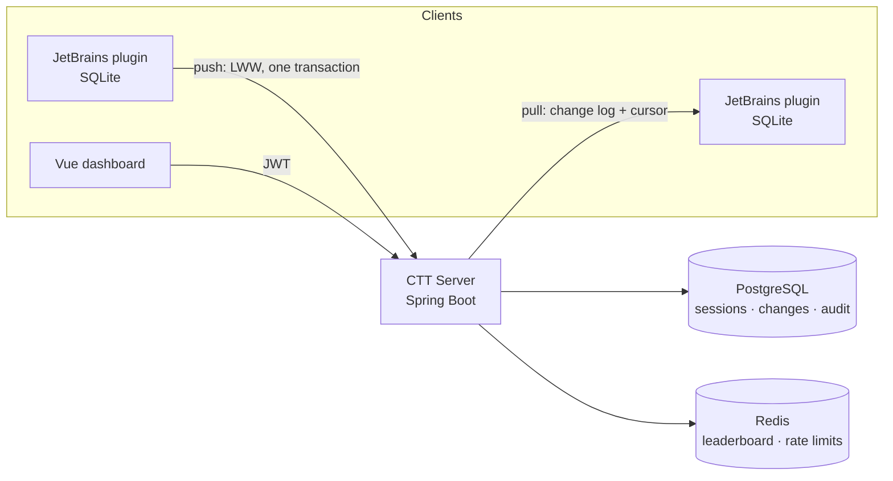

<p align="center">
  
</p>

<p align="center">
  <a href="LICENSE"></a>
  
  
  
  
</p>

**CTT Server is the cloud backend for [Code Time Tracker](https://github.com/AhogeK/code-time-tracker).**
The JetBrains plugin keeps a local SQLite database; this service synchronizes it across
installations and turns the history into statistics, achievements and a global leaderboard.

**Stack:** Java 25 · Spring Boot 4.1.2 · Spring Security 7 · PostgreSQL + Flyway · Redis ·
springdoc-openapi · Thymeleaf · JUnit 6 + Testcontainers.

## What it does

- **Sync that survives reinstalls.** The plugin's local database stays the source of truth. The
  server resolves conflicts with last-write-wins, records every accepted change in a monotonic log,
  and keeps a cursor per device — so a new machine pulls the whole history and an idle one catches up
  without duplicated rows. A pull names the client's own cursor, so a page that failed to apply is
  re-read instead of silently skipped.
- **Statistics that match the plugin.** The same merge rules, timezone-aware day boundaries and
  per-session accumulations the desktop view uses, served from materialized per-UTC-day rows for the
  common reads.
- **A leaderboard that only lists activity.** Rankings live in Redis, are recomputed shortly after a
  push (coalesced per user, off the write path), and use competition ordering (1, 2, 2, 4). A user
  who did none of the measured activity is absent rather than listed at zero — except on the growth
  board, where zero ("no change") is a measurement.
- **A security model, not a demo.** Short-lived JWTs for the dashboard, TOTP two-factor
  authentication and phishing-resistant passkeys with single-use recovery codes, device-bound API
  keys with scopes for plugins, SHA-256 token storage, declarative rate limits, account lockout,
  an audit trail that records security facts and never request bodies (append-only until the approved
  retention policy deletes whole rows), and production
  JSON logs that mask credential-bearing text and structured fields. Existing 2FA accounts can
  complete the second step with a passkey instead of a code.

## How it works



An accepted push writes three things in one transaction: the session row, its change-log entry, and
the materialized UTC day. It also leaves a dirty mark, and a scheduled drain recomputes the
leaderboard from it shortly after — a push never waits on a full-history recompute. The change log is
the only pull source, so every device converges on the same state — including soft deletes.

A pull delivers the winning snapshot of each change, including the IDE that produced the session:

```json
{
  "changes": [
    {
      "changeId": 1042,
      "sessionUuid": "1a2b3c4d-5e6f-4a7b-8c9d-0e1f2a3b4c5d",
      "op": "UPSERT",
      "serverVersion": 3,
      "projectName": "ctt-server",
      "language": "Java",
      "ideName": "IntelliJ IDEA",
      "ideVersion": "2026.1",
      "startTime": "2026-08-25T09:00:00Z",
      "endTime": "2026-08-25T10:00:00Z"
    }
  ],
  "nextCursor": 1042,
  "hasMore": false
}
```

## Quick start

Requires **JDK 25** and **Docker** (PostgreSQL, Redis and Mailpit run in containers).

```bash
./deploy/secrets/render.sh    # decrypt the SOPS payload into 0400 files
docker compose up -d --build  # Compose mounts those files as secrets
```

| Service | URL |
| --- | --- |
| API | <http://localhost:8080/ctt-server> |
| Swagger UI | <http://localhost:8080/ctt-server/swagger-ui.html> |
| Mailpit (verification emails) | <http://localhost:8025> |

To run the application from source against the containers:

```bash
docker compose up -d postgres redis mailpit
./gradlew bootRun
```

`bootRun` loads `application-local.yaml` and reads `.env`; the container stack reads the
rendered secret files instead (see [Deployment Secrets](docs/deployment-secrets.md)). Host ports
are overridable via `APP_EXTERNAL_PORT`, `POSTGRES_EXTERNAL_PORT`,
`REDIS_EXTERNAL_PORT`, `MAIL_SMTP_EXTERNAL_PORT` and `MAIL_UI_EXTERNAL_PORT`.

### Configuration

| Variable | Purpose | Default |
| --- | --- | --- |
| `SPRING_PROFILES_ACTIVE` | Active profile (`local`, `dev`, `prod`) | `local` |
| `DB_HOST`, `DB_PORT`, `DB_NAME` | PostgreSQL endpoint | `localhost`, `5432`, `ctt_server` |
| `DB_USERNAME`, `DB_PASSWORD` | Database credentials | required |
| `REDIS_HOST`, `REDIS_PORT`, `REDIS_PASSWORD` | Redis endpoint | `localhost`, `6379`, required |
| `JWT_SECRET_KEY` | JWT signing key, 256+ bits | required (including local compose) |
| `TOTP_ENCRYPTION_KEY` | AES key sealing TOTP secrets, base64 of exactly 32 bytes (`openssl rand -base64 32`) | required in production; dev-only fallback locally |
| `PASSKEY_RP_ID` | WebAuthn relying-party ID (effective domain, e.g. `ctt.example.com`); changing it invalidates all registered passkeys | `localhost` for local |
| `PASSKEY_ALLOWED_ORIGINS` | Comma-separated exact browser origins allowed to use passkeys | `http://localhost:5173` for local |
| `OAUTH_TOKEN_ENCRYPTION_KEY` | AES key sealing GitHub access tokens, base64 of exactly 32 bytes | required (including local compose) |
| `TRUSTED_PROXY_ADDRESSES` | Exact reverse-proxy IPs allowed to supply `X-Forwarded-For`; empty trusts the socket peer only | empty |
| `AUDIT_RETENTION_DAYS` | Days to keep audit rows; `0` keeps every row. Approved production policy: 180 days; changes require a new ADR (ADR-0002) | `0` |
| `RESEND_API_KEY` | Email delivery key | required in production |
| `MAIL_FROM_ADDRESS`, `MAIL_FROM_NAME` | Sender identity | required, `CTT` |

`.env` and `application-local.yaml` are gitignored; never commit secrets.

The container stack does not read these values from `.env`: `deploy/secrets/render.sh`
decrypts the SOPS payload (`deploy/secrets/secrets.enc.yaml`, ciphertext only) into `0400`
files, and Compose mounts them as secrets. The application reads them through Spring's
configtree, PostgreSQL through `POSTGRES_PASSWORD_FILE` and Redis from the mounted file, so
no credential appears in `docker inspect`. `.env` remains for `./gradlew bootRun` outside
Compose. Full workflow, rotation and the frp token: **[Deployment Secrets](docs/deployment-secrets.md)**.

## API at a glance

| Area | Base path | What it covers |
| --- | --- | --- |
| Authentication | `/api/v1/auth` | register, verify email, login, two-factor challenge, passkey sign-in, refresh, logout, password reset, GitHub OAuth |
| API keys | `/api/v1/auth/api-keys` | create, list, revoke and delete device-bound keys |
| Users | `/api/v1/users/me` | profile, display name, password, email change, login sessions (list, revoke one, revoke a batch), two-factor authentication, passkeys, export, account deletion |
| Devices | `/api/v1/devices` | register, list and revoke installations; reports the most recently used IDE |
| Sync | `/api/v1/sync/pull`, `/api/v1/sync/push` | change-log pull with cursors, LWW batch push |
| Statistics | `/api/v1/stats` | summary, heatmap, streaks, distributions, hourly views, recent sessions, achievements |
| Leaderboard | `/api/v1/leaderboard` | total, streak, night-owl, early-bird, growth, active-days and per-language boards |
| Configuration | `/api/v1/config/public` | terms version and other public settings |

Full request/response shapes, error codes and rate limits: **[API Reference](docs/api-reference.md)**.
The running service serves OpenAPI at `/v3/api-docs` and Swagger UI at `/swagger-ui.html`.

## Data model

| Table | Holds |
| --- | --- |
| `users`, `devices`, `api_keys` | accounts, installations and their credentials |
| `coding_sessions` | session history; soft deletes keep the change log consistent |
| `session_changes` | append-only change log, the pull source of truth |
| `sync_cursors` | per-device pull watermark |
| `daily_stats` | materialized per-user per-UTC-day seconds |
| `audit_logs` | security events with JSONB details |
| `mail_outbox` | transactional email queue with retry state |

Schema history lives in [`src/main/resources/db/migration`](src/main/resources/db/migration);
migrations are append-only.

## Project layout

```text
src/main/java/com/ahogek/cttserver/
├── auth/         JWT, refresh tokens, OAuth, API keys, terms, password reset
├── user/         accounts, email change, sessions, data export
├── device/       registration, revocation, last-seen activity
├── sync/         LWW resolver, change log, pull/push, materialization
├── stats/        aggregations, achievements
├── leaderboard/  Redis ZSets, periods, backfill
├── language/     canonical language vocabulary
├── audit/        audit events and persistence
├── mail/         outbox, templates, delivery
└── common/       security, rate limits, idempotency, error handling
```

## Development

```bash
./gradlew test                          # unit + integration tests
./gradlew build                         # compile, format check, tests
./gradlew spotlessApply                 # apply formatting
./gradlew test jacocoTestCoverageVerification
```

Integration tests use Testcontainers, so the first run pulls PostgreSQL and Redis images. The suite
is layered:

| Base class | Layer | Schema |
| --- | --- | --- |
| `@BaseControllerSliceTest` | controller slice | Mock MVC, no database |
| `@BaseRepositoryTest` | repository slice | Hibernate create-drop + Testcontainers |
| `@BaseIntegrationTest` | end-to-end | Flyway migrations + full context |

Enabling Testcontainers reuse (`testcontainers.reuse.enable=true` in `~/.testcontainers.properties`)
keeps the containers alive between runs. A new environment can verify its setup with
`./gradlew test --tests "*TestBaselineSmokeTest"`.

### Local full stack: blue/green, edge and observability

`docker-compose.local.yaml` layers a Caddy edge and two colours over the base compose file, so the
whole local stack is one command:

```bash
./deploy/local/up.sh                            # postgres, redis, mailpit, app-blue, edge
./deploy/local/up.sh --profile obs              # plus Prometheus :9090, Grafana :3000 and blackbox :9115
./deploy/local/up.sh --profile bluegreen --profile obs
```

Mailpit is meant to stay up between sessions (like every service it restarts unless stopped, and it
keeps its messages in the `mailpit_data` volume). `docker compose down` deletes it along with
everything else, so stop individual services instead, or restore it right away:

```bash
docker compose -f docker-compose.yaml up -d mailpit   # back at :8025, previous mail intact
```

Grafana ships with the `obs` profile and starts with the dashboard `CTT local stack` already
provisioned (source `Prometheus`, panels over `probe_success` and `probe_duration_seconds`).
Its first start takes about **three minutes**: version 13 installs the app-platform APIs one by one
before it binds `:3000`, so a short readiness check looks like a hang. Later starts reuse the volume
and are quicker.

Every service runs with the same hardening block: `restart: unless-stopped`, a read-only root
filesystem, no capabilities (PostgreSQL and Redis get back only what their entrypoints need),
`no-new-privileges`, a 45-second stop grace period, JSON log rotation (10 MB × 3) and per-service
memory/CPU limits. Anything a service must write goes to a named volume or an explicit tmpfs mount
(`/tmp`, PostgreSQL's socket directory, Redis's cache directory), never back into the image.

The edge serves <http://localhost:18080> and proxies to `app-blue` (`app-blue:8080` inside the
compose network; `:18081` is only the host-side publish); `app-green` takes
`:18082` when the `bluegreen` profile is on. Prometheus scrapes itself and probes both the edge and
app-blue readiness endpoints
through `blackbox_exporter`, and Grafana's provisioned dashboard charts those probes. The
application's own metrics endpoint arrives with the observability work (P1.1); business-metric
panels come with it.

### Recording image digests

A `latest` tag does not identify what ran, so a deploy record needs digests. The script reads
every image from both compose files and appends a timestamped table:

```bash
./deploy/local/digests.sh --out ~/deploy-records/ctt-local.md
```

`ctt-server-app` is built on the host, so it is reported by image id instead. An upgrade
rehearsal is: record, `./deploy/local/up.sh --profile obs`, `./gradlew clean build`, record
again, then compare the two tables — a changed digest explains a changed behaviour, and the
record is what makes a rollback to the previous images possible.

Every service image tracks `latest` on purpose (newest majors included); the digests above are
the record that keeps such a deploy reproducible.
The jar is built on the host and packaged by `deploy/local/Dockerfile`: the in-container Gradle
build cannot reach Maven Central through this machine's proxy. Production images still use the
multi-stage `Dockerfile`.

Sizing, measured on a 1.92 GB Docker VM: the default stack plus `obs` without Grafana sits at about
1.15 GB; adding Grafana takes it to about 1.4 GB and stays stable. Two colours **plus** Grafana does
not fit — the steady totals are close to 1.7 GB and the second JVM gets OOM-killed during startup
(observed: `OOMKilled=true`, exit 137). Give the VM **3 GB minimum, 4 GB recommended** if you want
blue + green + observability at the same time; `MemTotal` is reported by `docker info`.
Verified on a 4 GB VM (3.81 GiB usable): every profile on at once measured **≈2.06 GB**, all five
endpoints answered 200 and no container reported `OOMKilled` (Grafana is capped at 768 MB).

## Documentation

| Document | What it explains |
| --- | --- |
| [API Reference](docs/api-reference.md) | every endpoint, its contract, errors and limits |
| [Developer Handbook](docs/developer-handbook.md) | standard operations: error codes, audit events, exceptions, protected interfaces |
| [API Governance](docs/api-governance.md) | security tiers, rate limiting and idempotency rules |
| [Security Architecture](docs/security-architecture.md) | authentication, authorization and threat boundaries |
| [Time Strategy](docs/time-strategy.md) | UTC-first time handling across the system |
| [Case Normalization](docs/case-normalization.md) | email identity normalization |
| [Derived Score Invalidation](docs/derived-score-invalidation.md) | when stored scores and statistics must be recomputed |
| [Audit Boundary Spec](docs/audit-boundary-spec.md) | what is audited and what is deliberately not |
| [Audit Payload Boundary](docs/decisions/ADR-0001-audit-payload-boundary.md) | why request bodies stay out of the audit trail |
| [Audit Retention Policy](docs/decisions/ADR-0002-audit-retention-policy.md) | approved 180-day retention and whole-row deletion |
| [Deployment Secrets](docs/deployment-secrets.md) | SOPS/age payload, rendered `0400` files, rotation and the frp token |

## Related projects

- [Code Time Tracker](https://github.com/AhogeK/code-time-tracker) — JetBrains plugin (Kotlin)
- [CTT Web](https://github.com/AhogeK/ctt-web) — Vue dashboard

## License

MIT — see [LICENSE](LICENSE).

<div align="center">

## 💖 Support

**Free and open source. No paid tiers.**

If CTT helps you see where your time goes, you can support its development:

<a href="https://ko-fi.com/ahogek"></a>&nbsp;<a href="https://afdian.com/a/AhogeK"></a>&nbsp;<a href="https://solscan.io/account/55XnqvGKwH6LamJB7tSwUbrmJikEU2zwP3k1FjsdyEys"></a>

<sub>Donations are optional and carry no rewards or privileges.</sub>

Made with ❤️ for developers who care where their time goes.

</div>
