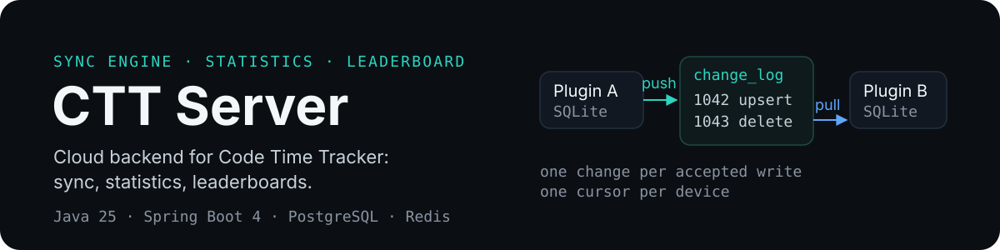
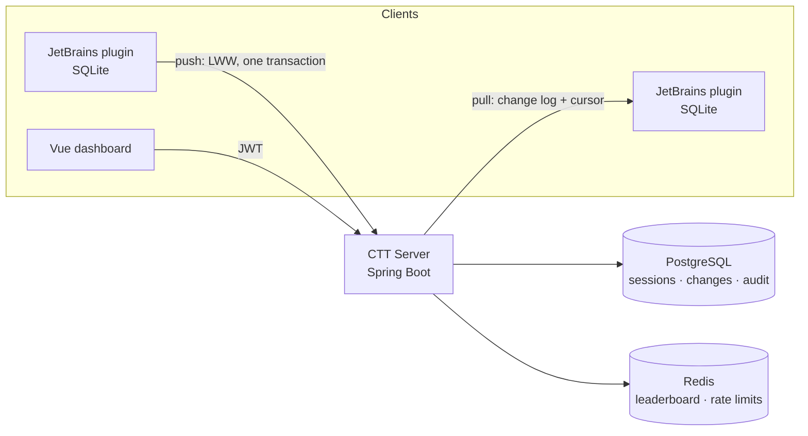

<p align="center">
  
</p>

<p align="center">
  <a href="LICENSE"></a>
  
  
  
  
</p>

<p align="center">
  <strong>Sync and analytics backend for <a href="https://github.com/AhogeK/code-time-tracker">Code Time Tracker</a>.</strong><br>
  Cross-device coding history, statistics, achievements and leaderboards — self-hosted.
</p>

## Features

- **Sync without losing history.** The JetBrains plugin keeps its local SQLite database; the server resolves
  conflicts, records every accepted change and lets a reinstall pull the complete history.
- **Statistics that match the client.** Timezone-aware day boundaries and the same merge rules as the desktop
  plugin, backed by materialized per-UTC-day rows.
- **Leaderboards with real activity.** Redis-backed rankings use competition ordering and omit users with no
  measured activity, except on the growth board where zero is a measurement.
- **Security by default.** Short-lived JWTs, TOTP and passkeys, scoped API keys, rate limits, account lockout,
  and an audit trail that never records request bodies.

## How it works



An accepted push writes three things in one transaction: the session row, its change-log entry, and
the materialized UTC day. It also leaves a dirty mark, and a scheduled drain recomputes the
leaderboard from it shortly after — a push never waits on a full-history recompute. The change log is
the only pull source, so every device converges on the same state — including soft deletes.

A pull delivers the winning snapshot of each change, including the IDE that produced the session:

```json
{
  "changes": [
    {
      "changeId": 1042,
      "sessionUuid": "1a2b3c4d-5e6f-4a7b-8c9d-0e1f2a3b4c5d",
      "op": "UPSERT",
      "serverVersion": 3,
      "projectName": "ctt-server",
      "language": "Java",
      "ideName": "IntelliJ IDEA",
      "ideVersion": "2026.1",
      "startTime": "2026-08-25T09:00:00Z",
      "endTime": "2026-08-25T10:00:00Z"
    }
  ],
  "nextCursor": 1042,
  "hasMore": false
}
```

## Quick start

Requires **Docker**, `sops`, and the repository's age identity; **JDK 25** is needed for source runs.

```bash
git clone https://github.com/AhogeK/ctt-server.git
cd ctt-server
export SECRET_GID="$(id -g)"
./deploy/secrets/render.sh
docker compose up -d --build
```

| Service | URL |
| --- | --- |
| API | <http://localhost:8080/ctt-server> |
| Swagger UI | <http://localhost:8080/ctt-server/swagger-ui.html> |
| Mailpit | <http://localhost:8025> |

For source runs, database/Redis setup, configuration and production deployment, see
[Deployment Secrets](docs/deployment-secrets.md) and
[Production Data Isolation](docs/production-data-isolation.md).

## API at a glance

| Area | Base path | What it covers |
| --- | --- | --- |
| Authentication | `/api/v1/auth` | register, verify email, login, two-factor challenge, passkey sign-in, refresh, logout, password reset, GitHub OAuth |
| API keys | `/api/v1/auth/api-keys` | create, list, revoke and delete device-bound keys |
| Users | `/api/v1/users/me` | profile, display name, password, email change, login sessions, two-factor authentication, passkeys, export, account deletion |
| Devices | `/api/v1/devices` | register, list and revoke installations; reports the most recently used IDE |
| Sync | `/api/v1/sync/pull`, `/api/v1/sync/push` | change-log pull with cursors, LWW batch push |
| Statistics | `/api/v1/stats` | summary, heatmap, streaks, distributions, hourly views, recent sessions, achievements |
| Leaderboard | `/api/v1/leaderboard` | total, streak, night-owl, early-bird, growth, active-days and per-language boards |
| Configuration | `/api/v1/config/public` | terms version and other public settings |

Full request/response shapes, error codes and rate limits live in the [API Reference](docs/api-reference.md).
Local and development profiles serve OpenAPI at `/ctt-server/v3/api-docs` and Swagger UI at `/ctt-server/swagger-ui.html`;
the production profile disables both paths (HTTP 404).

## Data model

| Table | Holds |
| --- | --- |
| `users`, `devices`, `api_keys` | accounts, installations and their credentials |
| `coding_sessions` | session history; soft deletes keep the change log consistent |
| `session_changes` | append-only change log, the pull source of truth |
| `sync_cursors` | per-device pull watermark |
| `daily_stats` | materialized per-user per-UTC-day seconds |
| `audit_logs` | security events with JSONB details |
| `mail_outbox` | transactional email queue with retry state |

Schema history lives in [`src/main/resources/db/migration`](src/main/resources/db/migration);
migrations are append-only.

## Development

```bash
./gradlew test                          # unit and integration tests
./gradlew build                         # compile, format check and tests
./gradlew spotlessApply                 # apply formatting
./gradlew test jacocoTestCoverageVerification
```

Test layers use Testcontainers for PostgreSQL and Redis. Contributor-facing conventions and common tasks are in
the [Developer Handbook](docs/developer-handbook.md).

## Documentation

| Document | What it explains |
| --- | --- |
| [API Reference](docs/api-reference.md) | every endpoint, its contract, errors and limits |
| [Developer Handbook](docs/developer-handbook.md) | standard operations: error codes, audit events, exceptions, protected interfaces |
| [API Governance](docs/api-governance.md) | security tiers, rate limiting and idempotency rules |
| [Security Architecture](docs/security-architecture.md) | authentication, authorization and threat boundaries |
| [Time Strategy](docs/time-strategy.md) | UTC-first time handling across the system |
| [Case Normalization](docs/case-normalization.md) | email identity normalization |
| [Derived Score Invalidation](docs/derived-score-invalidation.md) | when stored scores and statistics must be recomputed |
| [Audit Boundary Spec](docs/audit-boundary-spec.md) | what is audited and what is deliberately not |
| [Audit Payload Boundary](docs/decisions/ADR-0001-audit-payload-boundary.md) | why request bodies stay out of the audit trail |
| [Audit Retention Policy](docs/decisions/ADR-0002-audit-retention-policy.md) | approved 180-day retention and whole-row deletion |
| [Redis Source Restriction](docs/decisions/ADR-0003-redis-source-restriction.md) | why Redis has no source allowlist, and when one becomes mandatory |
| [Deployment Secrets](docs/deployment-secrets.md) | SOPS/age payload, rendered `0440` group-readable files, rotation and the frp token |
| [Production Data Isolation](docs/production-data-isolation.md) | production database, role, Redis logical database, data-plane network and verification |
| [Production Configuration](docs/production-configuration.md) | required production environment, startup guard rules and the API-documentation posture |
| [Host Logging and Time](docs/host-logging-and-time.md) | chrony, journald caps and log rotation on both hosts |

## Related projects

- [Code Time Tracker](https://github.com/AhogeK/code-time-tracker) — JetBrains plugin (Kotlin)
- [CTT Web](https://github.com/AhogeK/ctt-web) — Vue dashboard

## License

MIT — see [LICENSE](LICENSE).

<div align="center">

## 💖 Support

**Free and open source. No paid tiers.**

If CTT helps you see where your time goes, you can support its development:

<a href="https://ko-fi.com/ahogek"></a>&nbsp;<a href="https://afdian.com/a/AhogeK"></a>&nbsp;<a href="https://solscan.io/account/55XnqvGKwH6LamJB7tSwUbrmJikEU2zwP3k1FjsdyEys"></a>

<sub>Donations are optional and carry no rewards or privileges.</sub>

Made with ❤️ for developers who care where their time goes.

</div>
