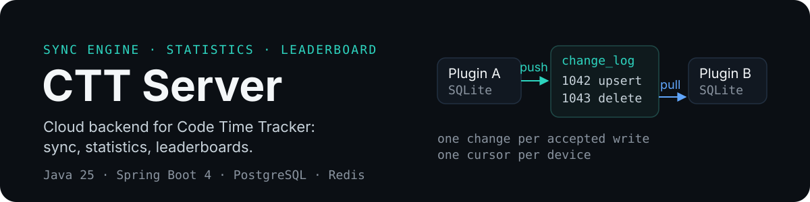
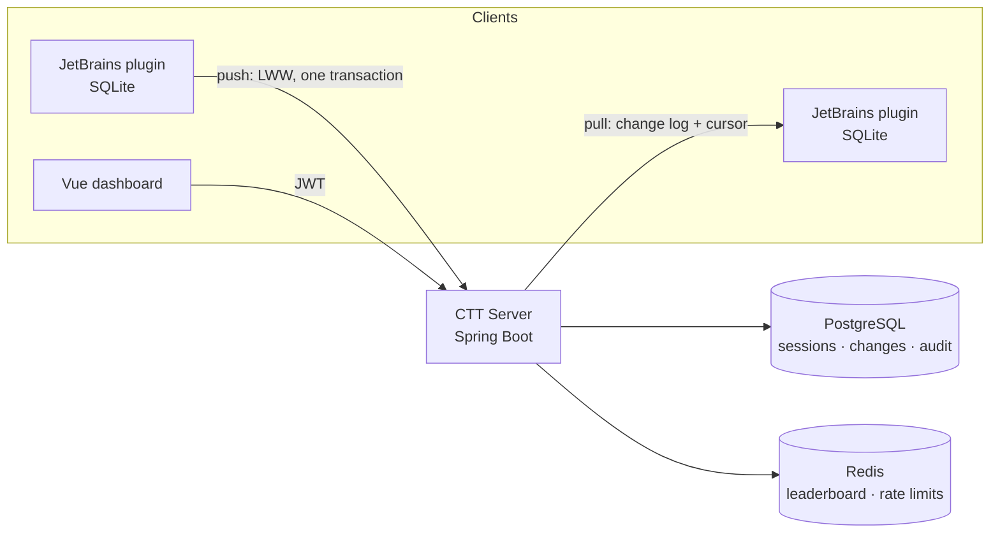

<p align="center">
  
</p>

<p align="center">
  <a href="LICENSE"></a>
  
  
  
  
</p>

**CTT Server is the cloud backend for [Code Time Tracker](https://github.com/AhogeK/code-time-tracker).**
The JetBrains plugin keeps a local SQLite database; this service synchronizes it across
installations and turns the history into statistics, achievements and a global leaderboard.

**Stack:** Java 25 · Spring Boot 4.1.2 · Spring Security 7 · PostgreSQL + Flyway · Redis ·
springdoc-openapi · Thymeleaf · JUnit 6 + Testcontainers.

## What it does

- **Sync that survives reinstalls.** The plugin's local database stays the source of truth. The
  server resolves conflicts with last-write-wins, records every accepted change in a monotonic log,
  and keeps a cursor per device — so a new machine pulls the whole history and an idle one catches up
  without duplicated rows.
- **Statistics that match the plugin.** The same merge rules, timezone-aware day boundaries and
  per-session accumulations the desktop view uses, served from materialized per-UTC-day rows for the
  common reads.
- **A leaderboard that only lists activity.** Rankings live in Redis, update on every push, and use
  competition ordering (1, 2, 2, 4). A user who did none of the measured activity is absent rather
  than listed at zero — except on the growth board, where zero ("no change") is a measurement.
- **A security model, not a demo.** Short-lived JWTs for the dashboard, device-bound API keys with
  scopes for plugins, SHA-256 token storage, declarative rate limits, account lockout and an
  append-only audit trail.

## How it works



An accepted push writes four things in one transaction: the session row, its change-log entry, the
materialized UTC day, and the leaderboard scores. The change log is the only pull source, so every
device converges on the same state — including soft deletes.

A pull delivers the winning snapshot of each change, including the IDE that produced the session:

```json
{
  "changes": [
    {
      "changeId": 1042,
      "sessionUuid": "1a2b3c4d-5e6f-4a7b-8c9d-0e1f2a3b4c5d",
      "op": "UPSERT",
      "serverVersion": 3,
      "projectName": "ctt-server",
      "language": "Java",
      "ideName": "IntelliJ IDEA",
      "ideVersion": "2026.1",
      "startTime": "2026-08-25T09:00:00Z",
      "endTime": "2026-08-25T10:00:00Z"
    }
  ],
  "nextCursor": 1042,
  "hasMore": false
}
```

## Quick start

Requires **JDK 25** and **Docker** (PostgreSQL, Redis and Mailpit run in containers).

```bash
cp .env.example .env          # set passwords and secrets
docker compose up -d --build
```

| Service | URL |
| --- | --- |
| API | <http://localhost:8080/ctt-server> |
| Swagger UI | <http://localhost:8080/ctt-server/swagger-ui.html> |
| Mailpit (verification emails) | <http://localhost:8025> |

To run the application from source against the containers:

```bash
docker compose up -d postgres redis mailpit
./gradlew bootRun
```

`bootRun` loads `application-local.yaml`; the container setup uses the environment variables from
`.env`. Host ports are overridable via `APP_EXTERNAL_PORT`, `POSTGRES_EXTERNAL_PORT`,
`REDIS_EXTERNAL_PORT`, `MAIL_SMTP_EXTERNAL_PORT` and `MAIL_UI_EXTERNAL_PORT`.

### Configuration

| Variable | Purpose | Default |
| --- | --- | --- |
| `SPRING_PROFILES_ACTIVE` | Active profile (`local`, `dev`, `prod`) | `local` |
| `DB_HOST`, `DB_PORT`, `DB_NAME` | PostgreSQL endpoint | `localhost`, `5432`, `ctt_server` |
| `DB_USERNAME`, `DB_PASSWORD` | Database credentials | required |
| `REDIS_HOST`, `REDIS_PORT`, `REDIS_PASSWORD` | Redis endpoint | `localhost`, `6379`, required |
| `JWT_SECRET_KEY` | JWT signing key, 256+ bits | required in production |
| `RESEND_API_KEY` | Email delivery key | required in production |
| `MAIL_FROM_ADDRESS`, `MAIL_FROM_NAME` | Sender identity | required, `CTT` |

`.env` and `application-local.yaml` are gitignored; never commit secrets.

## API at a glance

| Area | Base path | What it covers |
| --- | --- | --- |
| Authentication | `/api/v1/auth` | register, verify email, login, refresh, logout, password reset, GitHub OAuth |
| API keys | `/api/v1/auth/api-keys` | create, list, revoke and delete device-bound keys |
| Users | `/api/v1/users/me` | profile, display name, password, email change, login sessions (list, revoke one, revoke a batch), export, account deletion |
| Devices | `/api/v1/devices` | register, list and revoke installations; reports the most recently used IDE |
| Sync | `/api/v1/sync/pull`, `/api/v1/sync/push` | change-log pull with cursors, LWW batch push |
| Statistics | `/api/v1/stats` | summary, heatmap, streaks, distributions, hourly views, recent sessions, achievements |
| Leaderboard | `/api/v1/leaderboard` | total, streak, night-owl, early-bird, growth, active-days and per-language boards |
| Configuration | `/api/v1/config/public` | terms version and other public settings |

Full request/response shapes, error codes and rate limits: **[API Reference](docs/api-reference.md)**.
The running service serves OpenAPI at `/v3/api-docs` and Swagger UI at `/swagger-ui.html`.

## Data model

| Table | Holds |
| --- | --- |
| `users`, `devices`, `api_keys` | accounts, installations and their credentials |
| `coding_sessions` | session history; soft deletes keep the change log consistent |
| `session_changes` | append-only change log, the pull source of truth |
| `sync_cursors` | per-device pull watermark |
| `daily_stats` | materialized per-user per-UTC-day seconds |
| `audit_logs` | security events with JSONB details |
| `mail_outbox` | transactional email queue with retry state |

Schema history lives in [`src/main/resources/db/migration`](src/main/resources/db/migration);
migrations are append-only.

## Project layout

```text
src/main/java/com/ahogek/cttserver/
├── auth/         JWT, refresh tokens, OAuth, API keys, terms, password reset
├── user/         accounts, email change, sessions, data export
├── device/       registration, revocation, last-seen activity
├── sync/         LWW resolver, change log, pull/push, materialization
├── stats/        aggregations, achievements
├── leaderboard/  Redis ZSets, periods, backfill
├── language/     canonical language vocabulary
├── audit/        audit events and persistence
├── mail/         outbox, templates, delivery
└── common/       security, rate limits, idempotency, error handling
```

## Development

```bash
./gradlew test                          # unit + integration tests
./gradlew build                         # compile, format check, tests
./gradlew spotlessApply                 # apply formatting
./gradlew test jacocoTestCoverageVerification
```

Integration tests use Testcontainers, so the first run pulls PostgreSQL and Redis images. The suite
is layered:

| Base class | Layer | Schema |
| --- | --- | --- |
| `@BaseControllerSliceTest` | controller slice | Mock MVC, no database |
| `@BaseRepositoryTest` | repository slice | Hibernate create-drop + Testcontainers |
| `@BaseIntegrationTest` | end-to-end | Flyway migrations + full context |

Enabling Testcontainers reuse (`testcontainers.reuse.enable=true` in `~/.testcontainers.properties`)
keeps the containers alive between runs. A new environment can verify its setup with
`./gradlew test --tests "*TestBaselineSmokeTest"`.

## Documentation

| Document | What it explains |
| --- | --- |
| [API Reference](docs/api-reference.md) | every endpoint, its contract, errors and limits |
| [Developer Handbook](docs/developer-handbook.md) | standard operations: error codes, audit events, exceptions, protected interfaces |
| [API Governance](docs/api-governance.md) | security tiers, rate limiting and idempotency rules |
| [Security Architecture](docs/security-architecture.md) | authentication, authorization and threat boundaries |
| [Time Strategy](docs/time-strategy.md) | UTC-first time handling across the system |
| [Case Normalization](docs/case-normalization.md) | email identity normalization |
| [Derived Score Invalidation](docs/derived-score-invalidation.md) | when stored scores and statistics must be recomputed |
| [Audit Boundary Spec](docs/audit-boundary-spec.md) | what is audited and what is deliberately not |
| [Terms Acceptance Guide](docs/terms-acceptance-frontend-guide.md) | frontend contract for the terms gate |

## Related projects

- [Code Time Tracker](https://github.com/AhogeK/code-time-tracker) — JetBrains plugin (Kotlin)
- [CTT Web](https://github.com/AhogeK/ctt-web) — Vue dashboard

## License

MIT — see [LICENSE](LICENSE).

<div align="center">

## 💖 Support

**Free and open source. No paid tiers.**

If CTT helps you see where your time goes, you can support its development:

<a href="https://ko-fi.com/ahogek"></a>&nbsp;<a href="https://afdian.com/a/AhogeK"></a>&nbsp;<a href="https://solscan.io/account/55XnqvGKwH6LamJB7tSwUbrmJikEU2zwP3k1FjsdyEys"></a>

<sub>Donations are optional and carry no rewards or privileges.</sub>

Made with ❤️ for developers who care where their time goes.

</div>
